# AGENTS.md

```mermaid
flowchart LR
    code("<img src='barnacle:pen-line.svg' width='20' alt=''/><br/>Edit source") --> doc("<img src='barnacle:file-text.svg' width='20' alt=''/><br/><u>Update sibling .md<br/>in the same change</u>")
    doc --> regen("<img src='barnacle:terminal.svg' width='20' alt=''/><br/><u>scripts/docs.sh</u>")
    regen --> site("<img src='barnacle:folder.svg' width='20' alt=''/><br/>./site — git-ignored")
    site --> review("<img src='barnacle:check.svg' width='20' alt=''/><br/>Self-review the<br/>changed pages")
    review --> commit("<img src='barnacle:git-commit-horizontal.svg' width='20' alt=''/><br/>Commit source + doc together")
    click doc href "src/recipeserver/README.md"
    click regen href "scripts/docs.sh.md"
    class doc mdFile
    class regen shFile
    class site folder
    class review checkNode
    classDef mdFile fill:#dcd6ce,stroke:#6b6255,color:#292524
    classDef shFile fill:#abe07a,stroke:#3f6212,color:#16280a
    classDef folder fill:#f0c558,stroke:#8a6d1c,color:#332a05
    classDef checkNode fill:#9fe8c9,stroke:#0f766e,color:#052e22
```

## What this is

Local recipe-site generator and HTTP server. It reads a tree of `recipe.md` files, renders each to HTML, builds a searchable `index.html`, and serves the site with in-browser editing of metadata, ratings, and comments. Edits are written back to each recipe's YAML front matter and Markdown body.

CI is a single workflow (`.github/workflows/check-formatting.yml`, “PR Checks”) that checks formatting and runs the pytest suite (including the headless Selenium browser tests under `test/e2e/`) on the self-hosted macOS and Windows runners (provisioned via `scripts/spawn-runners.sh` and the committed `.runner-spawner.json`); there is no Python linter/typechecker configuration. Formatting is via formattington through `./scripts/format.sh`, which runs `uv run formattington all --config .formattington.json` (concurrently by default). `.formattington.json` declares Black (`.py`, line-length 150 in `pyproject.toml` `[tool.black]`), shfmt (bash), Prettier (css, js, html, `.md`, `.yml`, `.json`), taplo (`.toml`), and Prettier `prettier --parser html` for the SVG icons in `src/recipeserver/assets/` (Prettier discovery does not include `.svg`). Formatter configs are `.prettierrc` (Prettier), `[tool.black]` (Black), and formattington defaults for shfmt/taplo. Vendored KaTeX under `src/recipeserver/assets/katex/` is excluded via `.prettierignore`. `prettier` is PATH-only (`npm install -g prettier`) and `taplo` is expected on PATH (or bundled); if a tool is missing formattington exits `127` for that command.

## Commands

- Sync deps: `uv sync` (Python 3.14 required; `uv` owns `.venv`).
- Run: `./scripts/serve.sh` (same as `uv run python -m recipeserver`).
- Format: `./scripts/format.sh` (runs `uv run formattington all --config .formattington.json` — Black for Python, shfmt for Bash, Prettier for CSS/JS/HTML/Markdown/YAML, taplo for TOML, and `prettier --parser html` for SVG icons; pass `--check` for a dry-run check).
- Run all tests: `uv run pytest`.
- Browser end-to-end tests (Selenium, headless Chrome by default): `uv run pytest test/e2e` (see README, "Browser end-to-end tests").
- Scale/performance tests (opt-in, manual-only, never in CI, skipped by default): `RECIPE_SERVER_SCALE=1 uv run pytest test/scale -s` (see README, "Scale testing"; sizes via `RECIPE_SERVER_SCALE_SIZES`, artifacts via `.scale-artifacts/`).
- Focused tests: `uv run pytest test/test_index_html_generator.py test/test_ratings.py`
  - Single test: `uv run pytest test/test_ratings.py::test_validate_ratings_accepts_example_shape_and_decimal_score`
- Runtime logs: `.logs/<argv0>.py.log` in the current directory. Pass `--log-level DEBUG` for more detail.

The repo does not include a test config file. On startup the app reads the recipe source directory from the `source_directory` key in `<user-data>/recipe-server-cfg.toml` (TOML; a legacy `config.txt` is migrated automatically); if that key is missing or points at a non-directory, it opens a Tk directory picker and writes the chosen path to that file. Optional local-model settings live in the same file (`model_endpoint`, `all_purpose_model_name`, and `image_analysis_model`; the legacy keys `model_name` and `server_name` are still read but normalized to the canonical keys on save). If `model_endpoint` is absent, startup asks for it with `input()` (Enter skips); a skipped value is saved so the app does not ask again. All of these values can also be edited in the browser through the **Configuration** entry in the home page's menu (`GET|POST /api/config`); each save triggers a full site rebuild.

## Logging conventions

- The logger is `loguru` (`src/recipeserver/_logger.py`), which does not do printf-style substitution. Never pass format arguments to log calls: `logger.info("... %s", value)` and `logger.info("... {}", value)` print the placeholders literally. Always use f-strings: `logger.info(f"... {value}")` (use `!r` to preserve repr formatting).

## Architecture / flow

- Entrypoint: `src/recipeserver/__main__.py` -> `core.main`. `handle_configuration()` resolves the recipe source directory and optional local-model settings, then `core.main` loads `NewRecipePrompt.md` and `NewRecipeFromImagePrompt.md`, builds `Core`, calls `regen()`, starts `Server`, and runs `Tray`.
- `core.regen()` deletes and recreates the site directory, copies `src/recipeserver/assets`, converts every `recipe.md` under the source tree in parallel, then rebuilds `index.html`.
- The site directory is `platformdirs.user_data_path("recipe-server") / "site"` (macOS: `~/Library/Application Support/recipe-server/site`). It is generated output and is recreated on every `regen()`.
- `markdown_to_html/` (the `converter.py` orchestrator plus `page`/`quantities`/`overview`/`extras`/`feedback`/`icons`) renders a recipe page and injects metadata-derived HTML. `index_html_generator.py` builds the filter/sort index and metadata warnings. `server.py` serves the site and JSON APIs. `metadata_linter.py` owns the required-field list and warning text. `shopping_list.py` scrapes recipe ingredients for the shopping list. `ai_recipe.py` talks to a configured Ollama server (native `/api/chat`, `/api/ps`, and `/api/tags`; an OpenAI-style `/v1` suffix is normalized away), fetches URL text, transcribes images via the image analysis model, and drafts recipe Markdown/metadata without writing files.
- APIs: `GET /health`, `GET /api/recipe-folders`, `POST /api/recipe`, `GET /api/ai-status`, `POST /api/ai-recipe`, `POST /api/ai-assistant`, `GET /api/markdown?path=...`, `GET|POST /api/recipe-editor?path=...`, `GET|POST /api/metadata/<field>?path=...`, `GET /api/metadata-options`, `GET /api/shopping-list?path=...`, `POST /api/transcribe`, `POST /api/recipe-images/rename`, `POST /api/recipe-images/upload`, `POST /api/recipe-images/delete`, `GET|POST /api/bulk-editor`, `POST /api/bulk-delete`, and `GET|POST /api/config`. History APIs: `GET /api/history?path=...` (list snapshots, newest first), `GET /api/history/preview?path=...&snapshot=...` (rendered `text/html` preview), `GET /api/history/compare?path=...&snapshot=...` (unified diff), `POST /api/history/restore` (reversible restore). `path` must be a relative `.md` path inside the source directory. Every save regenerates that recipe page and the index; a configuration save triggers a full site rebuild. All saves (editor, raw Markdown, metadata, bulk, assistant, image reference rewrites, restore) flow through one mechanism (`_save_recipe_contents` in `server.py`) that snapshots the replaced version into the history directory first and forces the recipe's `recipe_id` into the saved content; unchanged saves skip the write, the snapshot, and the regeneration. The Files section of the editor lists the images that sit next to the Markdown file; `POST /api/recipe-images/upload` saves a staged image to the folder without saving the recipe, `rename` renames the file and rewrites Markdown references, and `delete` removes the file: if it was the main image (the first image link in the Markdown), that link falls back to the first remaining image alphabetically (or is removed when none remain), and the response says whether the Markdown still references the deleted image. In the editor, clicking a thumbnail toggles it as the main image; the current one gets a food-color outline and a MAIN badge. Staged (not yet saved) images render as rows in both modes: in Edit Recipe they carry an Upload button to save one to the folder, and in Create Recipe they carry no Upload button (images are saved with the recipe); both offer the main-image toggle, rename, and a Discard X.
- The bulk editor is opened from the index in selection mode with the **Bulk Edit** button. It loads the selected recipes' metadata (`GET /api/bulk-editor`) into the shared dialog, which edits the first recipe's values. Attributes whose loaded values differ across the selection carry a red `* MIXED` chip (an unmarked field means its values are identical); attributes the user actually changed carry a food-color `Modified` chip plus a "Modified: …" summary line above the footer — an edited field's chip flips from MIXED to Modified, so Modified always means "will be written to every selected recipe". **Apply Edits** restates the modified attributes and asks for confirmation first (a plain `confirm` alert, e.g. "Update the following for 2 recipes? Tags, Cuisine"), then applies only those attributes via `POST /api/bulk-editor` with a `fields` subset — untouched attributes, including ones whose values differ across the selection, are never overwritten. **Discard Edits** closes the dialog without writing anything. The rating name/score pair applies through the same confirmation, adding the named rating to every selected recipe.
- The dictation (speech) button belongs to the index search field. `assets/speech-button/speech-button.js` records a clip with `MediaRecorder` and posts it to `POST /api/transcribe`; the button works both as a tap toggle (tap to start, tap to stop) and held as push-to-talk (hold to record, release to stop), and while a capture is in flight a small status pill above the button reports its state (ready/listening/transcribing/done/failed, mirroring the assistant popup). `transcriber.py` decodes the clip with PyAV into a 16 kHz mono WAV and posts it to the managed `whisper-server` from [fordaj/whisper-native](https://github.com/fordaj/whisper-native) (bundled under `tools/whisper-native/`, lifecycle owned by `whisper_server.py`: binary resolution via `WHISPER_SERVER_BIN`/the bundle/`PATH`, one-time ggml model download into `<user-data>/recipe-server/models/`, lazy start on first transcription, stopped on app shutdown and on a configuration save that disables dictation). The button is generated `hidden` and is removed by the script unless the page was loaded over HTTPS (`location.protocol === "https:"`); the endpoint answers 403 unless the request arrived over HTTPS, which the server reads from the `X-Forwarded-Proto` (or `Forwarded`) header the local reverse proxy sets. The whole feature is HTTPS-only, in the browser and on the server.
- Dictation can be enabled or disabled with the `dictation_enabled` key (TOML boolean, default `true`): the Configuration dialog renders it as a **Dictation** checkbox, and when it is off the generated index omits the button and its assets, `POST /api/transcribe` answers 403, no Whisper model is downloaded or loaded, and a running whisper-server is stopped on the configuration save.
- The recording is decoded in `transcriber.decode_audio_to_wav()` rather than given to whisper-server directly: miniaudio (whisper-server's decoder) reads WAV/MP3/FLAC/OGG but not the WebM/MP4 containers the browsers record, so handing it the original upload answers HTTP 400. Decoding stays in this repo and is content-based, not suffix-based.
- The shopping list is opened from the index in selection mode with the "Shopping List" button. It scrapes the ingredients of the selected recipes from their generated pages (`shopping_list.scrape_ingredients`), scales each recipe with its own recipe scaler, and shows the combined ingredients as a task list. `GET /api/shopping-list` returns the ingredients of the selected recipes, each with the name and unit that say which ingredient it is, so the shopping list can add the amounts of several recipes together. The checklist is downloaded as Markdown, copied to the clipboard, or printed.
- AI generation is opt-in. With no `model_endpoint`, the create dialog hides the From text/From URL/From Images controls. A configured but unreachable endpoint shows them disabled. `NewRecipePrompt.md` supplies the system prompt for drafting and `NewRecipeFromImagePrompt.md` supplies the transcription prompt, both re-read on every run. For images, `POST /api/ai-recipe` accepts `inputType=image` as multipart with one or more `images` files; the image analysis model transcribes each image in upload order and the all-purpose model drafts from the combined text. Image payloads use Ollama's native message shape (`content` is a string and the base64 images travel in the message's `images` list); the OpenAI-style `image_url` content parts are not accepted by the native `/api/chat` route. The AI image picker reuses the recipe images dropzone (`assets/recipe-editor/recipe-editor.js` `createImagePicker`), so both accept dragged, pasted, and browsed images.
- `POST /api/ai-recipe` with `stream: true` returns `text/event-stream`. Events are `event: <type>` plus a JSON `data:` line: `status` (`state` plus `message`), `metrics` (`metrics`), `error` (`state` plus `message`), and `result` (`result`). States are `checking_model`, `loading_model`, `preparing`, `thinking`, `generating`, `complete`, and `error`. Ollama's `load_duration`, `eval_duration`, `total_duration`, `eval_count`, and `prompt_eval_count` are normalized to `model_load_seconds`, `generation_seconds`, `total_seconds`, `token_count`, `prompt_token_count`, `tokens_per_second`, and `prompt_tokens_per_second` when available.
- The browser-side progress logic lives in `assets/recipe-editor/ai-progress.js`. Status changes are applied immediately and metrics are rendered when the `metrics` event arrives. The generated Markdown is written to the editor from the `result` event; there is no separate thinking or content preview. `ai-progress.js` must load before `recipe-editor.js` on both recipe pages and the index.
- The AI assistant is a floating bubble at the bottom right of every page (`assets/ai-assistant/`, loaded after `icons.js` on both recipe pages and the index, but only rendered once `/api/ai-status` reports the model is configured). It renders an `ai.svg` icon in `--food-color` on a muted fill with a 1px `--food-color` outline; on mobile (`max-width: 600px`) it slides out on scroll-down and returns on scroll-up (always shown at the top of the page), and the chat panel pops out upper-left of the bubble (the lower-right corner stays free for the thumb); a press fully outside the panel — pointer down and pointer up — closes it, like the shared dialogs. Clicking it opens a chat panel; Enter or the send button posts to `POST /api/ai-assistant` (`stream: true` → `text/event-stream` with `status`/`metrics`/`error`/`result` events; otherwise plain JSON `{reply, edited, path, metrics}`). `ai_assistant.py` runs a small agent loop on the configured all-purpose model with native Ollama function tools: `list_recipes` and `read_recipe` (read-only, any library recipe) and `update_current_recipe` (the recipe being viewed only — the tool has no path argument, and on the index it is not offered, so from there the assistant is read-only). `update_current_recipe` replaces the recipe body wholesale (front matter is only changed through a partial `metadata` object limited to the editor fields; `updatedOn` is always refreshed by the server) and regenerates the page and index. There is no delete tool and no bulk-edit path. Recipe content is treated as data, not instructions; the loop caps at 10 tool rounds and degrades to a plain-text answer when the model cannot call tools. The conversation is ephemeral (kept in the open page only). When dictation is enabled (`dictation_enabled`) and the page was loaded over HTTPS, the bubble is also long-pressable and the composer carries its own inline microphone button inside the text box: holding either one (~450 ms for the bubble, press-and-hold or tap-toggle for the inline mic) opens a microphone popup directly above the press target (preparing/recording/transcribing/complete/error, the same states and icons as the search dictation button), and releasing stops the recording, transcribes it through `POST /api/transcribe`, and sends the transcript as a normal message. `GET /api/ai-status` reports `dictation_enabled` so the browser knows whether to offer dictation; over plain HTTP a long press degrades to a normal tap and the inline mic is not rendered.
- Generated pages use root-absolute URLs such as `/assets/...` and `/recipe-dir/recipe.html`, so they must be served from the site root (port 8000); opening the files directly will not load their assets.
- Index metadata warnings are hidden by default and shown by the "Metadata Status" toggle. They do not block generation, serving, or saving.

## Recipe data conventions

- A recipe is a directory containing a file named exactly `recipe.md`, plus its images. The source tree shape is preserved under the site directory.
- Every recipe carries a stable `recipe_id` UUIDv4 in its front matter, assigned automatically (on `regen()`, on first save, or when the history APIs first touch the file). Identity never depends on the path, and duplicates (a copied file) are detected and re-assigned during `regen()` — the first path in sorted order keeps the id. Do not remove or hand-edit `recipe_id`; it is preserved across saves, regeneration, and restores.
- Recipe version history lives in `<user-data>/recipe-server/history/recipes/<recipe-id>/<snapshot-id>.md` — immutable snapshots, never inside the source tree, never modified, retained indefinitely. A snapshot identifier embeds a UTC microsecond timestamp plus a random suffix, so identifiers are unique without relying on the clock alone. The storage carries no database; the directory is the index. Tests override the root with `RECIPE_SERVER_HISTORY_DIR`.
- A recipe page's title comes from the first `# ` heading in the Markdown. The index uses that heading too; if the heading is absent, it falls back to front matter `title`, then the directory name.
- The hero image and accent color use the first image in filename-sorted order from the recipe directory. Supported extensions are defined once in `image_handler.IMAGE_EXTENSIONS`. If a directory has multiple images, that sort order decides which one is the hero and drives the accent color.
- Front matter is YAML. The lint-required fields are `ratings`, `contributor`, `createdOn`, `meals`, `categories`, `makes`, and `difficulty`. "Required" means the index shows a warning; it does not prevent building or saving.
- The canonical field name is plural `categories`. The legacy singular `category` is accepted wherever metadata is read (index, recipe overview, metadata API, editor load) but is normalized to `categories` and removed on save. New code and new recipe data must use `categories`.
- The recipe editor fills `meals`, `categories`, `cuisine`, `tags`, `status`, and `contributor`, and the source fields `Source Author` and `Source Title` from a dropdown of the values that are already used in the library. `GET /api/metadata-options` collects them from the recipe Markdown files on request (`metadata_options.collect_metadata_options`), so they are never hard-coded into generated pages or front matter. Every value comes with the number of recipes that use it, and the dropdown and the chips show that count next to the value. "Add new" sits at the top of the dropdown and swaps it for a text field, so a value that is not in the library yet can be typed in. The widget lives in `assets/recipe-editor/metadata-picker.js` and is built for every `.recipe-editor__picker` element in `assets/recipe-editor/details.html` (and `sources.html` for `source.author` / `source.title`, which are single-value chip pickers keyed on the sub-field names while Apply Edits keeps the shared `source` key). The multi-value fields keep every value as a chip; the single-value fields keep one. The chips are outlined and font-colored with `--food-color`. The same widget fills the name fields in the ratings and comments forms (and their edit forms), in its "combo" variant: a typeable text input holding the current name with the library dropdown beside it — selecting a name writes it into the input and no chip is rendered, and the dropdown offers the full library (no "Add new" entry). `GET /api/metadata-options` also reports `commenters` and `raters` (from the `comments`/`ratings` front matter lists, one recipe per name, compared case-insensitively) and `source.author` / `source.title` (from the normalized source dict, one recipe per dropdown value), and the feedback forms re-read the feedback lists every time the form opens. Ratings and comments remember the last name used on the device in `localStorage` (`lastRater` / `lastCommenter`) and preselect it the next time the form renders.
- Inline-code quantities become scaler spans (`1/2 cup`, `1 1/2 tbsp`, `1-2 tbsp`, `1 1/2-2 1/2 tbsp`). Unparseable `<code>` produces a lint warning; unit aliases live in `UNIT_ALIASES` in `src/recipeserver/markdown_to_html/quantities.py`.
- The recipe scaler (`assets/recipe-scaler.html`, `assets/recipe-scaler.js`) is instantiated per scope: `new RecipeScaler(root, { onUpdate })` scales the `.quantity` elements inside `root`. A recipe page passes the document; the shopping list passes a single recipe row so every recipe can be scaled on its own. The scaler controls use the `recipe-scale-select` / `recipe-scale-custom` classes rather than IDs so several scalers can live on one page. The amount formatters are static (`RecipeScaler.formatQuantity`, `formatQuantityText`, `formatScaledRange`, ...) so other features can reuse them, and each scaled amount is also written to `data-scaled-text` and `data-scaled-quantity` for callers that cannot read the rendered KaTeX output.
- `POST /api/recipe-editor` rewrites the whole `recipe.md` through `python-frontmatter` and updates `updatedOn`. The per-field metadata endpoint rewrites the file but does not update `updatedOn`, so rating/comment activity does not change last-edited sorting.
- The rating score is a text field, not a number input: clicking it highlights the whole score so typing replaces it. Beside it sits a `role="slider"` star picker whose five stars are worth two points each, so every tenth of the slider sets the score to 1 through 10 and never to 0. The slider can be pressed, dragged, and moved with the arrow keys, and it is used by both the add form and the edit form. It lives in `assets/ratings.js` and `assets/ratings.css`.
- Text fields must be at least 16 pixels (`1rem`). iOS Safari zooms the page in when a focused field is smaller than that and never zooms back out, so a field styled below `1rem` leaves the whole page zoomed in on a phone.
- KaTeX is vendored under `src/recipeserver/assets/katex`; there is no JS package or build step in this repo.
- Icons are standalone `.svg` files in `src/recipeserver/assets/` (e.g. `chef-hat.svg`, `warning.svg`, `plus.svg`, `chevron-down.svg`). Never embed ad-hoc inline `<svg>` markup — or an encoded `data:image/svg+xml` URI — in Python, JS, or CSS files. Reuse an existing asset or add a new `.svg` file to `assets/` and reference it instead: in Python, read/inline the file via `read_svg`/`icon_html` (see `src/recipeserver/markdown_to_html/icons.py`) or `_icon_path` (see `index_html_generator.py`); in JS, use the shared `loadSvgIcon` helper in `assets/icons.js` (`window.RecipeIcons`, loaded before the other page scripts) to fetch the asset and inline it so `currentColor` styling is preserved; in CSS, use `url("/assets/<name>.svg")`. Vendored KaTeX files under `assets/katex/` are the only exception.

## Intentional design

These choices are deliberate and are not bugs to "fix":

- This is a local desktop app, not a headless service. Startup may open a Tk directory picker, and the process runs a `pystray` tray icon. The server listens on the configured port (`server_port`, default 8000), binds `127.0.0.1`, and has no authentication; the tray opens `http://127.0.0.1:<port>`. A port change takes effect on the next start. The loopback bind is deliberate: the site has no authentication, so it stays on this machine and is served over HTTPS by a local reverse proxy or tunnel.
- The dictation button is HTTPS-only, in the browser and on the server. The browser only reveals the button when `location.protocol === "https:"`, and `POST /api/transcribe` answers 403 without an HTTPS request. Do not relax either check: the microphone is unavailable on insecure pages, and the recorded audio must not travel in the clear.
- Generated HTML is disposable output. The Markdown files in the source tree are the source of truth, and the site directory is deleted and rebuilt on every startup. Never store source content or manual edits in the site directory.
- The local AI integration is optional and never writes recipe files. Its output only prefills the create dialog; the normal create endpoint is still the only path that saves a new recipe.
- Browser edits are written back to the source Markdown, not to generated HTML. The editor is the only path that updates `updatedOn`.
- Metadata warnings are advisory. Missing required fields are allowed in the data and only surface through the hidden index warning chips.
- Front matter uses `categories`; the singular `category` support is a read-only compatibility path for older recipes, not an alternative naming convention.
- Root-absolute URLs are intentional so generated pages remain independent of where the site is hosted; they require serving from the site root.

## Documentation files (barnacle)

The repository's documentation is a set of Markdown (`.md`) and Mermaid (`.mmd`) source files rendered into a static site by the pinned [barnacle](https://github.com/fordaj/barnacle) binary (`tools/barnacle/`, wired into the environment cascade as `BARNACLE_BIN`). Generate the site with `scripts/docs.sh`; the output (`./site/`) is git-ignored and never committed.

Layout — documentation lives next to the code it describes:

- One sibling `.md` per Python module in `src/recipeserver/` (for example `server.py` → `server.py.md`, `markdown_to_html/converter.py` → `markdown_to_html/converter.py.md`), plus `src/recipeserver/README.md` as the package hub. There is one page per module, including the small ones (`_logger.py` → [_logger.py.md](src/recipeserver/_logger.py.md)); none are optional.
- One sibling `.md` per script in `scripts/` (`entry.sh` → `entry.sh.md`, `env.sh` → `env.sh.md`, `version.sh` → `version.sh.md`, `docs.sh` → `docs.sh.md`, `release.sh` → `release.sh.md`), plus `scripts/README.md` as the hub. Scripts that live outside `scripts/` follow no separate rule — everything shell now lives there.
- One sibling `.md` per bundle in `tools/` (`tools/<name>/update.sh.md`), plus `tools/README.md` as the hub. `tools/` is excluded from the generated site via `.barnacle.json` (the pinned binaries carry their own upstream docs), so these pages exist for the repository, not the site.

Not documented page-by-page: vendored KaTeX under `src/recipeserver/assets/katex/` (third-party; mentioned in the package hub and the root README), the `assets/` tree itself, `test/` (fixtures are not pages), and the package's prompt files (`NewRecipePrompt.md`, `NewRecipeFromImagePrompt.md`, `FindOneForMePrompt.md` — content, loaded at startup, not rendered as documentation). These are excluded from the site via `.barnacle.json` (`tools`, `dist`, `test`, `src/recipeserver/assets/katex`, and the three prompt files).

Naming rules:

- **Retain the documented file's suffix.** A documentation file for `main.py` is `main.py.md`; for `scripts/serve.sh` it is `scripts/serve.sh.md`. This is the convention for everything in this repository, and it exists so files that share a base name can be documented individually.
- Hub pages (`README.md` in each documented directory) keep their plain names.
- Free-standing diagrams that do not document one specific file (for example `architecture.mmd`) may use a plain name.

Rules for keeping these files current:

- When you add, rename, remove, or repurpose a documented file — a module, a script, or a bundle — update its sibling `.md` **in the same change**. A new file without its page is incomplete work; a stale page is worse than none.
- **Every page opens with a Mermaid diagram** under its `#` heading (guidance, not a hard rule): what the thing is and how it fits, in the diagram type that fits best — a flowchart, class diagram, sequence diagram, state diagram, dependency graph — whatever best communicates the thing to someone who has never seen it. If a page you touch has no diagram at the top, add one. Barnacle prints a non-fatal stderr note listing pages without one.
- Source every fact: the `.py`/`.sh` file itself, this file (AGENTS.md), and README.md are the accepted sources. Never invent routes, flags, exit codes, or bundle-platform matrices.
- Use plain relative links (`converter.py.md`, `../../README.md`) with the linking file's `.md` path — barnacle rewrites them to `.html`. Do not link to files barnacle does not render (binaries, `.sh`, `LICENSE`); link the related `.md` page (for external references, a full `https://` URL is fine). Pages that are not rendered (`tools/`) may still be linked from other unrendered pages; rendered pages must not hyperlink into `tools/` — refer to those pages as code (for example `tools/barnacle/update.sh.md`), because `.barnacle.json` excludes them from the site.
- Mermaid `click` directives are rewritten too (`click Core href "core.py.md"`), so diagram nodes may link between pages — prefer this in the top-of-page diagram; it makes the site explorable by diagram alone. Transitions work the same way with an inline anchor in the label (`Idle --> Waiting : <a href="core.py.md">regen()</a>`, see barnacle's README ("Clickable edges") for the quoting rules) — no JS, no directives. Targets are relative to the current page, exactly like Markdown links, and `.md`/`.markdown`/`.mmd` targets rewrite to `.html`.
- A `foo.md` and a `foo.mmd` may not coexist for the same stem — barnacle fails the whole site rather than overwriting. The same applies with retained suffixes: `main.py.md` and `main.py.mmd` both generate `main.py.html`.
- Hub pages (`README.md` in each documented directory) list their siblings; adding a page means linking it from the hub too, in registry order where a registry order exists.
- Barnacle skips hidden files by default, so the `.common.env` and `.<platform>.env` cascade is documented inside [scripts/env.sh.md](scripts/env.sh.md) — keep it accurate there instead of adding hidden doc files.
- Regenerate and self-review the site before publishing: `scripts/docs.sh`, then click through the changed pages. The generator output must remain free of broken local links.

Definition of Done addition: a change that touches any documented file updates (or creates) its sibling page in the same commit — including the diagram at the top.
