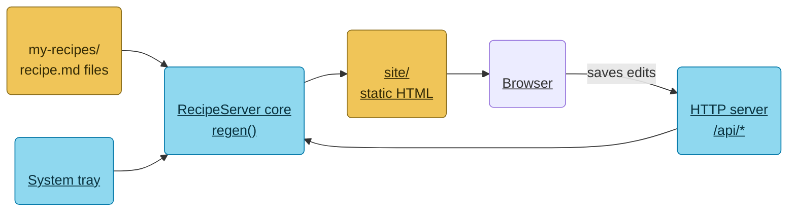

# RecipeServer



RecipeServer turns a folder of Markdown recipes into a local recipe website and serves it in your browser. Each recipe becomes its own page, and everything is collected into a searchable, sortable index.

The app runs as a desktop process with a system tray icon. There is no database and no build pipeline: your Markdown files remain the source of truth, and edits made in the browser are written back to them.

## Features

- Renders every `recipe.md` in a source tree to a standalone recipe page.
- Builds a searchable, sortable `index.html` with ratings, meals, categories, difficulty, and last-edited information.
- Dictates a search instead of asking for the keyboard, when the site is served over HTTPS.
- Filters recipe ratings by reviewer (up to 30 reviewers, most active first) without hiding any recipe cards.
- Creates recipes from the index in an existing folder or a new folder.
- Optionally drafts recipes from pasted text or a URL with a local AI model, then fills the recipe editor for review.
- Floats a one-tap AI assistant on every page that answers general questions, edits the recipe on screen, and transcribes a long-press as a message when dictation is available.
- Uploads supported images directly into a recipe folder from the recipe editor.
- Edits recipe Markdown, metadata, ratings, and comments in the browser.
- Bulk-edits metadata across the recipes selected in the index; the dialog flags which attributes differ across the selection (red `* MIXED` chips, and those fields open blank) and which you modified, restates the modified ones, and applies only those after you confirm (**Apply Edits** / **Discard Edits**).
- Writes browser edits back to the recipe's YAML front matter and Markdown body.
- Keeps a local, per-recipe version history: every managed edit snapshots the previous version, browsable in the recipe's Version History dialog (preview, diff against the current version, reversible restore), pruned automatically by a configurable GFS retention policy.
- Scales quantities inside inline code, such as `1 1/2 cups` or `1-2 tbsp`.
- Combines the ingredients of the recipes selected in the index into a shopping list, with a scale control per recipe.
- Downloads the shopping list as Markdown, copies it to the clipboard, or prints it as a checklist.
- Uses the first image in each recipe folder as the hero image and derives a page accent color from it.
- Shows metadata warnings for recipes missing recommended fields.
- Typesets math with a bundled copy of KaTeX.
- Regenerates the affected recipe page and the index whenever a recipe is saved.
- Provides a tray icon to open the recipes page, view server status, start or stop the server, and quit.

## Supported platforms

| Platform | Status    | Notes                                                                                   |
| -------- | --------- | --------------------------------------------------------------------------------------- |
| macOS    | Supported | The tray runs on the main thread.                                                       |
| Windows  | Supported | Includes `serve.bat`; the tray runs detached.                                           |
| Linux    | Untested  | Requires Tk and an X11-compatible `pystray` backend. Wayland is not guaranteed to work. |

The app is a local desktop application, not a headless web service. A graphical session is required for the tray and the first-run folder picker.

## Requirements

- Python 3.14 or newer.
- [uv](https://docs.astral.sh/uv/) for dependency and virtual-environment management.
- Tk support in Python, used to choose the recipe folder on first launch.
- A desktop environment with system tray support.

## Installation

```bash
git clone https://github.com/fordaj/RecipeServer.git
cd RecipeServer
uv sync
```

`uv sync` creates the project virtual environment and installs runtime and development dependencies.

## Usage

Start the app from the repository root:

```bash
./scripts/serve.sh
```

On Windows, run `serve.bat`. The equivalent cross-platform command is:

```bash
uv run python -m recipeserver
```

On first launch, RecipeServer asks you to choose the directory that contains your recipes. The selected path is saved, the site is generated, and the server starts on `http://127.0.0.1:8000`.

Open the site in either of these ways:

- Click the tray icon and choose **Open Recipes**.
- Visit [http://127.0.0.1:8000](http://127.0.0.1:8000) directly.

The server listens on the loopback interface only (`127.0.0.1`), so the site is not reachable from other machines. To reach it from a phone (or any other device), put a local reverse proxy or tunnel in front of it that terminates HTTPS — for example `tailscale serve --bg http://127.0.0.1:8000`, Caddy, or a Cloudflare Tunnel. The proxy forwards to `http://127.0.0.1:8000` and sets `X-Forwarded-Proto: https`; that is what enables the dictation button (see below).

If you do want the app reachable directly on your local network — for example as `http://<hostname>.local:8000` — set the **Bind address** (`server_bind_address`) in Configuration to `0.0.0.0` (all IPv4 interfaces) or `::` (all IPv6 interfaces) and restart the app. The default is `127.0.0.1` on purpose: the site has no authentication, and binding a non-loopback address lets anyone who can reach this machine load and edit your recipes over plain HTTP. Addresses must be IP literals; `localhost` is not accepted. The tray's **Open Recipes** opens the loopback address when the bind is a wildcard.

Use the **+** button in the index to create a recipe. Choose an existing folder or enter a new folder path relative to the configured recipe directory, then write the recipe in Markdown. The editor can also upload supported images beside the recipe; images added while editing an existing recipe are saved to that recipe's folder.

If a local AI model is configured, the create dialog also shows **From text**, **From URL**, and **From Images** inputs. Paste recipe text, a link, or choose one or more recipe photos and choose the matching **Generate** button; the model drafts the Markdown and metadata into the editor. Nothing is saved until you review the result and press **Create**.

The tray menu also shows the current server status and lets you start or stop the server. Use **Quit** to shut down the app. Closing the browser tab does not stop the server.

Pass `--log-level DEBUG` for more detailed output:

```bash
uv run python -m recipeserver --log-level DEBUG
```

## Optional local AI model

Recipe creation from text, URL, or image uses an [Ollama](https://ollama.com) server. Point RecipeServer at the Ollama base URL:

```toml
# In recipe-server-cfg.toml:
source_directory = "/path/to/recipes"
model_endpoint = "http://127.0.0.1:11434"
all_purpose_model_name = "llama3.2"
image_analysis_model = "llava3"
recipe_server_name = "My Recipe Server"
```

RecipeServer talks to Ollama's native API (`/api/chat`, `/api/ps`, and `/api/tags`). A configured endpoint that includes an OpenAI-style suffix such as `/v1` still works; the suffix is normalized away.

The TOML file lives in your user data directory (`recipe-server-cfg.toml`). Configuration can also be edited in the browser: choose **Configuration** from the menu on the home page, then Save and Cancel. Saving rebuilds the site immediately. If the `model_endpoint` key is absent, the app asks for the endpoint on startup:

```text
Ollama endpoint (for example http://127.0.0.1:11434). Press Enter to skip:
All-purpose model name (press Enter to auto-detect from the endpoint):
Image analysis model name (press Enter to auto-detect from the endpoint):
```

Press <kbd>Enter</kbd> at the endpoint prompt to skip the integration. The empty setting is saved, so the app will not ask again; to enable it later, add or edit the `model_endpoint` key in `recipe-server-cfg.toml` (or use the Configuration dialog). Set `all_purpose_model_name` (and `image_analysis_model` for From Images) when your server has more than one model, or leave it out and RecipeServer will ask `/api/tags` for the first available model.

The AI controls behave as follows:

- All controls are hidden when no model endpoint is configured.
- All controls are shown but disabled when the endpoint is configured but cannot be reached.
- The endpoint is checked with a short timeout each time the create dialog opens, so start the model server and reopen the dialog after it becomes available.
- Before generating, RecipeServer asks Ollama's `/api/ps` route whether the selected model is already loaded. When it is not, the dialog reports that the model is being loaded into memory.

While a recipe is generated, the dialog reports each step: checking the model, loading it into memory, preparing the source, thinking (when the model emits reasoning), generating, and complete or error. The generated Markdown is written to the recipe editor when generation finishes, and the final model load time, generation time, token count, and tokens per second are shown when Ollama reports them.

The model prompt requirements are read from `src/recipeserver/NewRecipePrompt.md` on every app run, so edits to that file take effect the next time you start RecipeServer. For **From URL**, RecipeServer fetches the page and sends its readable text (not the raw HTML) to the model. For **From Images**, every chosen image is sent to the configured `image_analysis_model` with the prompt from `src/recipeserver/NewRecipeFromImagePrompt.md`, in the order the images were added; the transcriptions are concatenated and sent to the `all_purpose_model_name` model with `NewRecipePrompt.md` to draft the recipe. The generated Markdown and front matter only pre-fill the editor; review them before creating the recipe.

## The AI assistant

Every page carries a small circle in the bottom-right corner. It appears when the local AI endpoint is configured; on a phone it hides itself while you scroll down and comes back when you scroll up. Click it to open the chat panel — on a phone it pops out upper-left of the bubble, leaving the corner free for your thumb.

The assistant answers questions and edits the recipe on screen:

- General knowledge — "how many tablespoons are in a cup?"
- Questions about other recipes in the library — "what does the tomato soup do, step by step?"
- Edits to the recipe you are viewing — "adjust the recipe to use half as much salt" rewrites the recipe and regenerates the page; the chat then offers a Reload button.

When dictation is enabled and the page is served over HTTPS (the same conditions the search dictation button needs), the composer carries its own microphone inside the text box — and the bubble is also long-pressable. Press and hold either one and a microphone pops up directly above it (above the bubble, above the field) showing when the microphone is ready, listening, transcribing, done, or failed. Let go and the recording stops, is transcribed on this machine, and the transcript is sent to the assistant exactly as if you had typed and sent it. Tapping the inline microphone instead toggles recording on and off.

Boundaries are deliberate:

- The assistant can never delete a recipe, and it cannot edit any recipe other than the one you are viewing. There is no bulk edit — asking for one gets an explanation, not an edit.
- On the index page the assistant answers questions and looks recipes up, but there is no edit control: the edit tool is not offered, and a request for one is refused.
- Edits rewrite the recipe body wholesale but only change front matter through the editor's field rules; `updatedOn` is refreshed automatically. Ratings, comments, and any other front-matter fields are preserved.
- The conversation is kept only for the open page; reloading or navigating starts fresh.

The endpoint, the all-purpose model, and availability are the same settings the create dialog uses — if the create dialog shows the AI controls disabled, the assistant reports itself as unavailable instead of answering.

## Dictating a search

The index has a microphone button next to the search field. Tap it, say what you are looking for, tap it again, and the transcript is typed into the search field — no keyboard needed, which is the point on a phone. You can also simply press and hold the button — release to stop — and a small status pill above it reports whether the microphone is ready, listening, transcribing, done, or failed.

The button is only offered when the site is served over HTTPS. Browsers hand out the microphone to secure pages only, so the button stays hidden on a plain `http://127.0.0.1:8000` page, and the server refuses transcription requests that did not arrive over HTTPS.

To use it from another device, run a local reverse proxy or tunnel in front of the app:

```bash
# Tailscale: serves https://<machine>.<tailnet>.ts.net and forwards to the app.
tailscale serve --bg http://127.0.0.1:8000
```

The proxy must forward to `http://127.0.0.1:8000` and set `X-Forwarded-Proto: https` (Caddy and Tailscale do this by default). Caddy and Cloudflare Tunnel work the same way.

The recording is transcribed on this machine with [whisper.cpp](https://github.com/ggml-org/whisper.cpp) through the `whisper-server` binary in the [fordaj/whisper-native](https://github.com/fordaj/whisper-native) release, bundled under `tools/whisper-native/`; no audio leaves the machine. The `base` model is used by default and its weights are downloaded from Hugging Face the first time a recording is transcribed, so the first dictation needs an internet connection and can take a minute or two. Set `RECIPE_SERVER_WHISPER_MODEL` to another model size (`tiny`, `base.en`, `small`, …) to trade accuracy for speed. RecipeServer manages the `whisper-server` process for you: it starts on the first transcription and stops when the app shuts down.

Dictation is on by default and can be switched off with the **Dictation** checkbox in the Configuration dialog (or the `dictation_enabled` key in `recipe-server-cfg.toml`). When it is off, no button is rendered, `POST /api/transcribe` answers 403, and no Whisper model is downloaded or loaded.

If the first dictation fails because the proxy gave up waiting for the model to download, raise the proxy's read timeout — nginx, for example, defaults to 60 seconds — or dictate again: the model stays loaded in memory after the first attempt.

## Recipe layout

Every directory containing a file named exactly `recipe.md` is treated as a recipe. Other Markdown files are ignored.

```text
my-recipes/
├── breakfast/
│   ├── recipe.md
│   └── pancakes.jpg
└── dinner/
    ├── recipe.md
    └── lemon-pasta.webp
```

The directory structure is preserved in the generated site. Images next to `recipe.md` are copied along with the page. The first image in filename-sorted order becomes that recipe's hero image and determines its accent color.

Supported image formats: JPG, JPEG, PNG, GIF, WebP, BMP, TIFF, TIF, SVG, and AVIF.

## Recipe format

Recipes use Markdown with optional YAML front matter:

```markdown
---
ratings:
  - name: Avery
    rating: 8
contributor: Avery
createdOn: "2026-02-14"
meals:
  - Dinner
categories:
  - Pasta
makes: 4
difficulty: 2
source:
  author: Example Cookbook
  title: Weeknight Pasta
  format: book
  url: ""
---

# Lemon Pasta

A quick weeknight dinner.

Mix `1 1/2 cups` flour with `1/2 tsp` salt.
```

The first `#` heading becomes the recipe and index title. If there is no heading, RecipeServer falls back to the front matter `title`, then to the directory name.

The metadata checker warns when these fields are missing:

- `ratings`
- `contributor`
- `createdOn`
- `meals`
- `categories`
- `makes`
- `difficulty`

Warnings are advisory. They appear in the hidden **Metadata Status** section of the index and do not block generation or saving.

When a reviewer is selected in **Filter Reviews**, Metadata Status also warns on recipes that have no rating from the selected reviewer(s).

`categories` is the canonical field. Older recipes using the singular `category` are still read correctly, but that field is normalized to `categories` when the recipe is saved.

### Quantity scaling

Wrap quantities in inline code to make them scalable:

```markdown
Add `1 cup` sugar and `1 1/2-2 1/2 tbsp` lemon juice.
```

RecipeServer recognizes common kitchen units and their aliases, including cups, tablespoons, teaspoons, grams, milliliters, liters, pounds, and ounces. It scales amounts but does not convert between units.

Unparseable inline-code quantities log a warning rather than breaking the page.

### Ratings, comments, and editing

The browser editor can update the recipe body and metadata. Ratings and comments are stored in the recipe's front matter as well.

A full editor save updates `updatedOn`. Rating and comment changes do not, so activity on those sections does not change the recipe's last-edited position in the index.

## Recipe version history

Every recipe carries a stable `recipe_id` UUID in its front matter (assigned automatically on first run or on the next save — never by you). Whenever RecipeServer replaces a recipe's contents — an editor save, a raw Markdown save, a metadata change, a bulk edit, an AI-assistant edit, an image rename — the replaced version is preserved as an immutable snapshot under `history/recipes/<recipe-id>/` in the data directory. Unchanged saves create no snapshot, and history survives recipe deletion (deleting a recipe never deletes its snapshots).

Open the recipe and use **Timeline** to browse previous versions (newest first, current version marked): preview any version rendered as that version of the recipe, compare it against the current recipe as a Markdown diff, or restore it. Restoring snapshots the current recipe first, so a restore is itself undoable. Snapshots are plain Markdown files and are never modified.

History is pruned automatically in the background according to the **Timeline retention** setting in **Configuration** (or the `timeline_retention` key in `recipe-server-cfg.toml`). The default, **GFS**, keeps every revision from the last 24 hours, one revision per hour for the last 7 days, one per day for the last 30 days, one per week for the last 12 months, and one per month older than that; older, redundant revisions are removed automatically, and the newest revision of every recipe is always kept. **Unlimited** keeps every revision forever (the pre-existing behavior). Existing installations default to GFS as well; switching policies never resets or migrates history, and the timeline, preview, diff, and restore all work the same either way.

This is an application-managed revision history, not a backup system — keep backing up your recipe library the way you always have.

## Where files live

RecipeServer uses the operating system's application-data directory:

| Platform | Data directory                                |
| -------- | --------------------------------------------- |
| macOS    | `~/Library/Application Support/recipe-server` |
| Windows  | `%LOCALAPPDATA%\recipe-server`                |
| Linux    | `~/.local/share/recipe-server`                |

Inside that directory:

- `recipe-server-cfg.toml` (TOML) holds the configuration: the `source_directory` path, the `recipe_server_name`, optional `model_endpoint`, `all_purpose_model_name`, and `image_analysis_model` keys for the local AI integration, the `dictation_enabled` switch, and the `timeline_retention` policy (`gfs` by default, or `unlimited`). A legacy `config.txt` file is migrated automatically on startup.
- `site/` contains the generated website.
- `history/recipes/<recipe-id>/` holds the version history: one `<snapshot-id>.md` per saved version. It is an application-managed revision history — not a backup — and is never placed in your recipe folders. Revisions are pruned automatically in the background according to the `timeline_retention` policy (GFS by default). See [Recipe version history](#recipe-version-history).

The site directory is disposable. It is deleted and rebuilt every time RecipeServer starts. Never store source content or manual edits there.

To change the recipe source directory, update the `source_directory` key in `recipe-server-cfg.toml` (or use **Configuration** on the home page), or remove the file so the folder picker appears again at startup.

Runtime logs are written under `.logs/` in the directory where the app was started.

## Troubleshooting

- **The configured port is unavailable:** RecipeServer listens on the port set in Configuration (default 8000) on the configured bind address (default `127.0.0.1`). Either stop whatever else is using that port or change `server_port` in `recipe-server-cfg.toml` (or use **Configuration**) and restart the app.
- **`http://<hostname>.local:8000` no longer loads:** Since the server binds `127.0.0.1` by default it answers on the loopback interface only; the `<hostname>.local` name also resolves to the machine's LAN address, where nothing is listening. If you want LAN access, set the **Bind address** (`server_bind_address`) to `0.0.0.0` (or `::`) in Configuration and restart — but note the site has no authentication. Prefer the reverse-proxy route above.
- **Via Tailscale the page sometimes loads without styling or scripts:** This was caused by the HTTP/1.0 protocol default, which made the browser open a fresh TCP connection for every asset — through a relay any dropped connection lost that asset (sometimes all of them, hence raw HTML). The server now speaks HTTP/1.1 with keep-alive and sends `Cache-Control` on every response. If you still see it, check that `tailscale serve status` shows `proxy http://127.0.0.1:8000` and that no other `tailscale serve`/`funnel` configuration is overriding it.
- **No tray icon appears:** Check that the app is running in a desktop session with tray support. On Linux, an X11-compatible `pystray` backend is required.
- **The folder picker does not appear:** Make sure the Python installation includes Tk.
- **A recipe is missing from the index:** Confirm that the file is named exactly `recipe.md` and lives under the configured recipe source directory.
- **A recipe has no hero image or expected accent color:** Add a supported image next to `recipe.md`. The first image in filename-sorted order wins.
- **Metadata warnings are visible:** Use the **Metadata Status** toggle in the index. Warnings are advisory and can be resolved by filling in the missing front matter fields.
- **The From text, From URL, and From Images inputs are missing:** No local model endpoint is configured. Add `model_endpoint` to `recipe-server-cfg.toml` (or use **Configuration**), or remove that key and restart to be prompted again.
- **The From text, From URL, and From Images inputs are disabled:** The configured model endpoint could not be reached. Start the model server, check the endpoint URL, and reopen the create dialog.
- **The From Images input is disabled while text/URL work:** The image prompt could not be loaded. Check `src/recipeserver/NewRecipeFromImagePrompt.md` exists, and that the endpoint serves a vision-capable `image_analysis_model`.
- **AI generation fails with an HTTP error:** Confirm the Ollama server is running and reachable, and that it exposes `/api/chat` and `/api/ps`. Set `all_purpose_model_name` explicitly if auto-detection picks the wrong model.
- **The microphone button is missing from the search field:** The site is not being served over HTTPS. Put a local reverse proxy or tunnel in front of `http://127.0.0.1:8000` that sets `X-Forwarded-Proto: https`, and open the site through that address.
- **Dictation returns "Speech transcription requires an HTTPS connection":** The proxy forwarded the request without the `X-Forwarded-Proto` header (or with `http`). Configure the proxy to forward the original protocol.
- **Dictation returns "Nothing was heard. Try again.":** The model did not recognise anything in the recording. Speak closer to the microphone and hold the button a little longer.
- **Dictation returns "Dictation is disabled in the server configuration":** Dictation is switched off. Enable the **Dictation** checkbox in **Configuration** on the home page, or set `dictation_enabled = true` in `recipe-server-cfg.toml`.
- **Dictation fails with "whisper-server was not found":** The bundled binary is missing for this platform. Run `tools/whisper-native/update.sh` to download the release, or set `WHISPER_SERVER_BIN` to a `whisper-server` binary.
- **Dictation fails when the model cannot be downloaded:** The first transcription downloads the ggml weights from Hugging Face. Check the network connection, or download `ggml-base.bin` manually and place it in `<user-data>/recipe-server/models/`.
- **The first dictation takes a long time and the proxy times out:** The model weights are downloaded on the first transcription. Raise the proxy's read timeout (nginx defaults to 60 seconds) or dictate again — the model stays loaded after that.

## Development

Run the test suite:

```bash
uv run pytest
```

Run a focused test file or test:

```bash
uv run pytest test/test_tray.py
uv run pytest test/test_ratings.py::test_validate_ratings_accepts_example_shape_and_decimal_score
```

### Browser end-to-end tests

`test/e2e/` contains Selenium browser tests that exercise the app as a real user
would: they build a site from a throwaway recipe tree, serve it from a live
RecipeServer on an ephemeral port, and drive a real browser against it. No user
data, configuration, or port 8000 is touched.

Prerequisites:

- Google Chrome (the default browser). Firefox and Edge also work via
  `RECIPE_SERVER_TEST_BROWSER`; see the environment variables below.
- The chromedriver matching your Chrome. Selenium Manager resolves it
  automatically on first run (needs network access once, cached afterwards).
  Override it with `RECIPE_SERVER_TEST_CHROMEDRIVER` if resolution fails.

Run only the browser tests:

```bash
uv run pytest test/e2e
```

Or the whole suite (which includes them):

```bash
uv run pytest
```

Skip the browser tests locally:

```bash
uv run pytest --ignore=test/e2e
```

Browser tests run headless by default. Relevant environment variables:

| Variable                                                               | Default           | Purpose                                                 |
| ---------------------------------------------------------------------- | ----------------- | ------------------------------------------------------- |
| `RECIPE_SERVER_TEST_BROWSER`                                           | `chrome`          | `chrome`, `firefox`, or `edge`.                         |
| `RECIPE_SERVER_TEST_HEADLESS`                                          | `1`               | Set to `0` to watch the browser.                        |
| `RECIPE_SERVER_TEST_CHROME_BINARY`                                     | auto              | Path to the Chrome/Chromium binary.                     |
| `RECIPE_SERVER_TEST_CHROMEDRIVER`                                      | auto              | Path to chromedriver.                                   |
| `RECIPE_SERVER_TEST_FIREFOX_BINARY` / `RECIPE_SERVER_TEST_EDGE_BINARY` | auto              | Path to the Firefox / Edge binary.                      |
| `RECIPE_SERVER_TEST_EDGEDRIVER`                                        | auto              | Path to edgedriver.                                     |
| `RECIPE_SERVER_TEST_ARTIFACTS`                                         | `.e2e-artifacts/` | Where failure screenshots and console logs are written. |

When a browser test fails, a screenshot and (Chrome/Edge) the browser console
log are saved to `.e2e-artifacts/` and attached to the pytest failure report;
CI uploads them as a workflow artifact. When the browser cannot be started the
tests fail in CI and skip locally (set `CI=true` to force the failure).

### Speech transcription tests

The dictation feature is covered by tests that need no model: `test/test_transcriber.py`
decodes real recordings (Opus in WebM, AAC in MP4, and WAV) with the installed
PyAV, `test/test_whisper_server.py` covers the subprocess lifecycle against a
stub server, and `test/test_speech_button.py` posts those recordings through the
`/api/transcribe` endpoint. The recorded phrase lives in `test/fixtures/speech/`.

The tests that run the real Whisper model are skipped by default, because they
download the model weights. Run them with:

```bash
RECIPE_SERVER_TEST_WHISPER=1 uv run pytest test/test_speech_model.py
```

| Variable                           | Default                            | Purpose                                                  |
| ---------------------------------- | ---------------------------------- | -------------------------------------------------------- |
| `RECIPE_SERVER_TEST_WHISPER`       | unset                              | Set to `1` to run the tests that use the real model.     |
| `RECIPE_SERVER_TEST_WHISPER_MODEL` | `tiny`                             | Model size for those tests (`tiny`, `base`, `small`, …). |
| `RECIPE_SERVER_WHISPER_MODEL`      | `base`                             | Model size the app uses.                                 |
| `RECIPE_SERVER_WHISPER_MODEL_DIR`  | `<user-data>/recipe-server/models` | Where the downloaded ggml weights are kept.              |
| `WHISPER_SERVER_BIN`               | bundled `tools/whisper-native/…`   | Points at the `whisper-server` binary to manage.         |

Writing new tests:

- Use the `recipe_server` fixture for a running server against temporary
  recipe/site directories and the `driver` fixture for the browser; request
  only the ones a test needs. `source_dir` is available separately when a test
  needs to inspect or mutate the recipe tree.
- Prefer `WebDriverWait`-based helpers from `test/e2e/helpers.py` over sleeps
  and prefer `data-testid` attributes (for example `[data-testid="recipe-item"]`)
  and stable element IDs over positional selectors.

### Scale testing

`test/scale/` builds and serves a mock recipe library at four sizes — 10, 100,
1,000, and 10,000 recipes, one generated image per recipe — and reports build,
startup, and request timings plus output sizes and RSS. It is a performance
analysis harness, not a correctness gate: it is skipped by default and is never
wired into CI. Run it manually, with `-s` so the console table is printed:

```bash
RECIPE_SERVER_SCALE=1 uv run pytest test/scale -s
```

It writes `.scale-artifacts/report.json` (machine-readable, with platform, CPU
count, Python version, git SHA, sizes, and seed) and `.scale-artifacts/report.md`
(human-readable tables, including per-doubling growth factors between
consecutive sizes). When a previous `report.json` exists in the artifacts
directory, the new report also prints deltas against it.

| Variable                          | Default             | Purpose                                      |
| --------------------------------- | ------------------- | -------------------------------------------- |
| `RECIPE_SERVER_SCALE`             | unset               | Set to `1` to run the scale tests.           |
| `RECIPE_SERVER_SCALE_SIZES`       | `10,100,1000,10000` | Comma-separated library sizes to measure.    |
| `RECIPE_SERVER_SCALE_ARTIFACTS`   | `.scale-artifacts/` | Where `report.json`/`report.md` are written. |
| `RECIPE_SERVER_SCALE_SEED`        | `207`               | Seed for the deterministic mock library.     |
| `RECIPE_SERVER_SCALE_REPETITIONS` | `5`                 | Timed repetitions per probed endpoint.       |

The mock library lives in a throwaway temporary directory (no real user data,
no tray, no port 8000, no browser) and is regenerated on every run. The
assertions check invariants only — expected page count, card count, 2xx
responses, a parseable index — and there are deliberately no time budgets.
Expect the full four-size run to take tens of minutes on a loaded machine
(10,000 recipes dominates); trim `RECIPE_SERVER_SCALE_SIZES` while iterating.

Format Python (Black, line-length 150), Bash (shfmt), CSS/JS/HTML/Markdown/YAML (Prettier), TOML (taplo), and SVG (Prettier `--parser html`) via formattington (`uv run formattington all --config .formattington.json`, concurrently by default). Formatters are declared in `.formattington.json`; vendored KaTeX is excluded via `.prettierignore`. Requires `prettier` on PATH (`npm install -g prettier`) and `taplo` on PATH:

```bash
./scripts/format.sh
./scripts/format.sh --check
```

### Bundled tooling and CI

This repository carries compiled executables from the sibling `fordaj/*`
repositories under `tools/` (pinned, platform-native; refreshed by each
`tools/<name>/update.sh`):

| Tool                       | Used for                                                                                                   |
| -------------------------- | ---------------------------------------------------------------------------------------------------------- |
| `tools/versioner`          | Compute `VERSION`/`TAG` for releases (`scripts/version.sh`, `scripts/release.sh`)                          |
| `tools/logamuffin`         | Shell logging behind `scripts/entry.sh` (`scripts/serve.sh`, `scripts/format.sh`, `scripts/release.sh`, …) |
| `tools/runner-spawner`     | Provision the self-hosted CI runners (`./scripts/spawn-runners.sh`)                                        |
| `tools/formattington-lite` | Formatting fallback; the pinned uv dependency is the primary path                                          |
| `tools/barnacle`           | Documentation site generation (`scripts/docs.sh`)                                                          |

Scripts source `scripts/entry.sh`, which exposes `log()` backed by the
bundled logamuffin binary. Formatting is orchestrated by
[formattington](https://github.com/fordaj/formattington) both as a pinned
`uv` dev dependency (`./scripts/format.sh`) and as the committed config in
`.formattington.json`.

GitHub Actions (`.github/workflows/check-formatting.yml`, “PR Checks”) runs
on the self-hosted macOS and Windows runners provisioned above; it checks
formatting and runs the pytest suite — including the headless Selenium
browser tests — on every pull request. The browser tests run against the
system Chrome installed on each runner, with chromedriver resolved by
Selenium Manager. Releases are cut with `./scripts/release.sh`
(tag + GitHub release notes only — no binaries are published for this app).

### Project layout

```text
src/recipeserver/
├── __main__.py             # CLI entrypoint
├── core.py                 # startup, regeneration, parallel recipe conversion
├── config.py               # recipe source, local model settings, prompt loading
├── ai_recipe.py            # local-model status, URL fetching, recipe generation
├── markdown_to_html.py     # recipe rendering and quantity scaling
├── index_html_generator.py # searchable/sortable index and metadata warnings
├── shopping_list.py         # ingredient scraping for the shopping list
├── metadata_linter.py      # required-field list and warning text
├── image_handler.py        # supported images, hero selection, accent colors
├── server.py               # HTTP server and JSON APIs
├── history.py              # recipe version history (snapshots in the user-data directory)
├── retention.py            # timeline revision retention (GFS default / Unlimited)
├── transcriber.py          # dictation: PyAV decode + whisper-server HTTP client
├── whisper_server.py       # whisper-server subprocess lifecycle and model download
├── tray.py                 # system tray icon and menu
├── NewRecipePrompt.md      # model prompt requirements, reloaded at startup
└── assets/                 # CSS, JavaScript, icons, and vendored KaTeX
test/                       # pytest suite (test/e2e/ holds the Selenium browser tests)
serve.bat / scripts/serve.sh      # launch helpers (Windows / Unix)
scripts/format.sh                   # Python (Black) and Bash (shfmt) formatting via formattington
scripts/spawn-runners.sh            # create the self-hosted CI runners (macOS/Windows)
scripts/                    # env cascade (entry.sh/env.sh) + version.sh + docs.sh
tools/                      # bundled fordaj/* binaries + update.sh refreshers
```

### Architecture and invariants

- `recipe.md` files in the source tree are the source of truth. Generated HTML is disposable output.
- Every save re-renders that recipe page and rebuilds the index.
- One broken recipe is skipped with a logged error so the rest of the site can still build.
- Metadata warnings are advisory and never block generation, serving, or saving.
- The HTTP API uses relative `.md` paths inside the configured source directory. Paths outside it are rejected.
- APIs include `GET /api/recipe-folders`, `POST /api/recipe`, `GET /api/ai-status`, `POST /api/ai-recipe`, `GET /api/markdown`, `GET|POST /api/recipe-editor`, `GET|POST /api/metadata/<field>`, `GET /api/metadata-options`, `GET /api/shopping-list`, `POST /api/transcribe`, and `GET /api/history` (plus `GET /api/history/preview`, `GET /api/history/compare`, `POST /api/history/restore`).
- Every RecipeServer-managed recipe save (editor, raw Markdown, metadata, bulk, assistant, image reference rewrites, restore) snapshots the replaced version into `<user-data>/recipe-server/history/recipes/<recipe-id>/` before writing, keyed by the recipe's stable `recipe_id` front-matter UUID — identity never depends on the file path. Unchanged saves write nothing and snapshot nothing; deletes preserve history.
- A background retention pass prunes history according to the server-level `timeline_retention` policy (`gfs` by default, `unlimited` optional): it runs periodically, at startup, after saves (throttled), and after configuration changes, never inside HTTP requests, and it never edits retained snapshots, never deletes the newest revision of a timeline, and never empties one. Restored snapshots are read under the same per-recipe lock the pruner uses, so a restore is never raced by retention.
- `GET /api/metadata-options` returns the metadata values that are already used in the library (meals, categories, cuisine, tags, status, contributor, plus source author and title) with the number of recipes that use each of them, so the editor can offer them as dropdown options. The values are read from the recipe Markdown files on request; they are never hard-coded into generated pages or front matter.
- Recipe creation writes `recipe.md` into the selected folder and rejects folder paths outside the source directory or existing recipes.
- AI recipe generation never writes files. It returns Markdown and metadata to the editor, which saves only when the user submits the create form.
- The AI assistant can rewrite only the recipe being viewed (the update tool takes no path) and never deletes anything. The conversation is ephemeral.
- The AI integration is opt-in and uses only the configured local endpoint. `NewRecipePrompt.md` is read at startup, not when the app is built.
- Generated pages use root-absolute URLs such as `/assets/...`. They must be served from the site root; opening the HTML files directly will not load their assets.
- The server uses the port set in Configuration (default `8000`) and the bind address set in Configuration (`server_bind_address`, default `127.0.0.1`), and has no authentication. Serve it over HTTPS through a local reverse proxy or tunnel; the dictation button only appears on those pages. The site is served with HTTP/1.1 keep-alive so browsers reuse one connection per host instead of opening a fresh connection per asset.
- There is no JavaScript build step. Frontend assets are served directly, and KaTeX is vendored in `src/recipeserver/assets/katex`.

## KaTeX

Updated last on 11/08/2026 to KaTeX 0.19.1 using `pnpm install katex` (see `src/recipeserver/assets/katex/README.md`).

## Documentation

Every module, script, and pinned tool carries a sibling Markdown page next to its source, named after the source file it documents — `server.py` → `server.py.md`, `scripts/docs.sh` → `scripts/docs.sh.md` — so files that share a base name stay individually documentable. Hub pages (`README.md`) keep their plain names, and every page opens with a Mermaid diagram: a map of what the page covers, right under its `#` heading, with clickable nodes (`click Node href "page.md"`) and clickable transitions (inline anchors in edge labels) that navigate the rendered site. [AGENTS.md](AGENTS.md) documents the sources and the rules for keeping them current; run `scripts/docs.sh` to render the set into `./site/` with the bundled [barnacle](https://github.com/fordaj/barnacle) binary.
