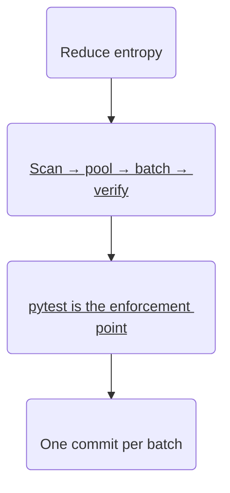

# ADR-0001: Architecture governance for entropy reduction

## Status

Accepted.

## Context

The programme requires a persistent progress file, architecture decision
records, and an optimization task pool. It also requires that every batch be
independently valuable, verified, and committed separately. The repository's
CI already runs the full pytest suite on both runner platforms, so tests are
the natural enforcement point for architectural rules.

## Decision

- Keep the programme's records under `architecture/`, excluded from the
  generated documentation site via `.barnacle.json`.
- Work in an isolated Git worktree; commit each coherent batch separately.
- Before each batch: record a behavioural baseline (`uv run pytest`) and the
  real callers of the code being changed.
- After each batch: run the full suite, review the complete diff, and update
  [PROGRESS.md](PROGRESS.md) and [TASK_POOL.md](TASK_POOL.md) in the same
  commit.
- Encode architectural standards as tests in `test/` so they run in CI
  without adding a new linter, type checker, or CI workflow.
- Do not relocate directories, add abstraction layers, or migrate callers
  unless the change genuinely removes more complexity than it introduces.

## Consequences

Tests that assert structure (import direction, canonical constants, route
contracts) become executable documentation of the intended architecture.
Records stay out of the published site but remain in the repository history.
