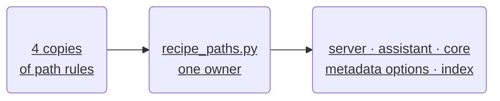

# ADR-0002: One owner for library path rules

## Status

Accepted (batch 1).

## Context

`server._resolve_markdown_path`, `ai_assistant._resolve_recipe_path` (whose
docstring said it "mirrors the server's rules"), and `server._resolve_recipe_directory`
implemented the same containment checks independently. The literal `recipe.md`
was repeated in four modules and `.md` in three. These are security-relevant
rules: a divergence in one copy could let a path escape the source directory.

## Decision

`src/recipeserver/recipe_paths.py` owns `RECIPE_FILENAME`, `MARKDOWN_FILE_SUFFIX`,
`resolve_recipe_file`, `resolve_recipe_folder`, and `display_path`. All callers
use it; the duplicated code is deleted rather than kept as aliases. The error
wording for a non-Markdown path is parameterised by `action` because the browser
edit endpoint says "can be edited" and the assistant says "can be read".

`history.SNAPSHOT_SUFFIX = ".md"` stays separate: a history snapshot suffix is
a different concept from the recipe Markdown suffix.

## Consequences

Path-safety fixes now land in one file. `test/test_architecture.py` fails if a
caller reintroduces the literals, and `test/test_recipe_paths.py` pins the
observable validation behaviour. A stale test that read the removed
`server.SERVER_BIND_ADDRESS` constant was migrated to the canonical config
constant; the default value itself did not change.
