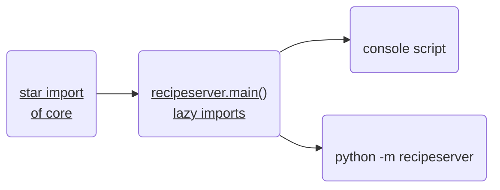

# ADR-0003: One startup entry point, no eager package import

## Status

Accepted (batch 2).

## Context

`recipeserver/__init__.py` was `from .core import *`, so importing any leaf
module eagerly loaded `core`, `server`, `tray`, `config`, `tkinter`, and
`pystray`, and formed a nine-module import cycle through the package root.
The console script `recipeserver = "recipeserver:main"` relied on that star
re-export, but `core.main` requires a `cfg` argument: the shipped script raised
`TypeError: main() missing 1 required positional argument: 'cfg'`.

## Decision

The package initializer owns a no-argument `main()` that performs argument
parsing, logger setup, configuration resolution, and then calls `core.main(cfg)`.
Its imports are inside the function. `__main__.py` delegates to that function,
so both startup routes share one implementation.

## Consequences

The console script works, and leaf imports stay light. The old behaviour that
made `Core`, `Server`, `Configuration`, etc. available at package scope through
a star import is gone; in-repository callers import those modules directly.
`test/test_startup_entrypoints.py` pins both entry points and asserts that a
leaf import does not load the server stack.
