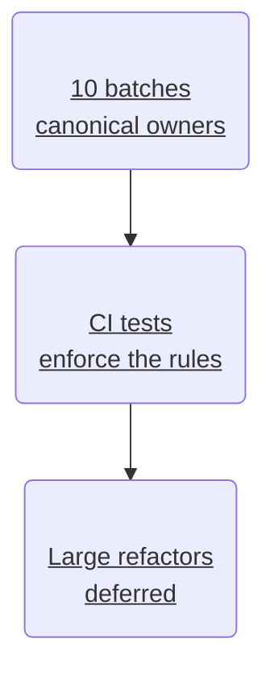

# ADR-0004: Convergence point and remaining work

## Status

Accepted.

## Context

Ten batches have moved the codebase toward the target architecture: canonical
owners for library paths, startup, SSE framing, math rendering, image
extensions, accent colors, title extraction, and several config defaults; dead
code removed; structural tests added to CI.

## Decision

Stop here rather than start the large, higher-risk decompositions in the same
programme:

- Splitting `server.py` (3262 lines) into cohesive modules without creating
  forwarding shells.
- Consolidating front-matter validation across `server.py`, `ai_recipe.py`,
  `ai_assistant.py`, and `recipe_utils.py`.
- Sharing the browser SSE reader and dictation controller between the recipe
  editor and the assistant.

These are recorded as `candidate`/`deferred` in [TASK_POOL.md](TASK_POOL.md)
with evidence. Each needs a dedicated behavioural baseline, a migration of
all callers, and its own verification cycle.

## Consequences

The current state is internally consistent and fully verified; remaining work
is additive and can be taken up in focused batches without invalidating the
decisions recorded here. Structural tests fail loudly if a replaced
duplication returns.
