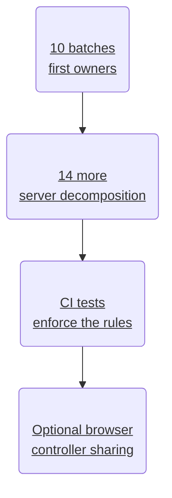

# ADR-0004: Convergence point and remaining work

## Status

Accepted; superseded in scope by batches 11–24 (the decision to stop was
revisited and the deferred items were completed).

## Context

The first ten batches established canonical owners for paths, startup, SSE
framing, math rendering, image extensions, accent colors, title extraction, and
config defaults. This ADR originally recorded the large `server.py`
decomposition, front-matter validation, and browser controller sharing as
deferred.

## Decision

The deferred items were subsequently taken up as bounded batches rather than
left open:

- `server.py` was decomposed into `request_payload`, `recipe_images`,
  `recipe_history_api`, `ai_streaming`, `config_endpoints`, and `auth_endpoints`;
  it went from 3262 to 2359 lines while keeping routing and response codes.
- Front-matter validation moved to `recipe_metadata`; config defaults and the
  retention policy moved to leaf modules.
- The browser SSE reader was unified in `assets/sse.js`, and the dictation
  transport in `assets/dictation.js`. The two triggers keep their own UI and
  pointer wiring (different labels and insertion policies); the microphone,
  MediaRecorder lifecycle, and `/api/transcribe` call have one implementation.

## Consequences

The task pool has no unaddressed high-value architectural deviations. Every
structural rule is enforced by tests in CI, and the full suite passes without
deselection. A future change should preserve the ownership boundaries listed in
[TASK_POOL.md](TASK_POOL.md); the AST tests fail if a replaced duplication
returns.
