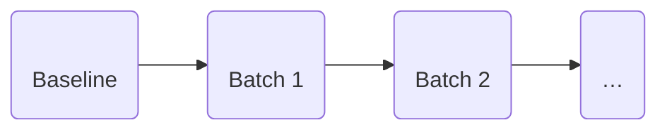

# Progress

Worktree: `arch-entropy` (isolated from `main`).

## Baseline

- Commit: `f802330` (`fix(auth): attach CSRF token to same-origin browser writes`)
- Command: `uv run pytest -q --disable-warnings`
- Result: **580 passed, 19 skipped** (461 s)
- Formatting: to be checked with `./scripts/format.sh --check` before each commit.

## Intended architecture (to converge toward)

1. One authoritative implementation per business concept (recipe identity,
   library paths, front-matter rules, configuration, Ollama transport).
2. Dependencies point from HTTP/UI inward to domain modules; no domain module
   imports the server or the core orchestrator.
3. No unexplained circular imports; no forwarding-only modules.
4. Engineering standards are enforced by tests in `test/` (which CI runs).

## Completed batches

_None yet._

## Verification record

| Batch | Tests                            | Formatting | Commit    |
| ----- | -------------------------------- | ---------- | --------- |
| —     | baseline: 580 passed, 19 skipped | —          | `f802330` |
