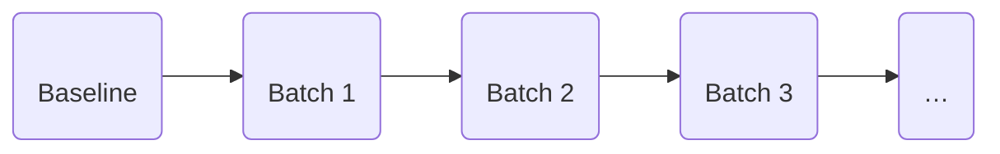

# Progress

Worktree: `arch-entropy` (isolated from `main`).

## Baseline

- Commit: `f802330` (`fix(auth): attach CSRF token to same-origin browser writes`)
- Command: `uv run pytest -q --disable-warnings`
- Result: **580 passed, 19 skipped** (461 s)
- Formatting: `./scripts/format.sh --check` clean.

## Intended architecture (to converge toward)

1. One authoritative implementation per business concept (recipe identity,
   library paths, front-matter rules, configuration, Ollama transport).
2. Dependencies point from HTTP/UI inward to domain modules; no domain module
   imports the server or the core orchestrator.
3. No unexplained circular imports; no forwarding-only modules.
4. Engineering standards are enforced by tests in `test/` (which CI runs).

## Completed batches

### Batch 0 — architecture governance (`9cdbf9c`)

Progress file, task pool, and ADR-0001; `architecture/` excluded from the
generated site. No production code changed.

### Batch 1 — canonical library-path rules (`74d9ffe`)

`src/recipeserver/recipe_paths.py` is the single owner of `recipe.md`/`.md`
constants and of Markdown-path, folder-path, and display-path rules. Migrated
`server.py`, `ai_assistant.py`, `core.py`, `metadata_options.py`, and
`index_html_generator.py`; deleted the duplicated validators and the
independent bind-address default in `server.py`. Added behavioural tests and
structural tests. ADR-0002 records the decision.

Evidence: focused run `129 passed, 1 skipped`; full run after this batch
`620 passed, 20 skipped, 1 failed` — the failure is
`test/e2e/test_timeline.py::test_timeline_preview_compare_and_restore`, which
passes in isolation and when the whole file is run (`3 passed`). It is a
pre-existing order/resource flake, not a regression.

### Batch 2 — one startup entry point, light package import (`1b0fbfa`)

`recipeserver:main` now owns the startup sequence (previously the console
script raised `TypeError: main() missing 1 required positional argument: 'cfg'`).
`python -m recipeserver` calls the same function. Lazy imports remove the
package-root cycle: importing `recipeserver.shopping_list` now loads only
`recipeserver` and that module — no `core`, `server`, `tray`, `config`,
`tkinter`, or `pystray`. ADR-0003 records the decision.

Evidence: `3 passed` for `test/test_startup_entrypoints.py`;
`uv run recipeserver --help` exits 0 with the expected usage; direct import
probe prints only the two package modules and `False False` for
tkinter/pystray.

### Batch 3 — shared SSE framing and generic-mode math (pending commit)

The two streaming endpoints now call one `_begin_event_stream()` and one
`_send_sse_event()` instead of carrying byte-identical closures. The recipe
Markdown renderer now uses `pymdownx.arithmatex` generic mode, so recipe-page
math produces the same `\(…\)`/`\[…\]` markup the chat renderer emits and the
vendored KaTeX auto-render can typeset. Structural test guards SSE delegation;
`test/test_math_rendering.py` guards the two renderers' agreement.

Evidence: `82 passed` for architecture + AI recipe + AI assistant tests;
`35 passed` for math + recipe-render + assistant-render tests.

### Batch 4 — service-worker image extensions (pending commit)

`assets/sw.js` omitted `.bmp`, `.tiff`, and `.tif` from the set that gets
stale-while-revalidate caching, so those hero images lost the flaky-network
protection the service worker exists to provide. The three browser/Python
extension sets now agree, and `test/test_service_worker.py` parses all three
to fail on future drift. Evidence: `5 passed`.

### Batch 5 — canonical Ollama chat URL in the transcriber (pending commit)

`transcriber.py` no longer declares its own `/api/chat` constant or builds the
chat URL itself; it calls `ai_recipe.ollama_chat_url`. The shared error-body
read limit replaces a near-identical local copy (2048 vs 2000 bytes). A
structural test prevents the local path literal from returning. Evidence:
`87 passed, 3 skipped` across architecture, transcriber, live-transcription,
and speech-button tests.

### Batch 6 — one accent-color declaration owner (pending commit)

`color_utils.accent_color_declarations` now owns the light/dark `--food-color`
and `--food-color-hover` rules; the index and recipe-page builders wrap the
same declarations. Previously recipe pages with a photo-derived accent kept
the stylesheet's brown hover color. Tests assert the hover declaration on
both generated page types. Evidence: `27 passed` for config-values and index
tests, `54 passed` for the wider rendering test set.

### Batch 7 — one fence-aware title rule (pending commit)

`recipe_utils.first_heading` now owns title extraction from Markdown. The
renderer and the assistant's `list_recipes` both use it, so a `#` line inside
a fenced code block can no longer become a recipe title in one path but not
the other. The converter's private duplicate is deleted. Evidence:
`83 passed, 1 skipped` across architecture, conversion, assistant, and path
tests.

### Batch 8 — dead-code removal (pending commit)

Deleted the unused `history.snapshot_exists` and the unused `FLOW_COOKIE`
import in `authorization.py` and `ImageDraw` import in `tray.py`, with the
sibling doc updated. Evidence: `38 passed` across history, auth, and tray
tests.

### Batch 9 — enforce documentation and icon standards (pending commit)

`test/test_architecture.py` now fails when source contains an inline `<svg>`
or `data:image/svg+xml` URI (vendored KaTeX excluded), when a Python module has
no sibling `.py.md`, or when a documentation page lacks a leading Mermaid
diagram. These standards previously existed only in `AGENTS.md`. Evidence:
`27 passed`.

## Verification record

| Batch | Tests                                                                         | Formatting | Docs                             | Commit    |
| ----- | ----------------------------------------------------------------------------- | ---------- | -------------------------------- | --------- |
| —     | baseline: 580 passed, 19 skipped                                              | clean      | —                                | `f802330` |
| 0     | docs only                                                                     | clean      | n/a                              | `9cdbf9c` |
| 1     | focused 129 passed, 1 skipped; full 620 passed, 20 skipped, 1 known flaky e2e | clean      | generated, no broken local links | `74d9ffe` |
| 2     | focused 3 passed; console script and import probe verified                    | clean      | generated                        | `1b0fbfa` |
| 3     | focused 82 passed + 35 passed; final full run pending                         | clean      | generated                        | `9d616fc` |
| 4     | focused 5 passed; final full run pending                                      | clean      | generated                        | `1d7532f` |
| 5     | focused 87 passed, 3 skipped; final full run pending                          | clean      | generated                        | `404fb12` |
| 6     | focused 27 passed + 54 passed; final full run pending                         | clean      | generated                        | `db61f8c` |
| 7     | focused 83 passed, 1 skipped; final full run pending                          | clean      | generated                        | `ffaa942` |
| 8     | focused 38 passed; final full run pending                                     | clean      | generated                        | `719cc82` |
| 9     | focused 27 passed; final full run pending                                     | clean      | generated                        | pending   |
