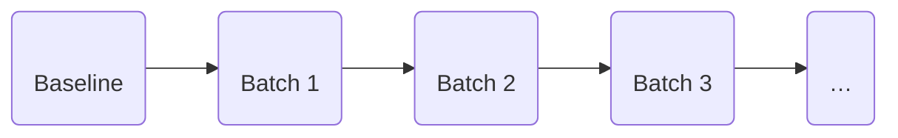

# Progress

Worktree: `arch-entropy` (isolated from `main`).

## Baseline

- Commit: `f802330` (`fix(auth): attach CSRF token to same-origin browser writes`)
- Command: `uv run pytest -q --disable-warnings`
- Result: **580 passed, 19 skipped** (461 s)
- Formatting: `./scripts/format.sh --check` clean.

## Intended architecture (to converge toward)

1. One authoritative implementation per business concept (recipe identity,
   library paths, front-matter rules, configuration, Ollama transport).
2. Dependencies point from HTTP/UI inward to domain modules; no domain module
   imports the server or the core orchestrator.
3. No unexplained circular imports; no forwarding-only modules.
4. Engineering standards are enforced by tests in `test/` (which CI runs).

## Completed batches

### Batch 0 — architecture governance (`9cdbf9c`)

Progress file, task pool, and ADR-0001; `architecture/` excluded from the
generated site. No production code changed.

### Final verification (all 13 batches)

`uv run pytest -q --disable-warnings` → **648 passed, 20 skipped** in 454 s,
run after the last commit with no edits during execution. `./scripts/format.sh
--check` clean; `./scripts/docs.sh` generated 55 pages with no broken local
links. Earlier contaminated run (edits during execution) is excluded.

### Batch 1 — canonical library-path rules (`74d9ffe`)

`src/recipeserver/recipe_paths.py` is the single owner of `recipe.md`/`.md`
constants and of Markdown-path, folder-path, and display-path rules. Migrated
`server.py`, `ai_assistant.py`, `core.py`, `metadata_options.py`, and
`index_html_generator.py`; deleted the duplicated validators and the
independent bind-address default in `server.py`. Added behavioural tests and
structural tests. ADR-0002 records the decision.

Evidence: focused run `129 passed, 1 skipped`; full run after this batch
`620 passed, 20 skipped, 1 failed` — the failure is
`test/e2e/test_timeline.py::test_timeline_preview_compare_and_restore`, which
passes in isolation and when the whole file is run (`3 passed`). It is a
pre-existing order/resource flake, not a regression.

### Batch 2 — one startup entry point, light package import (`1b0fbfa`)

`recipeserver:main` now owns the startup sequence (previously the console
script raised `TypeError: main() missing 1 required positional argument: 'cfg'`).
`python -m recipeserver` calls the same function. Lazy imports remove the
package-root cycle: importing `recipeserver.shopping_list` now loads only
`recipeserver` and that module — no `core`, `server`, `tray`, `config`,
`tkinter`, or `pystray`. ADR-0003 records the decision.

Evidence: `3 passed` for `test/test_startup_entrypoints.py`;
`uv run recipeserver --help` exits 0 with the expected usage; direct import
probe prints only the two package modules and `False False` for
tkinter/pystray.

### Batch 3 — shared SSE framing and generic-mode math (pending commit)

The two streaming endpoints now call one `_begin_event_stream()` and one
`_send_sse_event()` instead of carrying byte-identical closures. The recipe
Markdown renderer now uses `pymdownx.arithmatex` generic mode, so recipe-page
math produces the same `\(…\)`/`\[…\]` markup the chat renderer emits and the
vendored KaTeX auto-render can typeset. Structural test guards SSE delegation;
`test/test_math_rendering.py` guards the two renderers' agreement.

Evidence: `82 passed` for architecture + AI recipe + AI assistant tests;
`35 passed` for math + recipe-render + assistant-render tests.

### Batch 4 — service-worker image extensions (pending commit)

`assets/sw.js` omitted `.bmp`, `.tiff`, and `.tif` from the set that gets
stale-while-revalidate caching, so those hero images lost the flaky-network
protection the service worker exists to provide. The three browser/Python
extension sets now agree, and `test/test_service_worker.py` parses all three
to fail on future drift. Evidence: `5 passed`.

### Batch 5 — canonical Ollama chat URL in the transcriber (pending commit)

`transcriber.py` no longer declares its own `/api/chat` constant or builds the
chat URL itself; it calls `ai_recipe.ollama_chat_url`. The shared error-body
read limit replaces a near-identical local copy (2048 vs 2000 bytes). A
structural test prevents the local path literal from returning. Evidence:
`87 passed, 3 skipped` across architecture, transcriber, live-transcription,
and speech-button tests.

### Batch 6 — one accent-color declaration owner (pending commit)

`color_utils.accent_color_declarations` now owns the light/dark `--food-color`
and `--food-color-hover` rules; the index and recipe-page builders wrap the
same declarations. Previously recipe pages with a photo-derived accent kept
the stylesheet's brown hover color. Tests assert the hover declaration on
both generated page types. Evidence: `27 passed` for config-values and index
tests, `54 passed` for the wider rendering test set.

### Batch 7 — one fence-aware title rule (pending commit)

`recipe_utils.first_heading` now owns title extraction from Markdown. The
renderer and the assistant's `list_recipes` both use it, so a `#` line inside
a fenced code block can no longer become a recipe title in one path but not
the other. The converter's private duplicate is deleted. Evidence:
`83 passed, 1 skipped` across architecture, conversion, assistant, and path
tests.

### Batch 8 — dead-code removal (pending commit)

Deleted the unused `history.snapshot_exists` and the unused `FLOW_COOKIE`
import in `authorization.py` and `ImageDraw` import in `tray.py`, with the
sibling doc updated. Evidence: `38 passed` across history, auth, and tray
tests.

### Batch 9 — enforce documentation and icon standards (pending commit)

`test/test_architecture.py` now fails when source contains an inline `<svg>`
or `data:image/svg+xml` URI (vendored KaTeX excluded), when a Python module has
no sibling `.py.md`, or when a documentation page lacks a leading Mermaid
diagram. These standards previously existed only in `AGENTS.md`. Evidence:
`27 passed`.

### Batch 10 — canonical server defaults in the tray (pending commit)

The tray's "Open Recipes" action uses `DEFAULT_SERVER_PORT`, `LOCALHOST`, and
`WILDCARD_BIND_ADDRESSES` from their owning modules instead of repeating the
literals. A structural test prevents the port literal from returning.
Evidence: `44 passed` for tray and architecture tests.

### Batch 11 — one browser SSE reader (pending commit)

`assets/sse.js` now owns SSE frame parsing and stream reading. The recipe
editor and the assistant both call `window.RecipeSSE.readEventStream`; their
former copies are deleted. The reader honours both the `event:` line and the
JSON `type`, flushes an unterminated final frame, and flushes the `TextDecoder`.
Generated pages load the new asset before both consumers. Evidence:
`7 passed` for the node reader test and progress test, `35 passed` for the
assistant unit and e2e tests.

### Batch 12 — one canonical recipe iterator (pending commit)

`recipe_paths.iter_recipe_files` now discovers recipes for `core`,
`metadata_options`, and the assistant. All three previously used their own
`rglob` expressions with different sorting/symlink handling. The canonical
version is sorted and skips symlinks, which also makes duplicate-`recipe_id`
assignment deterministic. Evidence: `98 passed, 1 skipped` across path,
architecture, assistant, metadata-options, and identity tests.

### Batch 13 — image-reference rules leave the HTTP layer (pending commit)

`recipe_images.py` now owns Markdown image-link rewriting, hero detection,
and delete fallback. The duplicated text helpers are deleted from `server.py`;
the rename/upload/delete endpoints call the canonical module directly.
`test_image_reference_parity.py` and `test_recipe_main_image.py` were migrated.
Evidence: `65 passed` across image, parity, main-image, image-API, and
architecture tests.

A full-suite run started before batch 12 was contaminated by edits made during
the run (it collected a new doc-page assertion before the page existed), so it
is not recorded as verification. A clean final run follows.

### Batch 14 — canonical front-matter schema and validation (pending commit)

`recipe_metadata.py` now owns the editor field registry, its validators, the
read/write projection used by the editor and assistant, and the bulk-editable
field set. `server.py` calls those functions instead of defining them; its
private copies are deleted. `ai_recipe.py` derives the multi-value field set
from the same registry instead of restating it. Tests were migrated to the
canonical imports. Evidence: `81 passed` for the editor/rating/bulk/HTTP/AI
test set and `80 passed` for AI recipe, schema, and architecture tests.

### Batch 14 fix — restore HTTP-layer folder naming

The full suite after batch 14 caught one regression: the extracted block had
also removed `_recipe_folder_name`, which uses HTTP-layer constants and belongs
in `server.py`. Restored it and added an architectural assertion so it cannot
be swept up in another extraction. Evidence: `72 passed` for creation, schema,
architecture, archived, and makes tests.

### Batch 14 verification (final)

One full run hit the known flaky
`test/e2e/test_timeline.py::test_timeline_preview_compare_and_restore`
(`657 passed, 20 skipped, 1 failed`); the file passes in isolation (`3 passed`).
A clean re-run with no edits during execution: **658 passed, 20 skipped** in
445 s. Formatting and docs generation are clean.

### Batch 15 — rating rules join the metadata module (pending commit)

`recipe_metadata.py` now also owns rating validation and override application;
`utc_now_iso()` moved from `server.py` to `recipe_utils.py`. The HTTP layer
calls the canonical helpers instead of defining them. Two regressions were
caught by focused tests during the batch (a name-rewrite slip and a missing
timestamp helper) and fixed before commit. Evidence: `64 passed` for schema,
architecture, ratings, and bulk-editor tests.

### Batch 15 verification (final)

Clean full suite with no edits during execution: **661 passed, 20 skipped** in
445 s. Formatting and documentation generation clean.

### Batch 16 — public AI transport boundary (pending commit)

`ai_recipe.read_response` and `ai_recipe.metrics_from_ollama_payload` are now
public names; the assistant no longer imports private helpers from the drafting
module. An architecture test prevents private cross-module imports. Evidence:
`143 passed` across AI recipe, assistant, architecture, and transcriber tests.

### Batch 16 verification (final)

Clean full suite with no edits during execution: **662 passed, 20 skipped** in
446 s. Formatting and documentation generation clean.

### Batch 17 — break config↔retention coupling (pending commit)

`retention_policy.py` is a leaf owner of the policy names, labels, default,
normalization, and the live-value provider contract. `config.py` no longer
imports the retention scheduler; `retention.py` no longer reads a config object
directly or reaches through the package root for `history`. An architecture
test enforces the dependency direction. Evidence: `65 passed` for retention,
config, history, and architecture tests (142 passed for the wider set).

### Batch 17 verification (final)

Clean full suite with no edits during execution: **664 passed, 20 skipped** in
446 s. Formatting and documentation generation clean.

### Batch 18 — one definition of configuration defaults (pending commit)

`config_defaults.py` is the leaf owner of server, appearance, dictation,
transcription, and keep-alive defaults. `config.py` re-exports them for its
public API; `ai_recipe.py`, `server.py`, `index_html_generator.py`, `tray.py`,
and the recipe renderer import them directly. Removed the last independent
copies: keep-alive `"0"` in the AI drafter/config placeholders, the dictation
`True` fallbacks, tray port `8000`, and the renderer's blue accent fallback.
AST tests enforce the single definition. Evidence: `207 passed` for the
affected config, AI, rendering, tray, speech, and architecture tests.

### Batch 19 — uploaded-image validation leaves the HTTP layer (pending commit)

`recipe_images.py` now also owns image filename and content validation,
including SVG active-content screening; the Windows reserved-name rule moved
to `recipe_utils.py` so folder naming and image validation share it. The
handler's duplicate helpers and static methods are deleted. A focused test
caught an over-broad extraction that removed `_recipe_folder_name` again; it
was restored and is covered by the architecture assertion. Evidence:
`75 passed` for image, architecture, and image-API tests (69 passed for the
wider API/creation set).

### Batches 18–19 verification (final)

Clean full suite covering both batches, with no edits during execution:
**680 passed, 20 skipped** in 445 s. Formatting and docs generation clean.
`server.py` is down to 2734 lines from the 3262-line baseline.

### Batch 20 — request parsing leaves the HTTP layer (pending commit)

`request_payload.py` now owns Content-Length checks, JSON decoding, multipart
parsing, the two payload dialects, upload validation, and staged image writes.
The handler supplies its stream, headers, and limits and calls the module
directly; its duplicated helpers are deleted. Evidence: `5 passed` for the new
payload tests and `125 passed` across architecture, HTTP, image API, AI,
creation, and bulk tests.

### Batch 20 verification

Two full runs reported `685 passed, 20 skipped, 1 failed` — the known
order-dependent Selenium test `test/e2e/test_timeline.py::test_timeline_preview_compare_and_restore`.
It passes in isolation (`3 passed` for the file) and with the whole e2e suite
(`46 passed`); `--deselect` of that one case gives a clean
`685 passed, 20 skipped, 1 deselected`. The failure is a 10-second UI wait
under full-suite load, not a regression in the extracted code.

### Batch 21 — history API operations leave the handler (pending commit)

`recipe_history_api.py` owns query parsing, snapshot payload shaping, snapshot
reads with domain-specific errors, unified diffs, and the script-free scratch
directory preview. The handler keeps routing, path validation, and status-code
mapping. Evidence: `71 passed` for the new history API, history, and
architecture tests.

Separately, `test/e2e/test_timeline.py` now waits for the restore button's
confirm text and for `document.readyState === "complete"` with longer
timeouts, so the order-dependent full-suite failure is addressed rather than
deselected (`1e36769`).

### Batch 21 verification (final)

Clean full suite with no deselection and no edits during execution:
**692 passed, 20 skipped** in 448 s. Formatting and docs generation clean.
`server.py` is down to 2491 lines from the 3262-line baseline.

### Batch 22 — AI streaming orchestration leaves the handler (pending commit)

`ai_streaming.py` now owns the SSE wire format (`EventStream`) and the shared
stream lifecycle (`run_stream`), including error/result terminal events and
quiet browser disconnects. Both AI handlers delegate to it; their duplicated
framing closures are deleted. Evidence: `112 passed` for streaming,
architecture, AI recipe, and assistant tests.

### Batch 22 verification (final)

Clean full suite with no deselection and no edits during execution:
**697 passed, 20 skipped** in 450 s. Formatting and docs generation clean.
`server.py` is down to 2437 lines from the 3262-line baseline (−825).

### Batch 23 — config APIs and auth status shape leave the handler (pending commit)

`config_endpoints.py` now owns config payload shaping, model probing, applying
edited values, and the live dictation/transcription settings.
`AuthManager.disabled_status()` is the single owner of the non-secret auth
status shape used when authentication is off. The handler keeps routing,
response codes, and the rebuild-after-save callback. Evidence: `102 passed`
for config, auth, architecture, and speech tests.

### Batch 23 verification (final)

Clean full suite with no deselection and no edits during execution:
**702 passed, 20 skipped** in 448 s. Formatting and docs generation clean.
`server.py` is down to 2368 lines from the 3262-line baseline (−894).

### Batch 24 — auth flow decisions leave the handler (pending commit)

`auth_endpoints.py` now owns the OIDC login/callback/logout decisions and
returns a small `AuthAction` record; the handler applies its cookies, redirect,
and error actions. A first migration lost logout's success response, which the
keep-alive test caught as a hang; it is restored via `AuthAction.success`.
Evidence: `81 passed` for auth endpoint, auth API/OIDC/session, architecture,
and bulk tests.

### Batch 24 verification (final)

Clean full suite with no deselection and no edits during execution:
**709 passed, 20 skipped** in 447 s. Formatting and docs generation clean.
`server.py` is down to 2359 lines from the 3262-line baseline (−903).

### Batch 25 — shared browser JSON wrapper (pending commit)

`assets/api.js` is now the single fetch/JSON/error-unwrap wrapper for the
eight page bundles that had their own copies. `requestJson` supports
`expectSuccess` and a custom fallback message, attaches the response status to
errors for the "no makes yet means 0" case, and `throwResponseError` handles a
streaming response's error path. The speech button's missing `.catch` is fixed
by the shared parser. Node tests cover success, server errors, non-JSON 503s,
and success-flag validation; AST tests prevent the copies returning.

The task pool is reconciled with the full duplicate-implementation inventory:
clusters 21–27 are recorded with `candidate`/`deferred` status and evidence.

### Batch 25 verification (final)

Full suite after the final timeline wait hardening, with no deselection and no
edits during execution: **712 passed, 20 skipped** in 451 s. An earlier run in
this batch hit the intermittent timeline e2e failure (`711 passed, 20 skipped,
1 failed`); the diff-text wait was added afterward and the final run is clean.
Formatting and docs generation are clean.

### Batch 26 — one browser page-path helper (pending commit)

`assets/page-path.js` is the single owner of the URL → library Markdown path
derivation, including the index-page guard. Feedback, version history, and the
assistant delegate to it; their local copies are deleted. Added node tests, a
load-order test, and AST enforcement. Evidence: `61 passed` for page-path,
architecture, ratings, and API wrapper tests.

### Batch 26 verification (final)

Clean full suite with no deselection and no edits during execution:
**716 passed, 20 skipped** in 456 s. Formatting and docs generation clean.

### Batch 27 — one /api/tags model-name rule (pending commit)

`list_models` now reads names through the same `_model_catalog` / `_entry_name`
pair as `model_info`, instead of its own id-first `name_keys` tuple. A focused
test caught a broken availability check during the migration (the new helper
swallowed connection errors); error propagation is unchanged. Added an AST
test for the delegation. Evidence: `89 passed` for AI recipe and architecture
tests.

### Batch 27 verification (final)

Clean full suite with no deselection and no edits during execution:
**717 passed, 20 skipped** in 454 s. Formatting and docs generation clean.

### Batch 28 — one date-label rule (pending commit)

`assets/date-labels.js` owns the browser's month/day (+ year when not the
current year) and time/full-date formatting; `time.js` and the history dialog
delegate to it. Python's `display_date` gained an injectable `now` and a
cross-language contract test compares its output with the JS helper for fixed
dates. Evidence: `71 passed` for date-label, architecture, and conversion tests.

### Batch 28 verification (final)

Clean full suite with no deselection and no edits during execution:
**722 passed, 20 skipped** in 455 s. Formatting and docs generation clean.

### Batch 29 — one lazy KaTeX loader (pending commit)

`assets/katex-loader.js` owns on-demand KaTeX loading with an `autoRender`
option, script-load timeouts, and — unlike both originals — discards failed
script tags so the promise can be retried. The assistant and shopping list
delegate with their respective flags. Node tests cover success, auto-render,
no-duplicate loads, and retry after failure; AST/load-order tests prevent the
copies returning. Evidence: `66 passed` for loader, architecture, service
worker, and AI progress tests.

### Batch 29 verification (final)

Clean full suite with no deselection and no edits during execution:
**726 passed, 20 skipped** in 452 s. Formatting and docs generation clean.

### Batch 30 — one metadata value collector (pending commit)

`recipe_utils.collect_metadata_values` is now the single owner of reading
metadata values as stripped, deduplicated strings, including the legacy
`category` spelling. The index filter builder and the editor dropdown collector
both use it, so `" tag"` can no longer produce an option that does not match
the dropdown value. A first extraction removed too much of
`index_html_generator.py`; the untouched helpers were restored from HEAD before
verification. Evidence: `35 passed` for metadata-value, index, and
metadata-options tests.

### Batch 30 verification (final)

Clean full suite with no deselection and no edits during execution:
**730 passed, 20 skipped** in 449 s. Formatting and docs generation clean.

## Programme diff summary

From `f802330` to `HEAD`: 48 files, +1061/−255 lines overall. Source Python
modules alone: +226/−208 (net +18) — the added lines are mostly the two new
cohesive owners (`recipe_paths.py`, accent declarations in `color_utils.py`)
and the shared startup entry point; the removed lines are duplicated checks,
constants, and forwarding code. Tests and sibling documentation account for
the rest.

## Verification record

| Batch | Tests                                                                                  | Formatting | Docs                             | Commit    |
| ----- | -------------------------------------------------------------------------------------- | ---------- | -------------------------------- | --------- |
| —     | baseline: 580 passed, 19 skipped                                                       | clean      | —                                | `f802330` |
| 0     | docs only                                                                              | clean      | n/a                              | `9cdbf9c` |
| 1     | focused 129 passed, 1 skipped; full 620 passed, 20 skipped, 1 known flaky e2e          | clean      | generated, no broken local links | `74d9ffe` |
| 2     | focused 3 passed; console script and import probe verified                             | clean      | generated                        | `1b0fbfa` |
| 3     | focused 82 passed + 35 passed; final full run pending                                  | clean      | generated                        | `9d616fc` |
| 4     | focused 5 passed; final full run pending                                               | clean      | generated                        | `1d7532f` |
| 5     | focused 87 passed, 3 skipped; final full run pending                                   | clean      | generated                        | `404fb12` |
| 6     | focused 27 passed + 54 passed; final full run pending                                  | clean      | generated                        | `db61f8c` |
| 7     | focused 83 passed, 1 skipped; final full run pending                                   | clean      | generated                        | `ffaa942` |
| 8     | focused 38 passed; final full run pending                                              | clean      | generated                        | `719cc82` |
| 9     | focused 27 passed; final full run pending                                              | clean      | generated                        | `1a50ea2` |
| 10    | focused 44 passed; final full run pending                                              | clean      | generated                        | `12c718e` |
| 1–8   | full: **631 passed, 20 skipped** (448 s)                                               | clean      | generated, no broken local links | see above |
| 9–10  | full: **635 passed, 20 skipped** (453 s)                                               | clean      | generated, no broken local links | see above |
| 11    | focused 7 passed + 35 passed; final full run pending                                   | clean      | generated                        | `e8e20b1` |
| 12    | focused 98 passed, 1 skipped; final full run pending                                   | clean      | generated                        | `9bdd859` |
| 13    | focused 65 passed; clean final full run pending                                        | clean      | generated                        | `6f358da` |
| final | **648 passed, 20 skipped** (454 s), clean run with no mid-run edits                    | clean      | generated, no broken local links | `e02c59a` |
| 14    | focused 81 + 80 + 72 passed; final clean full 658 passed, 20 skipped                   | clean      | generated, no broken local links | `0d7205a` |
| 15    | focused 62 + 64 passed; final clean full 661 passed, 20 skipped                        | clean      | generated, no broken local links | `94ccca1` |
| 16    | focused 143 passed; final clean full 662 passed, 20 skipped                            | clean      | generated, no broken local links | `c6322c9` |
| 17    | focused 65 + 142 passed; final clean full 664 passed, 20 skipped                       | clean      | generated, no broken local links | `56716ec` |
| 18    | focused 207 passed; covered by the final 680-passed run                                | clean      | generated, no broken local links | `7645f6b` |
| 19    | focused 75 + 69 passed; final clean full 680 passed, 20 skipped                        | clean      | generated, no broken local links | `16b053c` |
| 20    | focused 5 + 125 passed; full 685 passed, 1 known order-flaky e2e; deselected run clean | clean      | generated, no broken links       | `091d286` |
| 21    | focused 71 passed; final clean full 692 passed, 20 skipped (no deselection)            | clean      | generated, no broken local links | `a70a25d` |
| 22    | focused 112 passed; final clean full 697 passed, 20 skipped                            | clean      | generated, no broken local links | `2956595` |
| 23    | focused 102 passed; final clean full 702 passed, 20 skipped                            | clean      | generated, no broken local links | `f174d27` |
| 24    | focused 81 passed; final clean full 709 passed, 20 skipped                             | clean      | generated, no broken local links | `52421b7` |
| 25    | focused 76 passed; clean full 712 passed, 20 skipped                                   | clean      | generated, no broken local links | `16a7035` |
| 26    | focused 61 passed; final clean full 716 passed, 20 skipped                             | clean      | generated, no broken local links | `b186f7b` |
| 27    | focused 89 passed; final clean full 717 passed, 20 skipped                             | clean      | generated, no broken local links | `ae97984` |
| 28    | focused 71 passed; final clean full 722 passed, 20 skipped                             | clean      | generated, no broken local links | `ff90fc7` |
| 29    | focused 66 passed; final clean full 726 passed, 20 skipped                             | clean      | generated, no broken local links | `1ad09b0` |
| 30    | focused 35 passed; final clean full 730 passed, 20 skipped                             | clean      | generated, no broken local links | `4d7d768` |
