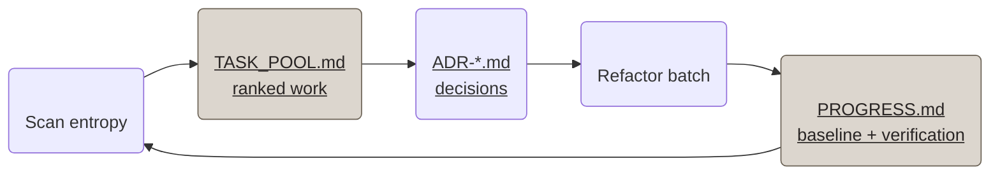

# Architecture governance

This directory is the working record for the ongoing architectural-entropy
reduction programme. It is excluded from the generated documentation site
(`.barnacle.json`) because it records the _process_, not the product.

- [PROGRESS.md](PROGRESS.md) — baseline, completed batches, verification evidence.
- [TASK_POOL.md](TASK_POOL.md) — ranked candidate work, with status.
- [ADR-0001](ADR-0001-architecture-governance.md) — why this record exists and how batches are structured.
