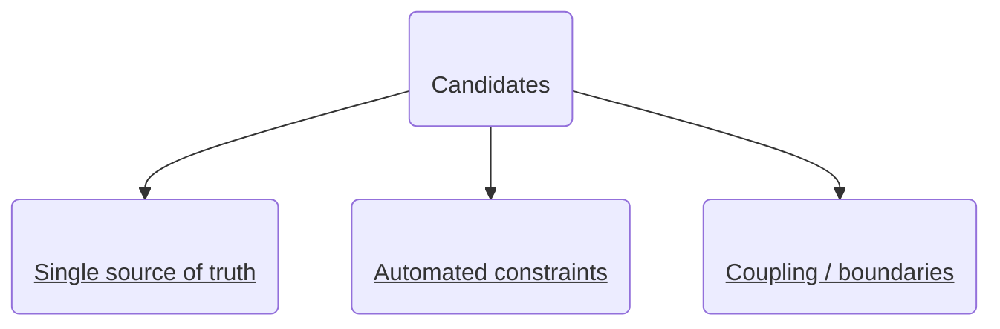

# Optimization task pool

Ranked by (risk reduction × maintenance saving) / migration cost. Status values:
`candidate`, `in-progress`, `done`, `deferred`, `rejected`.

| #   | Task                                                                                                                                                                                                                                                                                         | Evidence                                                                                                        | Status                     |
| --- | -------------------------------------------------------------------------------------------------------------------------------------------------------------------------------------------------------------------------------------------------------------------------------------------- | --------------------------------------------------------------------------------------------------------------- | -------------------------- |
| 1   | Canonical library-path rules: one owner for `recipe.md`/`.md` constants, relative-path validation, and relative display paths. `server`, `ai_assistant`, `core`, and `metadata_options` each implement part of this today; the assistant's helper even says it "mirrors the server's rules". | `server.py` 133–134, 3050–3079; `ai_assistant.py` 230–254, 273; `core.py` 75, 213; `metadata_options.py` 105    | candidate                  |
| 2   | Enforce architectural rules in CI via tests: no import cycles, no domain→server/core imports, no forwarding-only wrappers, canonical path/metadata constants.                                                                                                                                | `.github/workflows/check-formatting.yml` runs pytest; no architecture checks exist                              | candidate                  |
| 3   | Consolidate Ollama endpoint/path constants and chat-URL construction; `transcriber.py` redefines `/api/chat` and builds the URL itself while importing the normalizer from `ai_recipe.py`.                                                                                                   | `ai_recipe.py` 58–60, 251–260; `transcriber.py` 65, 165–167                                                     | candidate                  |
| 4   | Canonical front-matter/metadata rules: `recipe_utils.py` already owns `categories`, source, identity, and rating helpers, but `server.py`, `ai_recipe.py`, and `ai_assistant.py` still carry parallel validation/normalization.                                                              | `recipe_utils.py` 18–35, 142–185; `server.py` 294–474, 535–655; `ai_recipe.py` 1038–1065; `ai_assistant.py` 474 | candidate                  |
| 5   | Image-reference manipulation (`_first_image_reference`, `_replace_image_reference`, `_fallback_main_image`) is HTTP-layer code with no HTTP concerns; give it a domain owner.                                                                                                                | `server.py` 656–766                                                                                             | candidate                  |
| 6   | `server.py` (3262 lines) owns routing, parsing, validation, file writes, history, images, AI streaming, and config. Decompose along cohesive boundaries without creating forwarding shells.                                                                                                  | `server.py` function inventory                                                                                  | deferred (large)           |
| 7   | Remove stale `__pycache__` artefacts whose `.py` sources no longer exist (build noise; not source-of-truth).                                                                                                                                                                                 | `_shared_core`, `whisper_server`, `pallette` .pyc files                                                         | deferred (generated files) |
| 8   | Record product decisions, major architectural changes, and breaking migrations as pending confirmation.                                                                                                                                                                                      | programme constraint                                                                                            | candidate                  |

## Pending confirmation (no action without user decision)

- None yet.
