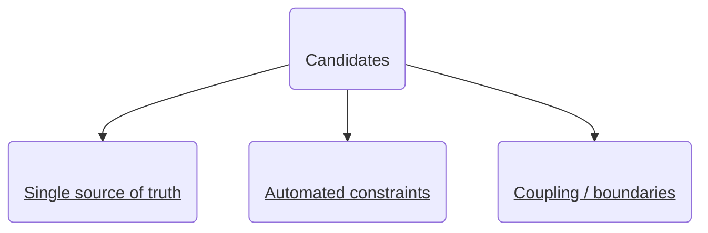

# Optimization task pool

Ranked by (risk reduction × maintenance saving) / migration cost. Status values:
`candidate`, `in-progress`, `done`, `deferred`, `rejected`.

| #   | Task                                                                                                                                | Evidence                                                                 | Status            |
| --- | ----------------------------------------------------------------------------------------------------------------------------------- | ------------------------------------------------------------------------ | ----------------- |
| 1   | Canonical library-path rules (`recipe_paths.py`) and one definition of `recipe.md`/`.md`; migrate all callers.                      | `server.py`, `ai_assistant.py`, `core.py`, `metadata_options.py`         | done (batch 1)    |
| 2   | Architecture tests in CI: canonical constants, path-rule delegation, domain modules not importing higher layers, SSE delegation.    | `test/test_architecture.py`                                              | partial (1 + 3)   |
| 3   | Remove the package-root import cycle and fix the broken console entry point.                                                        | `__init__.py`, `__main__.py`, `test/test_startup_entrypoints.py`         | done (batch 2)    |
| 4   | One canonical SSE writer: `_stream_ai_recipe` and `_stream_ai_assistant` duplicate the framing helper byte-for-byte.                | `server.py` `_begin_event_stream` / `_send_sse_event`                    | done (batch 3)    |
| 5   | One browser SSE reader: editor ignores `event:` and flushes the tail; assistant uses `event:` and drops an unterminated tail.       | `recipe-editor.js:260-309`; `ai-assistant.js:1076-1135`                  | candidate         |
| 6   | Consolidate Ollama URL constants and chat payload construction; `transcriber.py` redefines `OLLAMA_CHAT_PATH`.                      | `ai_recipe.py`; `transcriber.py`; `test/test_architecture.py`            | partial (batch 5) |
| 7   | One canonical service-worker image extension set; `sw.js` omitted `bmp`/`tiff`/`tif` relative to `image_handler.IMAGE_EXTENSIONS`.  | `sw.js`; `image_handler.py`; `test/test_service_worker.py`               | done (batch 4)    |
| 8   | One accent/style helper: recipe pages never set `--food-color-hover`; index does; third blue fallback in `image_handler.py`.        | `page.py:76-96`; `index_html_generator.py:797-812`; `image_handler.py:6` | candidate         |
| 9   | Fence-aware title extraction shared by converter and assistant; assistant treats `#` headings inside code fences as titles.         | `converter.py:38-56`; `ai_assistant.py:102,236-241`                      | candidate         |
| 10  | One Markdown renderer configuration: generic arithmatex markup for both recipe pages and chat.                                      | `converter.py`; `assistant_render.py`; `test/test_math_rendering.py`     | done (batch 3)    |
| 11  | One `iter_recipe_files(root)` used by core/metadata-options/assistant; sorting and symlink handling currently differ.               | `core.py:214`; `metadata_options.py:101-106`; `ai_assistant.py:244-252`  | candidate         |
| 12  | Canonical config defaults at consumption sites: port `8000` in `tray.py`, keep-alive `"0"` placeholders, dictation booleans.        | `tray.py:53`; `config.py:54`; `config-editor.js:126`                     | candidate         |
| 13  | Canonical metadata rules: `recipe_utils.py` owns categories/source/identity, but server/ai modules carry parallel validators.       | `recipe_utils.py`; `server.py:294-655`; `ai_recipe.py:1038-1065`         | deferred (large)  |
| 14  | Image-reference manipulation moved out of the HTTP layer into a domain owner.                                                       | `server.py:656-766`                                                      | candidate         |
| 15  | `server.py` (3262 lines) owns routing, parsing, writes, history, images, AI streaming, config; decompose without forwarding shells. | `server.py` function inventory                                           | deferred (large)  |
| 16  | Remove dead code: `history.snapshot_exists` and unused imports (`FLOW_COOKIE` in `authorization.py`, `ImageDraw` in `tray.py`).     | dependency map DEAD-CODE                                                 | candidate         |
| 17  | Enforce "no inline SVG / data:image/svg+xml" and sibling-doc/Mermaid rules with repository tests.                                   | config/state map ENFORCEMENT                                             | candidate         |
| 18  | Record product decisions, major architectural changes, and breaking migrations as pending confirmation.                             | programme constraint                                                     | candidate         |

Rejected: stale `__pycache__` cleanup — a full scan found every `.pyc` has a
matching `.py` source; the suspected orphans were build noise, not source.

## Pending confirmation (no action without user decision)

- None yet.
