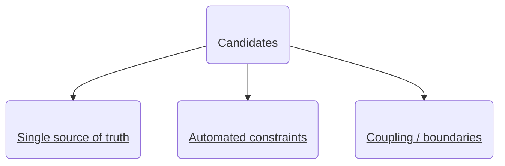

# Optimization task pool

Ranked by (risk reduction × maintenance saving) / migration cost. Status values:
`candidate`, `in-progress`, `done`, `deferred`, `rejected`.

| #   | Task                                                                                                                                | Evidence                                                                                                                          | Status               |
| --- | ----------------------------------------------------------------------------------------------------------------------------------- | --------------------------------------------------------------------------------------------------------------------------------- | -------------------- |
| 1   | Canonical library-path rules (`recipe_paths.py`) and one definition of `recipe.md`/`.md`; migrate all callers.                      | `server.py`, `ai_assistant.py`, `core.py`, `metadata_options.py`                                                                  | done (batch 1)       |
| 2   | Architecture tests in CI: canonical constants, path-rule delegation, domain modules not importing higher layers, SSE delegation.    | `test/test_architecture.py`                                                                                                       | done (batches 1–25)  |
| 3   | Remove the package-root import cycle and fix the broken console entry point.                                                        | `__init__.py`, `__main__.py`, `test/test_startup_entrypoints.py`                                                                  | done (batch 2)       |
| 4   | One canonical SSE writer: `_stream_ai_recipe` and `_stream_ai_assistant` duplicate the framing helper byte-for-byte.                | `server.py` `_begin_event_stream` / `_send_sse_event`                                                                             | done (batch 3)       |
| 5   | One browser SSE reader: editor ignores `event:` and flushes the tail; assistant uses `event:` and drops an unterminated tail.       | `assets/sse.js`; `test/js/sse_test.js`; `test/test_sse_reader.py`                                                                 | done (batch 11)      |
| 6   | Consolidate Ollama URL constants and chat payload construction; `transcriber.py` redefines `OLLAMA_CHAT_PATH`.                      | `ai_recipe.py`; `transcriber.py`; `ai_assistant.py`; `test/test_architecture.py`                                                  | done (5 + 16)        |
| 7   | One canonical service-worker image extension set; `sw.js` omitted `bmp`/`tiff`/`tif` relative to `image_handler.IMAGE_EXTENSIONS`.  | `sw.js`; `image_handler.py`; `test/test_service_worker.py`                                                                        | done (batch 4)       |
| 8   | One accent/style helper: recipe pages never set `--food-color-hover`; index does; third blue fallback in `image_handler.py`.        | `color_utils.accent_color_declarations`; `test/test_config_values.py`                                                             | done (batch 6)       |
| 9   | Fence-aware title extraction shared by converter and assistant; assistant treats `#` headings inside code fences as titles.         | `recipe_utils.first_heading`; `test/test_architecture.py`                                                                         | done (batch 7)       |
| 10  | One Markdown renderer configuration: generic arithmatex markup for both recipe pages and chat.                                      | `converter.py`; `assistant_render.py`; `test/test_math_rendering.py`                                                              | done (batch 3)       |
| 11  | One `iter_recipe_files(root)` used by core/metadata-options/assistant; sorting and symlink handling currently differ.               | `recipe_paths.iter_recipe_files`; `test/test_recipe_paths.py`                                                                     | done (batch 12)      |
| 12  | Canonical config defaults at consumption sites: port `8000` in `tray.py`, keep-alive `"0"` placeholders, dictation booleans.        | `config_defaults.py`; `test/test_architecture.py`                                                                                 | done (batch 18)      |
| 13  | Canonical metadata rules: `recipe_utils.py` owns categories/source/identity, but server/ai modules carry parallel validators.       | `recipe_metadata.py`; `test/test_recipe_metadata.py`                                                                              | done (batch 14)      |
| 14  | Image-reference manipulation moved out of the HTTP layer into a domain owner.                                                       | `recipe_images.py`; `test/test_recipe_images.py`                                                                                  | done (batch 13)      |
| 15  | `server.py` (3262 lines) owns routing, parsing, writes, history, images, AI streaming, config; decompose without forwarding shells. | `request_payload`, `recipe_images`, `recipe_history_api`, `ai_streaming`, `config_endpoints`, `auth_endpoints`, `recipe_metadata` | done (13, 14, 19–24) |
| 16  | Remove dead code: `history.snapshot_exists` and unused imports (`FLOW_COOKIE` in `authorization.py`, `ImageDraw` in `tray.py`).     | dependency map DEAD-CODE                                                                                                          | done (batch 8)       |
| 17  | Enforce "no inline SVG / data:image/svg+xml" and sibling-doc/Mermaid rules with repository tests.                                   | `test/test_architecture.py`                                                                                                       | done (batch 9)       |
| 18  | Record product decisions, major architectural changes, and breaking migrations as pending confirmation.                             | `architecture/ADR-*.md`; no pending confirmations                                                                                 | done                 |
| 19  | Break config↔retention coupling with a leaf policy module and a provider contract.                                                  | `retention_policy.py`; `test/test_architecture.py`                                                                                | done (batch 17)      |
| 20  | Shared browser `requestJson` wrapper for the eight fetch/JSON bundles (speech button forgot `.catch`).                              | `assets/api.js`; `test/js/api_test.js`                                                                                            | done (batch 25)      |
| 21  | One lazy KaTeX loader: assistant retries after failure, shopping list keeps a rejected promise forever.                             | `assets/katex-loader.js`; `test/js/katex_loader_test.js`; `test/test_katex_loader.py`                                             | done (batch 29)      |
| 22  | One page URL → Markdown path helper (feedback, timeline, assistant).                                                                | `assets/page-path.js`; `test/js/page_path_test.js`; `test/test_page_path.py`                                                      | done (batch 26)      |
| 23  | One date/time label formatter (Python `display_date`, `time.js`, timeline `dateLabel`).                                             | `assets/date-labels.js`; `recipe_utils.display_date(now=…)`; cross-language contract test                                         | done (batch 28)      |
| 24  | One metadata value collector: index trims values, metadata-options strips; `" tag"` can miss the dropdown.                          | `recipe_utils.collect_metadata_values`; `test/test_metadata_values.py`                                                            | done (batch 30)      |
| 25  | Shared focus-ring/status-pill CSS utilities instead of ~40 repeated rules.                                                          | `definitions.css`; component CSS files                                                                                            | deferred (cosmetic)  |
| 26  | One model-name probe: `list_models` (id-first) vs `_model_catalog` (name-first) read `/api/tags` differently.                       | `ai_recipe.list_models` now uses `_model_catalog`; AST test                                                                       | done (batch 27)      |
| 27  | One dictation controller for search button and assistant composer (different labels/insertion policies).                            | `assets/dictation.js`; `test/js/dictation_test.js`; `test/test_dictation_controller.py`                                           | done (batch 31)      |

Rejected: stale `__pycache__` cleanup — a full scan found every `.pyc` has a
matching `.py` source; the suspected orphans were build noise, not source.

## Pending confirmation (no action without user decision)

- None yet.
