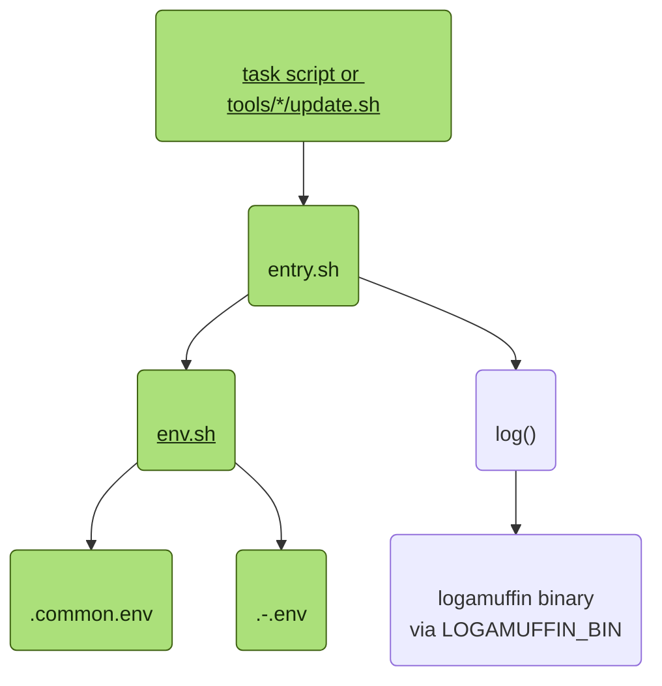

# The script entry point (`scripts/entry.sh`)



Every repository script sources `scripts/entry.sh` instead of the individual cascade files, because it does two jobs at once:

1. **It loads the environment** — it sources [env.sh.md](env.sh.md), which sources the hidden cascade (`.common.env` plus the platform file).
2. **It defines `log()`** — the shared logging function used by the scripts and by the `tools/` (`tools/README.md`) update scripts.

It is sourced, never executed, and works from both bash and zsh (it locates itself via `$BASH_SOURCE[0]` in bash and `$0` in zsh).

## `log()` semantics

`log LEVEL MESSAGE...` forwards to the pinned logamuffin binary (`tools/logamuffin/update.sh.md`) referenced by `LOGAMUFFIN_BIN`. The caller context is passed through in `LOG_SOURCE` (`file[:function]:line`), and logamuffin's own exit code (`0`, or `2` for usage/config errors) is preserved even under `set -e`.

When the binary is missing (a fresh clone before tools are populated), `log()` falls back to a `printf` implementation with the same call shape, word-to-severity mapping (TRACE…ALWAYS → numeric thresholds), `LOG_LEVEL`/`LOGAMUFFIN_LEVEL` filtering, and stream routing (ERROR and above to stderr). The fallback exits `2` when called with no arguments. LEVEL may be a word (`INFO`) or a number (`50`).

## Usage

```bash
#!/usr/bin/env bash
set -euo pipefail
SCRIPT_DIR=$(cd -- "$(dirname -- "${BASH_SOURCE[0]}")" && pwd)   # repo root
if [[ ! -f "$SCRIPT_DIR/scripts/entry.sh" ]]; then ... fi
. "$SCRIPT_DIR/scripts/entry.sh"   # as used by scripts/serve.sh, scripts/format.sh, scripts/spawn-runners.sh
```

Scripts inside `scripts/` source it as `"$SCRIPT_DIR/entry.sh"` instead (see [version.sh.md](version.sh.md)).

## Related pages

- [env.sh.md](env.sh.md) — the cascade `entry.sh` loads
- [version.sh.md](version.sh.md) · [docs.sh.md](docs.sh.md) — scripts that source it
- `tools/logamuffin/update.sh.md` — the binary behind `log()` (not rendered in the site)
