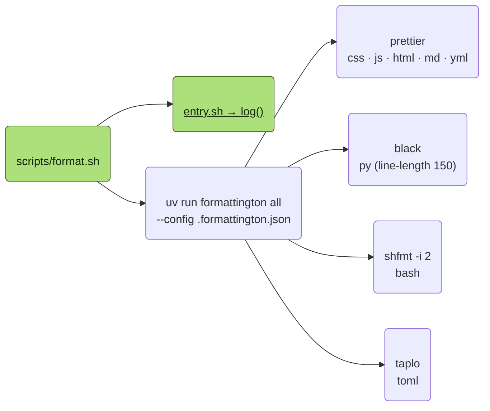

# The format script (`scripts/format.sh`)



Runs [formattington](https://github.com/fordaj/formattington) over the repository with logging via logamuffin. It is the repo's one-command formatter.

## Usage

```bash
./scripts/format.sh [--check] [...]
```

All arguments are forwarded to `uv run formattington <args> all --config .formattington.json`. In practice: `./scripts/format.sh` to format, `./scripts/format.sh --check` for a dry-run check.

The committed `.formattington.json` declares four commands: `prettier` (CSS/JS/HTML/Markdown/YAML), `black` (Python; line-length 150 in `pyproject.toml` `[tool.black]`), `shfmt -i 2` (Bash), and `taplo` (TOML). As described in the root README and AGENTS.md, SVG icons under `src/recipeserver/assets/` are formatted with Prettier's HTML parser, and vendored KaTeX under `assets/katex/` is excluded via `.prettierignore`. `prettier` is PATH-only (`npm install -g prettier`) and `taplo` is expected on PATH; if a tool is missing, formattington exits `127` for that command.

Before formatting, the script sources [scripts/entry.sh](entry.sh.md) for the `log()` helper, then `cd`s to the repository root so `--config .formattington.json` resolves regardless of the caller's directory.

## Related pages

- [scripts/entry.sh.md](entry.sh.md) · [scripts/env.sh.md](env.sh.md)
- `tools/formattington-lite/update.sh.md` — the pinned fallback binary (not rendered in the site)
- [README.md](../README.md) — the Formattington background
