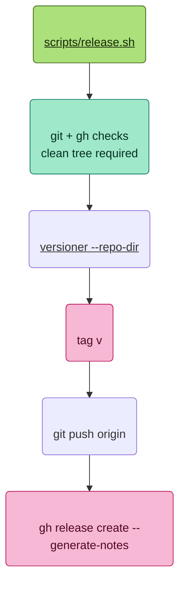

# The release script (`scripts/release.sh`)



Computes the next version with versioner (dogfooding the bundled binary), tags `HEAD`, pushes the tag, and creates a GitHub release — for version tracking only. Unlike the Versioner and Logamuffin tools, RecipeServer ships no binaries or archives in its releases: no `.exe` uploads, no zip archives, just a tag and auto-generated release notes (`gh release create … --generate-notes`).

## Usage

```bash
scripts/release.sh             # compute version, tag, push, gh release create
scripts/release.sh --dry-run   # compute + verify only, touch nothing remote
```

`--dry-run`/`-n` allows a dirty working tree and skips `gh`; a real release requires a clean working tree, `git`, and `gh` authenticated via `gh auth login`. Unknown arguments are a usage error (exit `2`).

## What it does

1. Sources the env cascade via [entry.sh.md](entry.sh.md). Logging goes through `log()` (logamuffin, with the printf fallback).
2. Verifies `git` (and, for a real release, `gh` authentication), finds the repository root with `git rev-parse --show-toplevel`.
3. Requires a clean working tree; `--dry-run` only warns. Fetches tags from origin (warning only in `--dry-run`).
4. Resolves `VERSIONER_BIN` (via the cascade or PATH), checks it is executable, prints its version, and computes the next `VERSION`/`TAG` by running versioner against the repo root. The tag must match `vX.Y.Z.W.V`.
5. Refuses to proceed if the tag already exists locally or on origin.
6. Creates an annotated tag `v<version>`, pushes it, and runs `gh release create <tag> --title "recipeserver <tag>" --generate-notes` (version tracking only, no assets). If a release for the tag already exists, it errors out noting the tag was pushed.

## Caveat

None currently. The entry-point check resolves the repository root as the parent of the `scripts/` directory (the same idiom as the other scripts), so `$SCRIPT_DIR/scripts/entry.sh` points at the real cascade.

## Related pages

- [version.sh.md](version.sh.md) — prints the same computed version
- `tools/versioner/update.sh.md` — refreshing the bundled versioner (not rendered in the site)
- [env.sh.md](env.sh.md) · [entry.sh.md](entry.sh.md)
