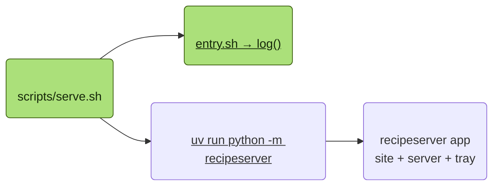

# The serve script (`scripts/serve.sh`)



Starts the local recipe server. On Windows, use `serve.bat` instead (a two-line wrapper around the same `uv run python -m recipeserver`); this document covers the bash path only.

## Usage

```bash
./scripts/serve.sh
```

Sources [scripts/entry.sh](entry.sh.md) — which loads the [env cascade](env.sh.md) and defines the logamuffin-backed `log()` — then `cd`s to the repository root and `exec`s:

```bash
uv run python -m recipeserver
```

The module entry point is [src/recipeserver/**main**.py](../src/recipeserver/__main__.py.md): it parses `--log-level` (pass it through with `uv run python -m recipeserver --log-level DEBUG`; `scripts/serve.sh` forwards no arguments), handles configuration, builds the site, and starts the tray server on the configured port (default `http://localhost:8000`).

Requires `uv`; on first launch the app asks you to choose the recipes directory (or writes `recipe-server-cfg.toml` for you). Runtime logs go to `.logs/` in the directory the app was started from.

## Related pages

- [scripts/entry.sh.md](entry.sh.md) · [scripts/env.sh.md](env.sh.md)
- [src/recipeserver/**main**.md](../src/recipeserver/__main__.py.md) · [src/recipeserver/core.py.md](../src/recipeserver/core.py.md)
- [README.md](../README.md) — usage from the user's perspective
