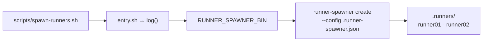

# The runner-spawner script (`scripts/spawn-runners.sh`)



Creates the repository-scoped self-hosted CI runners described by `.runner-spawner.json` (two runners, `runner01`/`runner02`, registered to `fordaj/RecipeServer`, installed under `.runners/`, gitignored). The runners are used by the `.github/workflows/check-formatting.yml` "PR Checks" workflow that runs on macOS and Windows.

## Usage

```bash
./scripts/spawn-runners.sh                # create the runners in .runner-spawner.json
./scripts/spawn-runners.sh --dry-run      # print what would happen, change nothing
./scripts/spawn-runners.sh <flags...>     # any additional runner-spawner create flags
```

Sources [scripts/entry.sh](entry.sh.md) to resolve `RUNNER_SPAWNER_BIN` (bundled via `tools/runner-spawner/update.sh.md`) and the `log()` helper, then runs:

```bash
runner-spawner create --config .runner-spawner.json "$@"
```

from the repository root. Extra arguments are forwarded to the binary.

## Details worth knowing

- The script `unset`s `RUNNER_SPAWNER_REPO` and `RUNNER_SPAWNER_OWNER` before invoking the binary: those selectors are read by runner-spawner as the _target_ repository, and a stale value in the caller's shell would override `.runner-spawner.json` and the git remote. An explicit `--owner`/`--repo` flag (forwarded through `"$@"`) still wins.
- It fails with a clear error when the binary or `.runner-spawner.json` is missing, or when the binary is not executable.
- runner-spawner is macOS/Windows only, and requesting the registration token requires `gh` to be authenticated (or `--token`). On Linux the bundled binary still ships but reports unsupported (see [scripts/env.sh.md](env.sh.md)).

## Related pages

- `tools/runner-spawner/update.sh.md` — refreshing the bundled binary (not rendered in the site)
- [scripts/entry.sh.md](entry.sh.md) · [scripts/env.sh.md](env.sh.md)
- [README.md](../README.md) — the bundled-tooling overview
