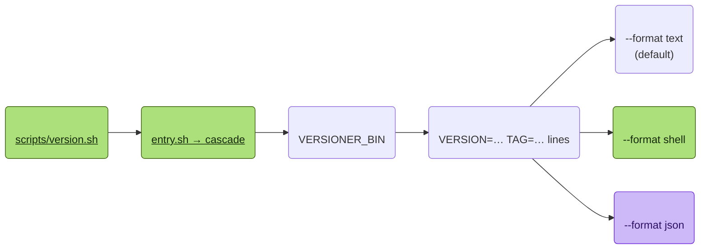

# The version script (`scripts/version.sh`)



Prints the version of this repository as computed by the pinned versioner bundle (`tools/versioner/update.sh.md`) — the same computation the release pipeline uses, so a local build and the published tag can never drift apart.

## Usage

```bash
scripts/version.sh                 # VERSION=<v> and TAG=<t> lines (default)
scripts/version.sh --format shell  # export VERSION=... and export TAG=...
scripts/version.sh --format json   # the raw versioner JSON document
```

`--format` accepts `text` (default), `shell`, or `json`; `json` passes `--format json` through to versioner. `--format` requires a value; `--help`/`-h` prints usage. Unknown arguments are a usage error (exit `2`).

## How it works

Sources [entry.sh.md](entry.sh.md) for the cascade and `log()`. If `VERSIONER_BIN` is unset or not executable, it fails with `no versioner binary found (run tools/versioner/update.sh or set VERSIONER_BIN)` (exit `1`). Otherwise it runs `versioner --repo-dir <root> --quiet [--format json]`; the repository root defaults to `VERSIONER_REPO_DIR`, then `REPO_ROOT_DIR` (set by the cascade), then the parent of `scripts/`.

For `text` and `shell` it parses the `VERSION=` and `TAG=` lines out of the versioner output; unparseable output is an error (exit `1`).

## Consumers

- `scripts/release.sh` — computes the next tag for a release ([release.sh.md](release.sh.md)).
- `.versioner.json` configures versioner for this repository (`tagPattern: "v[0-9]*"`, `defaultBranchVersion: 254`, `exemptBranches: { "main": 0 }`) — read by versioner itself, referenced here for completeness.

## Related pages

- [entry.sh.md](entry.sh.md) · [env.sh.md](env.sh.md)
- [release.sh.md](release.sh.md) — the release pipeline
