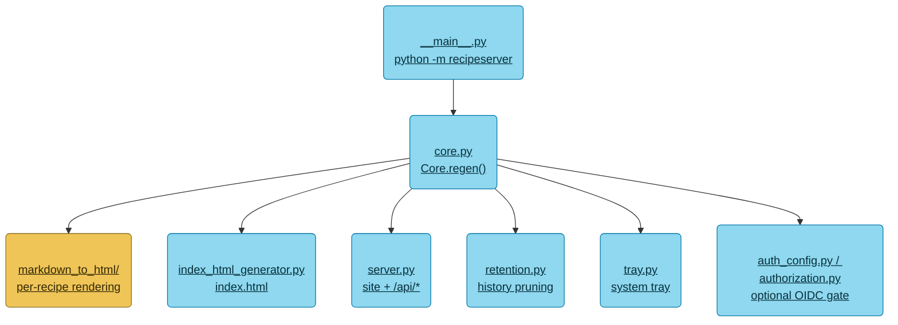

# The `recipeserver` package

All of RecipeServer's implementation lives here: the startup pipeline, the `recipe.md` → HTML renderers, the index generator, the HTTP server, the tray, and the asset tree. The console script declared in `pyproject.toml` (`recipeserver = "recipeserver:main"`) resolves through this package.

Looking for the big picture? Start with the root [README.md](../../README.md) and [AGENTS.md](../../AGENTS.md). To render this documentation, see [scripts/docs.sh.md](../../scripts/docs.sh.md).

## Entry points and startup

- [**init**.py](__init__.py.md) — re-exports `core` at package scope (console script target)
- [**main**.py](__main__.py.md) — `python -m recipeserver`
- [core.py](core.py.md) — startup, site regeneration, parallel conversion
- [config.py](config.py.md) — the TOML configuration, legacy migration, Tk folder picker, prompt loading
- [_logger.py](_logger.py.md) — loguru setup (`setup_logger`, `LogLevel`)
- [_version.py](_version.py.md) — `PACKAGE_VERSION`, `versioned_asset_url`

## Rendering pipeline

- [markdown_to_html/**init**.py](markdown_to_html/__init__.py.md) — package exports (`MarkdownToHTMLConverter`, `VERSION`)
- [markdown_to_html/converter.py](markdown_to_html/converter.py.md) — orchestrates the recipe-page stages
- [markdown_to_html/page.py](markdown_to_html/page.py.md) — the HTML page shell
- [markdown_to_html/quantities.py](markdown_to_html/quantities.py.md) — inline-code quantities → scaler spans
- [markdown_to_html/overview.py](markdown_to_html/overview.py.md) — rating/makes/difficulty/meals strip
- [markdown_to_html/extras.py](markdown_to_html/extras.py.md) — contributor, sources, and version blocks
- [markdown_to_html/feedback.py](markdown_to_html/feedback.py.md) — comments and ratings sections
- [markdown_to_html/icons.py](markdown_to_html/icons.py.md) — asset SVG loading
- [index_html_generator.py](index_html_generator.py.md) — the searchable/sortable index and metadata warnings
- [image_handler.py](image_handler.py.md) — supported images, hero selection, accent colors
- [color_utils.py](color_utils.py.md) — dark-mode accent remapping

## Optional authentication

- [auth_config.py](auth_config.py.md) — environment/TOML/default precedence, validation, persistent signing secret
- [oidc.py](oidc.py.md) — discovery, PKCE, state/nonce, ID-token verification
- [session.py](session.py.md) — signed cookies, expiry, CSRF token
- [authorization.py](authorization.py.md) — None/View/Edit permissions, Owner privilege, central request gate

## HTTP and editing

- [server.py](server.py.md) — `ThreadingHTTPServer`, the `/api/*` routes
- [recipe_paths.py](recipe_paths.py.md) — canonical library-relative path rules and recipe filename constants
- [recipe_images.py](recipe_images.py.md) — image-reference rewriting in recipe Markdown
- [recipe_metadata.py](recipe_metadata.py.md) — front-matter field registry and validation
- [history.py](history.py.md) — recipe revision history (immutable snapshots in the user-data directory)
- [retention.py](retention.py.md) — timeline revision retention policies (GFS / Unlimited) that prune snapshots
- [transcriber.py](transcriber.py.md) — Ollama Qwen3-ASR transcription for the dictation button
- [ai_recipe.py](ai_recipe.py.md) — optional Ollama integration, recipe drafting
- [ai_assistant.py](ai_assistant.py.md) — optional Ollama chat assistant behind the floating bubble
- [assistant_render.py](assistant_render.py.md) — sanitized Markdown rendering for the chat messages (shared recipe pipeline)
- [metadata_options.py](metadata_options.py.md) — in-use metadata and feedback-name values for the dropdowns
- [metadata_linter.py](metadata_linter.py.md) — required-field warnings
- [recipe_utils.py](recipe_utils.py.md) — shared metadata/JSON/markup helpers
- [sources.py](sources.py.md) — shared `source` front-matter rendering rules
- [shopping_list.py](shopping_list.py.md) — ingredient scraping for the shopping list
- [archive.py](archive.py.md) — on-demand 7z archives of source/site
- [menu.py](menu.py.md) — the sandwich menu markup
- [tray.py](tray.py.md) — the pystray tray icon

## Also in this tree

- `NewRecipePrompt.md`, `NewRecipeFromImagePrompt.md`, `FindOneForMePrompt.md`, `AssistantPrompt.md` — model prompts, loaded at startup (the assistant reads `AssistantPrompt.md` on every request), not rendered as documentation
- `TranscriptionTestSample.wav` — a bundled speech sample ("Add two cups of flour and one cup of sugar.") the Configuration dialog's **Test transcription** button posts through the transcription path to verify the configured Ollama server and model work
- `assets/` — CSS, JavaScript, icons, fonts, and the vendored KaTeX distribution under `assets/katex/` (third-party; not documented file-by-file)

## Testing

Tests live in `test/` (pytest) and run with `uv run pytest`; they cover the renderers, the APIs, and the tray, and are not documented page-by-page.
