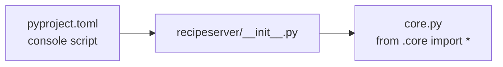

# The package initializer (`src/recipeserver/__init__.py`)

One line: `from .core import *`. It re-exports the public names of [core.py.md](core.py.md) — the `Core` class, `main`, `parse_args`, `get_worker_count`, and the worker-count/poll constants — at package scope.

This is what makes the `recipeserver` console script declared in `pyproject.toml` (`recipeserver = "recipeserver:main"`) work: the entry point resolves `main` straight off the package.

Note the import has side effects you should be aware of: importing `recipeserver` imports `core`, which imports `server`, `tray`, `index_html_generator`, and the rest of the stack, including `pystray` and `tkinter` via `config`. Importing the package is not import-light.

## Related pages

- [core.py.md](core.py.md) — the startup pipeline and `Core`
- [**main**.md](__main__.py.md) — `python -m recipeserver` entry
- [README.md](README.md) — the package hub
