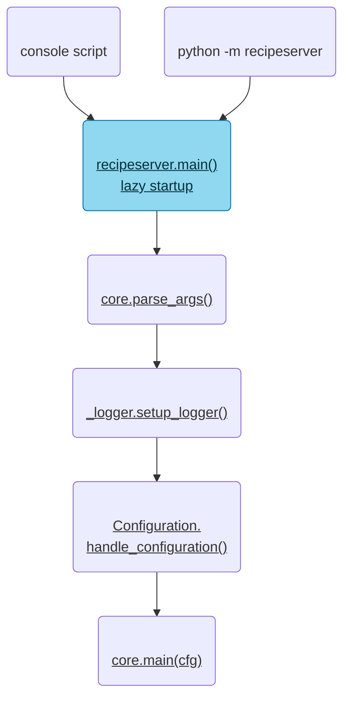

# The package initializer (`src/recipeserver/__init__.py`)

The package owns one public function, `main()`, which is the console-script
entry point declared in `pyproject.toml` (`recipeserver = "recipeserver:main"`)
and the function [**main**.py.md](__main__.py.md) calls for
`python -m recipeserver`. Both routes therefore execute the same startup
sequence, and the console script works without arguments.

The body imports the rest of the stack only when called. Importing
`recipeserver` — or a leaf module such as `recipeserver.shopping_list` — no
longer loads `core`, `server`, `tray`, `config`, `tkinter`, or `pystray`. This
removes the import cycle that previously routed every module through the
orchestrator. `test/test_startup_entrypoints.py` enforces both properties.

## Related pages

- [core.py.md](core.py.md) — `parse_args()` and `main(cfg)`
- [**main**.md](__main__.py.md) — `python -m recipeserver` entry
- [README.md](README.md) — the package hub
