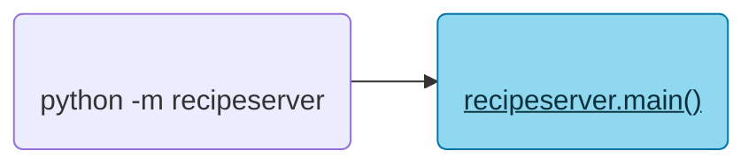

# The module entry point (`src/recipeserver/__main__.py`)

Enables `python -m recipeserver`. The module delegates to
[recipeserver.main()](__init__.py.md), which is also the console-script entry
point, so both ways of starting the app run exactly the same sequence:
argument parsing, logger setup, configuration resolution, then the build,
serve, and tray pipeline in [core.py.md](core.py.md).

## Related pages

- [**init**.md](__init__.py.md) — package initializer and console-script entry
- [core.py.md](core.py.md) — `parse_args()` and `main()`
- [config.py.md](config.py.md) — `Configuration` and `handle_configuration()`
- [README.md](README.md) — the package hub
