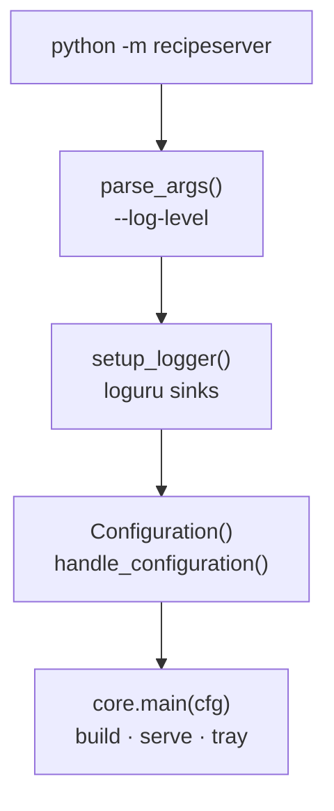

# The module entry point (`src/recipeserver/__main__.py`)

Enables `python -m recipeserver`. Ten lines, no logic of its own — it just wires the startup sequence together:

1. `parse_args()` from [core.py.md](core.py.md) parses `--log-level LEVEL` (default `INFO`; choices come from the `LogLevel` enum in [_logger.py.md](_logger.py.md)).
2. `setup_logger(args.log_level)` configures the loguru sinks.
3. `Configuration().handle_configuration()` resolves the recipe source directory and the optional local-model settings ([config.py.md](config.py.md)).
4. `main(cfg)` builds the site, starts the server, and runs the tray ([core.py.md](core.py.md)).

`__main__.py` is only executed for `python -m recipeserver`. The console script from `pyproject.toml` and [scripts/serve.sh](../../scripts/serve.sh.md) both go through the package `main` instead.

## Related pages

- [**init**.md](__init__.py.md) — package initializer and console-script entry
- [core.py.md](core.py.md) — `parse_args()` and `main()`
- [config.py.md](config.py.md) — `Configuration` and `handle_configuration()`
- [README.md](README.md) — the package hub
