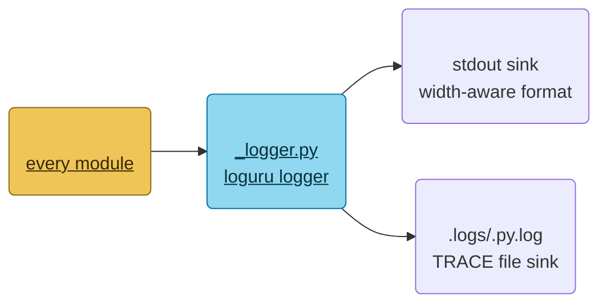

# Logging (`src/recipeserver/_logger.py`)

The package's logging setup, built on [loguru](https://github.com/Delgan/loguru). Every module logs through the shared `logger` exported here; nothing uses `print` (scripts at the repository root use the shell `log()` from [scripts/entry.sh.md](../../scripts/entry.sh.md), which is a separate path).

## What it provides

- `LogLevel` — an `IntEnum` with `TRACE=5` … `CRITICAL=50`, used for the `--log-level` choices in [core.py.md](core.py.md).
- Two extra loguru levels registered at import: `COMMAND` (no=6) and `FILE` (no=7), with their own colors and `logger.command = ...` / `logger.file = ...` convenience wrappers (e.g. `logger.file("Converting …")` in the converter).
- `console_format(record)` — switches the console format by terminal width: `<120` columns gets `TINY_CONSOLE_FORMAT`, `<180` gets `COMPACT_CONSOLE_FORMAT`, otherwise `FULL_CONSOLE_FORMAT` (timestamp, hostname, file:line, thread).
- `setup_logger(log_level="INFO")` — removes loguru's default sink, adds an `enqueue=True` stdout sink at the requested level, and a `TRACE`-level file sink at `.logs/<argv0>.py.log` relative to the current working directory (created on demand). Guarded by `_is_configured` so it only runs once.

The loguru logger does not do printf-style substitution. Never pass format arguments: use f-strings (`logger.info(f"... {value}")`, with `!r` to preserve repr formatting).

## Where it is used

Every module imports `logger` from here. The `log()` shell helper used by scripts is unrelated; it exists in [scripts/entry.sh](../../scripts/entry.sh.md).

## Related pages

- [core.py.md](core.py.md) — consumes `LogLevel` for `--log-level`
- [README.md](README.md) — the package hub
