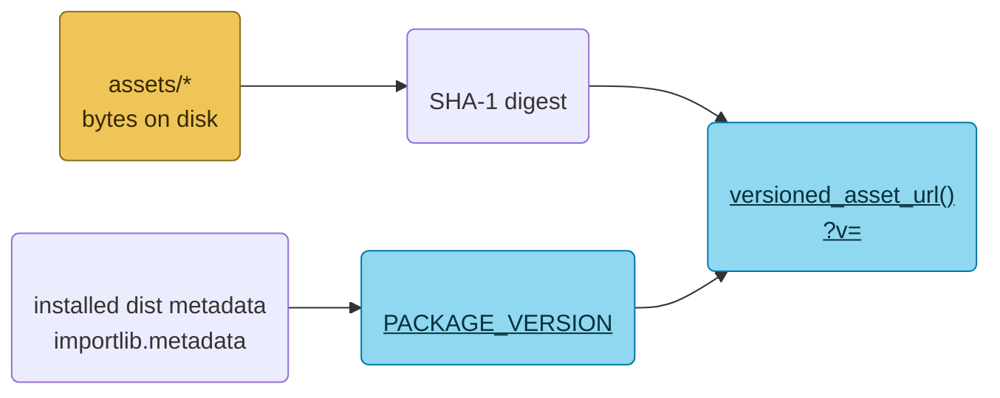

# Package version and asset URLs (`src/recipeserver/_version.py`)

Two things live here: the runtime package version, and a cache-busting helper for the static assets.

## `PACKAGE_VERSION`

Read from the installed distribution metadata (`importlib.metadata.version("recipeserver")`). When the code runs from a source tree that was never installed (for example in tests), the lookup throws and falls back to `"0.0.0"`. The version is dynamic in `pyproject.toml` and computed from git tags by setuptools-scm; the package deliberately does not carry a hand-written `_version.py`-as-file-pattern beyond this shim.

## `versioned_asset_url(url)`

Appends `?v=<10 hex chars>` to an asset URL, where the digest is the SHA-1 of the asset bytes read at call time (`ASSETS_DIR / url.removeprefix("/assets/")`). There is no cache: the URL always reflects the file currently on disk, so browsers pick up changed assets without manual cache busting. Used by the HTML generators for their static asset URLs (see [index_html_generator.py.md](index_html_generator.py.md) and [menu.py.md](menu.py.md)).

## Related pages

- [index_html_generator.py.md](index_html_generator.py.md) — builds the index's versioned asset URLs
- [menu.py.md](menu.py.md) — uses `versioned_asset_url` for `MENU_CSS_URL`/`MENU_JS_URL`
- [README.md](README.md) — the package hub
