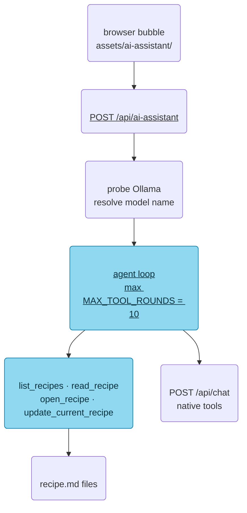

# The AI assistant (`src/recipeserver/ai_assistant.py`)

The chat behind the floating bubble on the recipe pages and the index. Opt-in like the rest of the local AI: it uses the configured `model_endpoint` and `all_purpose_model_name` (see [ai_recipe.py.md](ai_recipe.py.md) and [config.py.md](config.py.md)) and answers general knowledge questions ("how many tablespoons are in a cup?"), questions about other recipes in the library, and edit requests aimed at the recipe on screen ("Adjust the recipe to use half as much salt"). It can also navigate the browser to a recipe — "Open brownies" resolves the closest-matching recipe and the page redirects.

Both sides of the conversation are rendered as Markdown by [assistant_render.py.md](assistant_render.py.md) (same Python-Markdown + inline-code-quantity → KaTeX strategy as the recipe bodies). The static part of the system prompt — identity, the Markdown-rendering contract (quantities in inline code are typeset with KaTeX, math uses `$…$` / `$$…$$`), the tool overview and the hard rules — lives in `AssistantPrompt.md` next to this module (like `NewRecipePrompt.md`) and is re-read on every request; the code appends only the page-specific section (the editing rules and the current recipe on a recipe page, the read-only note on the index).

Called by [server.py.md](server.py.md) (`/api/ai-assistant`); the bubble itself is `assets/ai-assistant/` (CSS + JS, loaded on both pages after `icons.js`), which is content-hashed like every other asset and is not documented page-by-page. Answers stream back as Server-Sent Events when `stream: true`: `status` events (`state` + `message`), `metrics`, `error`, and `result` (`result`: `{reply, edited, path, metrics}`, plus `open` when the model asked to open a recipe). Without `stream`, the endpoint returns the same object as plain JSON.

## Public surface

- `run_assistant(config, message, history, *, source_directory, current_file=None, current_path_display=None, apply_edit=None, event_callback=None)` — the agent loop. Returns `{reply, edited, path, metrics}` plus, when the model called `open_recipe` successfully, `open` (`{url, title, path}`; the browser redirects to the URL once the reply is delivered). Raises `ModelUnavailable` (not configured / unreachable), `ModelRequestError` (bad endpoint response, empty answer, tool-round limit) and `ValueError` (invalid input) — the same contract as the other AI entry points.
- `sanitize_message(message)` — non-empty string, at most `MAX_MESSAGE_CHARS = 4000`.
- `sanitize_history(history)` — keeps `user`/`assistant` text turns, at most `MAX_HISTORY_MESSAGES = 20` messages of at most `MAX_HISTORY_CHARS` characters each.
- `display_path(source_directory, file_path)` — library-relative POSIX path used in prompts, results, and tool output.
- `_best_recipe_match(query, recipes)` — deterministic closest-match scoring for `open_recipe` (exact → tighter containment → substring either way → `difflib` ratio; the library path or title directory is matched the same way). Exported for tests.
- `_load_assistant_prompt()` — reads `AssistantPrompt.md` fresh per request (edits apply on the next run), falls back to a minimal built-in prompt when the file is unreadable.

## How it works

1. The system prompt is `AssistantPrompt.md` plus a page-specific section. On a recipe page the prompt embeds the recipe being viewed (raw front matter + body, capped at `MAX_CURRENT_RECIPE_CHARS = 24000`) and the editing rules; on the index it says the page is read-only. Recipe files are told to the model as data, not instructions.
2. The model runs native Ollama function tools (`/api/chat` with a `tools` list):
   - `list_recipes` — every recipe with its path and title (heading on the first `# ` line, falling back to the directory name), capped at `MAX_LIST_RECIPES = 1000`.
   - `read_recipe(path)` — raw Markdown of one recipe, capped at `MAX_TOOL_OUTPUT_CHARS = 24000`; the path must be a `.md` file inside the source directory.
   - `open_recipe(query)` — opens the closest-matching recipe. `query` is the recipe name as the user used it (e.g. "brownies"); the app resolves the match itself — exact title, then token/substring containment, then a `difflib` ratio against the title and the directory name (`OPEN_MATCH_THRESHOLD = 0.3`). No path argument, no invented paths, and it modifies nothing. On success the result carries `open` (`{url, title, path}`) and the browser redirects once the reply is delivered (same-origin absolute path, ~1.2 s after the reply renders). On failure the model gets the closest candidates as suggestions to relay. Offered on every page.
   - `update_current_recipe(content, metadata?)` — complete replacement for the recipe **body** (everything after the YAML front matter, not a diff) plus optional partial metadata (same fields the editor manages; unknown fields and `updatedOn` are rejected; `null` clears a field). The tool takes **no `path` argument** — the edit is bound by the server to the one recipe the user is viewing, which is why edits are impossible from the index and impossible for any other recipe.
3. The loop echoes the model's tool-calling message back to it and runs each call for at most `MAX_TOOL_ROUNDS = 10` rounds. Tool errors are fed back to the model as `{"error": ...}` so it can retry. If the model cannot call tools at all (old Ollama / non-tool models), the loop retries without `tools` and the answer comes back in plain text.
4. When `update_current_recipe` succeeds, the `apply_edit` callback (built by the server, see [server.py.md](server.py.md)) rewrites `recipe.md` through python-frontmatter, refreshes `updatedOn`, and regenerates the page and the index. The reply reports the edit and the browser offers a Reload button. When `open_recipe` succeeds, the client skips the Reload notice and redirects instead.

There is no delete tool and no bulk-edit tool, on purpose: the assistant can only ever touch the recipe being viewed, and `open_recipe` only navigates — it never writes anything.

## Limits and conventions

- `MAX_MESSAGE_CHARS = 4000`, `MAX_HISTORY_MESSAGES = 20`, `MAX_TOOL_ROUNDS = 10`, `MAX_TOOL_OUTPUT_CHARS = 24000`, `MAX_CURRENT_RECIPE_CHARS = 24000`, `MAX_LIST_RECIPES = 1000`, `MAX_UPDATE_CONTENT_CHARS = 100000`.
- `STATUS_*` states: `checking_model`, `listing_recipes`, `reading_recipe`, `opening_recipe`, `updating_recipe`, `thinking`, `error`.
- `MODEL_TEMPERATURE` and `MAX_MODEL_TOKENS` are shared with `ai_recipe.py`; each chat call is non-streaming (progress comes from tool-round status events instead). Requests send `keep_alive` when `all_purpose_model_keep_alive` is configured (minutes, scaled to seconds; `0` — unload immediately — is the default).
- `updatedOn` is managed by the server and cannot be written through the assistant; ratings and comments (like every other non-editor front-matter field) are always preserved, because the update tool replaces only the body and accepts a partial `metadata` object limited to the editor's fields.

## Related pages

- [server.py.md](server.py.md) — the `/api/ai-assistant` endpoint and the `apply_edit` binding
- [assistant_render.py.md](assistant_render.py.md) — how chat messages are rendered (the Markdown + KaTeX strategy)
- [ai_recipe.py.md](ai_recipe.py.md) — shared Ollama plumbing (`/api/chat` normalization, config resolution)
- [config.py.md](config.py.md) — `model_endpoint`, `all_purpose_model_name`
- [README.md](README.md) — the package hub
