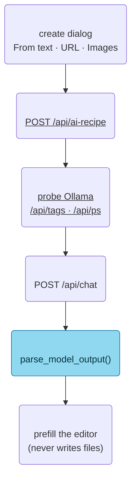

# Local AI recipe integration (`src/recipeserver/ai_recipe.py`)

Optional, opt-in integration with a local [Ollama](https://ollama.com) server. It powers the **From text**, **From URL**, and **From Images** paths of the create dialog; it never writes recipe files. The normal create endpoint is still the only path that saves a new recipe. Called by [server.py.md](server.py.md) (`/api/ai-status`, `/api/ai-recipe`); the prompts come from `NewRecipePrompt.md` / `NewRecipeFromImagePrompt.md`, loaded via [config.py.md](config.py.md).

## Public surface

- `resolve_ai_config(config)` → frozen `AIConfigView` (endpoint, models, prompts) with `is_configured` / `is_image_configured`.
- `ai_status(config)` → the dict served by `/api/ai-status` (endpoint configured?, reachable?, which models). The server adds one more key, `dictation_enabled` (see [server.py.md](server.py.md)), before sending the response.
- `generate_recipe(config, input_type, input_value, event_callback=None, images=None)` — the drafting pipeline. `input_type` is `text`, `url`, or `image`. Emits progress events (`status`, `metrics`, `error`, `result`) through `event_callback`; the server streams them as SSE for `stream: true` requests and blocks otherwise.
- `normalize_ollama_base_url(endpoint)` — strips a trailing `/v1`-style suffix so an OpenAI-style configured endpoint still reaches Ollama's native API. `ollama_chat_url` / `ollama_ps_url` / `ollama_tags_url` build on it.
- `list_models`, `resolve_model_name`, `is_available`, `is_model_loaded`, `loaded_model_names` — endpoint probes. All are best-effort: any failure means "unavailable", never a crash (`MODEL_PROBE_ERRORS`).
- `fetch_url_content(url)` — fetches a URL (`URL_TIMEOUT_SECONDS = 20`, `MAX_URL_BYTES = 2 MiB`) and returns readable `(text, title)` rather than raw HTML.
- `parse_model_output(output)` — splits `(markdown, metadata_dict)` out of the model's reply (handles code fences, YAML front matter via python-frontmatter).

Exceptions: `ModelUnavailable` (not configured / unreachable), `ModelRequestError` (endpoint returned an error or unusable response), `SourceFetchError` (a `url` source could not be fetched). Chat `/api/chat`, loaded models via `/api/ps`, installed models via `/api/tags`; timeouts: `AVAILABILITY_TIMEOUT_SECONDS = 3`, `MODEL_TIMEOUT_SECONDS = 120`. Metrics from Ollama (`load_duration`, `eval_duration`, …) are normalized to `model_load_seconds`, `generation_seconds`, `tokens_per_second`, and friends (see [server.py.md](server.py.md) for how they reach the browser).

## Notes

- Image input goes to the configured `image_analysis_model` first; transcriptions are concatenated and drafted by `all_purpose_model_name`. Image payloads use Ollama's native message shape (base64 in the message `images` list), not OpenAI `image_url` parts. SVG is excluded from the image MIME table; the vision path only accepts raster formats.
- Nothing is persisted here. The result only pre-fills the editor.

## Related pages

- [server.py.md](server.py.md) — the `/api/ai-status` and `/api/ai-recipe` endpoints
- [ai_assistant.py.md](ai_assistant.py.md) — the assistant the floating bubble talks to
- [config.py.md](config.py.md) — endpoint/model/prompt configuration
- [README.md](README.md) — the package hub
