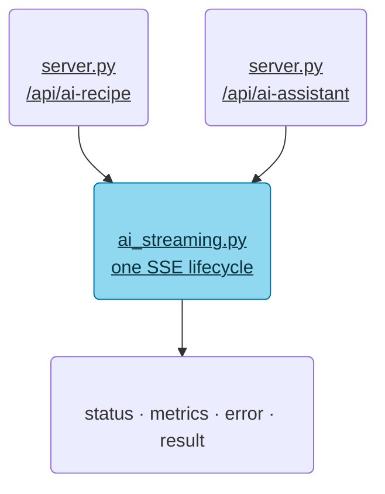

# AI streaming (`src/recipeserver/ai_streaming.py`)

The single owner of the Server-Sent Events wire format and of the lifecycle
shared by both streamed AI endpoints. [server.py.md](server.py.md) supplies the
response object, the domain generator, and its own non-streaming behavior; it
no longer writes SSE frames or duplicates terminal-event handling.

## Public interface

- `EventStream(wfile)` — `begin(responder)` writes the no-store, close-delimited
  headers; `send(event)` writes one `event:`/`data:` frame; `error(...)` and
  `result(...)` write the two terminal events.
- `StreamClosed` — a browser disconnect during a write.
- `run_stream(wfile, responder, generate, expected_exceptions, error_event,
error_state, result_event, label)` — begin the stream, call the generator
  with `send`, convert expected failures to an error event, unexpected ones to
  a generic error, and a successful result to the terminal event. A disconnect
  ends the stream quietly.

The browser side reads these frames through `assets/sse.js`; the two readers
and this writer are kept compatible by the AI streaming tests.

## Related pages

- [server.py.md](server.py.md) — the two endpoints and their non-stream paths
- [ai_recipe.py.md](ai_recipe.py.md) · [ai_assistant.py.md](ai_assistant.py.md) — the generators
- [README.md](README.md) — the package hub
