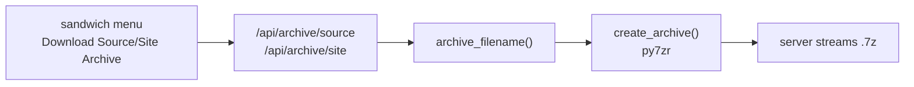

# On-demand archives (`src/recipeserver/archive.py`)

Builds the `.7z` downloads linked from the sandwich menu's **Download Source Archive** and **Download Site Archive** entries ([menu.py.md](menu.py.md), served by [server.py.md](server.py.md) via `/api/archive/source` and `/api/archive/site`).

The archive is built on request rather than pre-generated during `regen()`, so downloads stay current without a second stored copy of every recipe. The server streams the result back with a browser-timezone-aware filename.

## Public surface

- `ARCHIVE_KINDS` — `("source", "site")`; `_KIND_LABELS` maps them to the `Source`/`Site` filename labels.
- `archive_filename(kind, archive_date)` — `YYYY-MM-DD_RecipeServer_<Label>.7z`; raises `ValueError` for an unknown kind.
- `utc_today(fallback=None)` — today's UTC date (used when the browser supplies no date).
- `resolve_archive_date(raw, fallback=None)` — parses the browser-supplied `YYYY-MM-DD`; anything else is rejected (`ValueError`) so a malformed value never leaks into the filename.
- `create_archive(source_directory, archive_path)` — writes a 7z archive of the directory via `py7zr`, storing it under a top-level folder named after the directory (e.g. `site/...`) rather than an absolute path.

## Where it is used

[server.py.md](server.py.md) `_handle_archive` / `_stream_archive` handle the endpoints: they pick the source or site directory, resolve the date from the query string, stream the archive in `ARCHIVE_STREAM_CHUNK_BYTES` chunks, and delete the temp file afterwards.

## Related pages

- [server.py.md](server.py.md) — `/api/archive/source` and `/api/archive/site`
- [menu.py.md](menu.py.md) — the menu entries that link to these endpoints
- [README.md](README.md) — the package hub
