# Chat Markdown rendering (`src/recipeserver/assistant_render.py`)

```mermaid
flowchart LR
    chat("<img src='barnacle:message-circle.svg' width='20' alt=''/><br/>user + assistant<br/>messages") --> api("<img src='barnacle:globe.svg' width='20' alt=''/><br/><u>POST /api/assistant-markdown</u>")
    api --> md("<img src='barnacle:file-text.svg' width='20' alt=''/><br/>Python-Markdown<br/>+ arithmatex (generic)")
    md --> qty("<img src='barnacle:pen-line.svg' width='20' alt=''/><br/>inline-code quantities<br/>→ .quantity spans")
    qty --> san("<img src='barnacle:shield.svg' width='20' alt=''/><br/>sanitize: strip scripts,<br/>handlers, unsafe URLs")
    san --> html("<img src='barnacle:code.svg' width='20' alt=''/><br/>HTML fragment<br/>→ the chat bubble")
    click api href "server.py.md"
    click qty href "markdown_to_html/quantities.py.md"
    class qty goFile
    class san goFile
    classDef goFile fill:#8fd8ef,stroke:#0277a8,color:#08303d
```

Renders chat messages (both the user's and the assistant's) to a sanitized HTML fragment with the same strategy the recipe pages use for recipe bodies: Python-Markdown with `pymdownx.extra`, `pymdownx.blocks.html`, `pymdownx.tasklist` and `pymdownx.arithmatex` (in `generic` mode, so `$…$` and `$$…$$` math becomes `\(…\)` / `\[…\]` spans that the vendored KaTeX auto-render typesets in the browser), then the same inline-code-quantity rewrite the recipe pipeline applies — `1 1/2 cups` becomes a `` element that the browser fills with KaTeX at 1x scale (the chat has no scaler controls).

Unlike recipe bodies, chat messages are not trusted input, so the fragment is sanitized after rendering: scripts, styles, forms, embeds, iframes and similar tags are removed, only disabled (task-list) checkboxes survive, `on*`/`style`/`id` attributes are dropped, URLs are limited to `http`, `https`, `mailto` and scheme-less relative/fragment links, and external `http(s)` links get `target="_blank" rel="noopener noreferrer"`.

## Public surface

- `render_chat_markdown(text)` — render a Markdown string to a sanitized HTML fragment. Raises `ValueError` for non-string input or input longer than `MAX_RENDER_CHARS = 100000`.
- `MAX_RENDER_CHARS = 100000` — the upper cap for a single render call (bounds the endpoint as well as the library use).

## How it fits

Called by [server.py.md](server.py.md) (`POST /api/assistant-markdown`, `{markdown}` → `{html}`); the floating bubble calls it for every user and assistant message it shows, then typesets the fragment (quantities via `RecipeScaler` statics, math via the vendored KaTeX auto-render, both loaded lazily on first use, like the shopping list does). Falling back to raw text when the call fails is a client-side concern — the renderer always answers with a fragment string.

## Related pages

- [ai_assistant.py.md](ai_assistant.py.md) — the assistant whose replies are rendered through this path
- [markdown_to_html/quantities.py.md](markdown_to_html/quantities.py.md) — the quantity parsing shared with the recipe pipeline
- [server.py.md](server.py.md) — the endpoint
- [README.md](README.md) — the package hub
