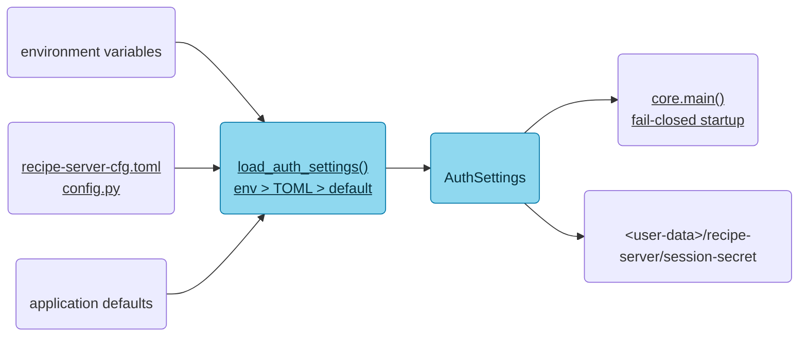

# Authentication configuration (`src/recipeserver/auth_config.py`)

Authentication is **off by default**. It is enabled explicitly with `auth_enabled = true` in `recipe-server-cfg.toml` or `AUTH_ENABLED=true` in the environment. When it is enabled, missing or invalid settings are a startup error — the server never silently falls back to open access.

## Precedence

Every setting is resolved in this order:

1. the environment variable, **only when it is explicitly present** (an empty value is still explicit);
2. the key in `recipe-server-cfg.toml`;
3. the application default.

| Environment variable       | TOML key                   | Default                             |
| -------------------------- | -------------------------- | ----------------------------------- |
| `AUTH_ENABLED`             | `auth_enabled`             | `false`                             |
| `OIDC_ISSUER`              | `oidc_issuer`              | required when enabled               |
| `OIDC_CLIENT_ID`           | `oidc_client_id`           | required when enabled               |
| `OIDC_CLIENT_SECRET`       | `oidc_client_secret`       | required when enabled               |
| `OIDC_REDIRECT_URI`        | `oidc_redirect_uri`        | required when enabled               |
| `OIDC_OWNER_SUB`           | `oidc_owner_sub`           | required when enabled               |
| `SESSION_SECRET`           | `session_secret`           | generated and persisted (see below) |
| `SESSION_LIFETIME_MINUTES` | `session_lifetime_minutes` | `720` (12 hours)                    |

`OIDC_REDIRECT_URI` must end in the fixed callback path `/api/auth/callback`. The issuer and redirect URI must use HTTPS except for loopback development URLs. `SESSION_SECRET` must be at least 16 characters; the lifetime is limited to 1 minute through 30 days.

## Secrets are not served with the site

These keys are deliberately **not** `ConfigField`s. `GET /api/config` returns only `ConfigField` values, and `POST /api/config` accepts only those keys, so `oidc_client_secret` and `session_secret` cannot be read or written through the web API. [config.py.md](config.py.md) keeps the keys in a separate mapping and writes them back verbatim when the configuration is saved, so a save from the Configuration dialog never erases them. The generated site, `/api/auth/status`, and every other response omit them.

## Persistent signing secret

If neither the environment nor the TOML file supplies `session_secret`, a random secret is generated once and written to `<user-data>/recipe-server/session-secret` (permissions tightened where the OS supports it). The same file is reused on every start, so sessions remain valid across restarts. Changing `SESSION_SECRET`/`session_secret` or deleting that file invalidates **all** sessions at once — the emergency revocation lever for stateless cookies (see [session.py.md](session.py.md)).
