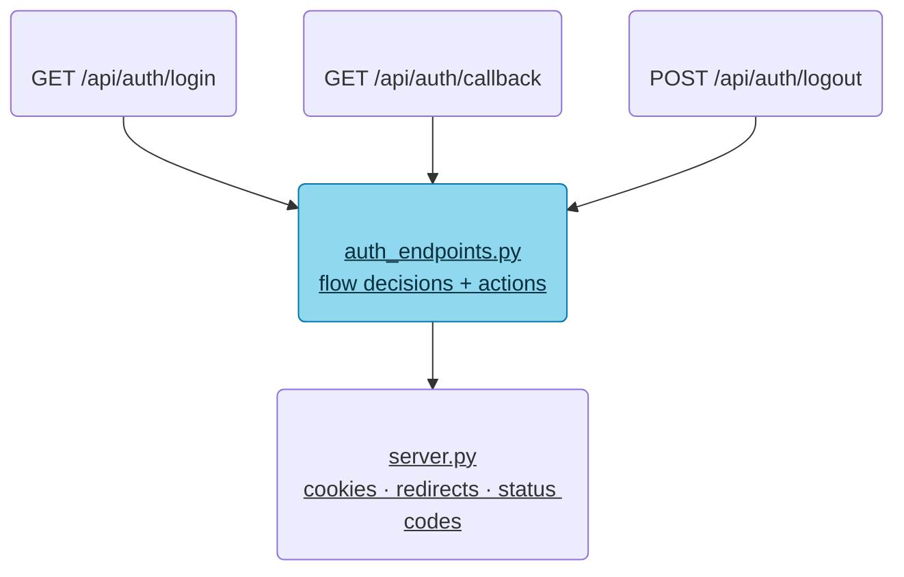

# Auth endpoint orchestration (`src/recipeserver/auth_endpoints.py`)

The OIDC login flow decisions, separated from the HTTP response code that
applies them. [server.py.md](server.py.md) owns the routes and writes the
cookies/redirects; this module decides _which_ cookies, redirect, or
non-leaking error the flow requires. It delegates the actual session and token
work to [authorization.py.md](authorization.py.md), [oidc.py.md](oidc.py.md),
and [session.py.md](session.py.md).

## Public interface

- `AuthAction` — a small action record: `redirect`, `cookie`, `clear_cookie`,
  `error`, `error_json`, `success`. A decision returning `None` means auth is
  disabled and the endpoint does not exist.
- `begin_login(auth, path)` — start the flow, queue the single-use flow cookie,
  or return a 503 error page.
- `finish_login(auth, path, headers)` — clear the flow cookie even on failure,
  complete the login, and queue the session cookie.
- `logout(auth, identity, headers)` — enforce CSRF and clear the session cookie.
- `queue_cookie_header(auth, cookie)` — render `Set-Cookie` with the live
  `secure_cookies` setting.

## Related pages

- [server.py.md](server.py.md) — the three endpoints and their route registration
- [authorization.py.md](authorization.py.md) — permissions and the auth gate
- [README.md](README.md) — the package hub
