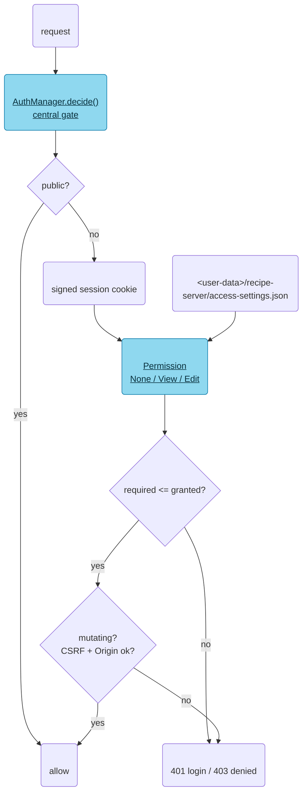

# Authorization (`src/recipeserver/authorization.py`)

Authentication answers _who_ is calling; this module answers _what they may do_. `Permission` has three levels: `NONE` (no access), `VIEW` (browse and search), and `EDIT` (create, modify, delete). Owner is a separate administrative privilege, not a fourth level.

## Defaults

When authentication is disabled, every request keeps RecipeServer's historical open access (`EDIT`). When it is enabled:

| Identity                | Permission                     |
| ----------------------- | ------------------------------ |
| Anonymous visitor       | `AccessSettings.guest`         |
| Authenticated non-owner | `AccessSettings.authenticated` |
| Configured Owner        | `EDIT` plus access to settings |

Owner identity is the issuer plus the subject configured by `oidc_owner_sub`. The defaults are stored as the non-secret JSON file `access-settings.json` in the user-data directory; the Owner can change them through `/api/auth/settings`.

## Central enforcement

`required_access()` classifies every path/method as `PUBLIC`, `VIEW`, `EDIT`, or `OWNER`. `/health`, `/assets/*` and the `/api/auth/*` login endpoints are public. `/api/config`, `/api/config/test-transcription`, and `/api/auth/settings` are Owner-only. Mutating routes are `EDIT`, except ratings/comments, dictation, and assistant Markdown rendering, which are `VIEW` so browsing visitors can still leave feedback. Every generated page and image is `VIEW`.

[server.py.md](server.py.md) calls `AuthManager.decide()` at the very start of `GET`, `HEAD`, `POST`, and `DELETE`, so static pages and `HEAD` cannot bypass the gate. Insufficient permission for an anonymous caller redirects to login (or answers JSON 401 for `/api/*` with a `loginUrl`); an authenticated caller gets 403.

Mutations additionally require `X-CSRF-Token` for signed-in callers and reject `Sec-Fetch-Site: cross-site` or an `Origin` that does not match the request host or configured redirect host. Anonymous callers have no cookie, so the Origin check is their CSRF protection.

`AuthManager.status()` is the only auth information sent to the browser: flags, permission, display name, CSRF token, and login/logout URLs — never secrets.
