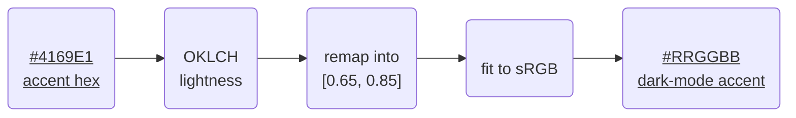

# Color helpers (`src/recipeserver/color_utils.py`)

One function: `dark_mode_color(hex_color)`. It remaps a hex color's OKLCH lightness into the band `[DARK_MODE_LIGHTNESS_BASE, DARK_MODE_LIGHTNESS_BASE + DARK_MODE_LIGHTNESS_SPAN]` (`0.65` / `0.20`) so the recipe accent stays legible on dark backgrounds; hue and chroma are preserved. Darker accents are pushed further up the band than already-bright ones, and the result is fit back into sRGB and returned as a hex string.

Used by the page templates that emit per-page `--food-color` overrides with a `prefers-color-scheme: dark` block: [markdown_to_html/page.py.md](markdown_to_html/page.py.md) (`doc_specific_overrides`) and [index_html_generator.py.md](index_html_generator.py.md) (`_food_color_style`).

Built on [coloraide](https://github.com/facelessuser/coloraide). The base/span constants are named here so the tuning lives in one place; the upper bound is implicit in the formula (lightness 1.0 maps to `BASE + SPAN`).

## Related pages

- [markdown_to_html/page.py.md](markdown_to_html/page.py.md) — per-recipe accent override
- [index_html_generator.py.md](index_html_generator.py.md) — index accent override
- [README.md](README.md) — the package hub
