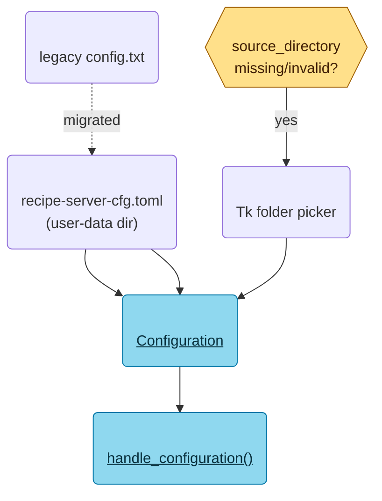

# Configuration (`src/recipeserver/config.py`)

Everything about the runtime configuration lives here: the `recipe-server-cfg.toml` file in the user-data directory, the legacy `config.txt` migration, the Tk folder picker, the optional local-AI settings, and the prompt files.

## The on-disk files

- Config file: `<user-data>/recipe-server-cfg.toml` (macOS: `~/Library/Application Support/recipe-server/recipe-server-cfg.toml`). A legacy `config.txt` in the same directory is read on startup and rewritten as TOML (the legacy file is then removed).
- Site directory: `user_data_path("recipe-server") / "site"` — generated output, recreated on every regeneration. Never store content there.
- Prompts: `NewRecipePrompt.md` and `NewRecipeFromImagePrompt.md`, re-read on every run so edits take effect on next start.
- Runtime logs: `.logs/<argv0>.py.log` relative to the cwd (see [_logger.py.md](_logger.py.md)).

## `Configuration`

Mutable bag of settings with property setters that normalize and validate (assignment never raises; invalid non-blank typed values fall back to defaults with a logged warning). The optional auth keys (`auth_enabled`, `oidc_issuer`, `oidc_client_id`, `oidc_client_secret`, `oidc_redirect_uri`, `oidc_owner_sub`, `session_secret`, `session_lifetime_minutes`) are deliberately **not** `ConfigField`s: `_parse_toml_config` stores them in a separate mapping, `get_auth_values()` exposes that mapping to [auth_config.py.md](auth_config.py.md), and `_write_config()` writes them back verbatim so a Configuration save never erases them. They never appear in `get_config_values()`, `field_specs()`, or `GET /api/config`, so secrets are not served with the site. Keys and their `CONFIG_FIELDS` entries — `recipe_server_name`, `source_directory`, `model_endpoint`, `all_purpose_model_name`, `image_analysis_model`, `server_port` (default 8000), `server_bind_address` (IPv4/IPv6 literal, default `0.0.0.0`; takes effect on the next start — `127.0.0.1` restricts the site to this machine, `::` binds every IPv6 interface), `food_color`, `dictation_enabled`, `all_purpose_model_keep_alive`, `image_analysis_model_keep_alive`, `transcription_endpoint` (default `http://localhost:11434`), `transcription_model` (default `hf.co/ggml-org/Qwen3-ASR-0.6B-GGUF:Q8_0`), `transcription_keep_alive` (minutes, see below), `timeline_retention` — are the single source of truth for the Configuration editor UI: `field_specs()`, `get_config_values()`, and `apply_config_values()` all derive from `CONFIG_FIELDS`, so adding a field means appending one `ConfigField`.

`dictation_enabled` is the one boolean field. It is stored in the TOML file as a real TOML boolean (`dictation_enabled = true`), round-trips through `get_config_values()` as the string `"true"`/`"false"`, is edited in the UI as a checkbox (`input_type="checkbox"`), and defaults to `true`. `_parse_toml_config` accepts either the TOML boolean or a quoted `"true"`/`"false"` string; `_normalize_dictation_enabled` accepts the usual truthy spellings for hand-edited values. When dictation is saved as disabled, generated index pages omit the dictation button ([index_html_generator.py.md](index_html_generator.py.md)). The Ollama server and its models behind dictation are managed independently of the app — nothing is stopped or unloaded on a configuration save ([transcriber.py.md](transcriber.py.md)).

`transcription_endpoint`, `transcription_model`, and `transcription_keep_alive` configure the Ollama server used for dictation. The endpoint is the same kind of value as `model_endpoint` (an optional scheme is added, http/https only, a trailing `/v1`-style suffix is accepted and stripped on use); blank falls back to `http://localhost:11434`, the server's default address. The model is free text with a length cap; blank falls back to the Qwen3-ASR default `hf.co/ggml-org/Qwen3-ASR-0.6B-GGUF:Q8_0`. All three are tested before they are saved by the **Test transcription** button in the Configuration dialog ([server.py.md](server.py.md)).

Every supported model has a keep-alive companion setting, an integer number of **minutes before unload**: `all_purpose_model_keep_alive` (for the all-purpose model), `image_analysis_model_keep_alive` (for From Images), and `transcription_keep_alive` (for dictation). `-1` keeps the model loaded indefinitely, `0` unloads it immediately (the default), and any positive whole number of minutes keeps it loaded for that long after each request (Ollama's `keep_alive`, in seconds on the wire). Values are stored as TOML strings and written as such; bare TOML integers are accepted on read. The Configuration dialog captions every model field with its on-disk size (as probed from the server, e.g. `17.7 GB on disk · 27.3B · Q4_K_M`) and **disables the keep-alive field while the model cannot be verified as installable/resident** (server unreachable, model missing, or no size reported); the save is always permitted.

`timeline_retention` controls how the [retention.py.md](retention.py.md) background pass prunes the recipe revision history. It is stored as a TOML string, defaults to `"gfs"` — new installations and installations with no key take GFS — and `"unlimited"` keeps every revision (the historical behavior). `_validate_timeline_retention` accepts exactly those two values; unknown values are rejected with a user-facing message, and an unknown value already in the file falls back to GFS with a logged warning. It is edited in the UI as a dropdown (`input_type="select"`, the one field of that type) whose options come from the field spec's `options` list; switching policies never resets or migrates history.

Legacy read-only keys: `model_name` → `all_purpose_model_name`, `server_name` → `recipe_server_name` (normalized on save). `categories`-style singular field handling lives in [recipe_utils.py](recipe_utils.py.md), not here.

## Startup flow

`handle_configuration(optional_config_path=None)` resolves the config file (migrating legacy when present), reads and parses it, resolves the source directory (Tk directory picker when missing/invalid — cancel exits), applies loaded settings (prompting for the Ollama endpoint with `input()` when the key is absent; Enter skips and the empty setting is saved), loads the prompts, and persists everything back to TOML.

## Validation helpers

`_normalize_model_endpoint` (adds a scheme if omitted, requires http/https), `_normalize_server_port` (1–65535), `_validate_server_bind_address` (IP literal via `ipaddress.ip_address`; blank falls back to the documented default), `_normalize_food_color` (`#rgb`/`#rrggbb`, normalized to lowercase `#rrggbb`), `_normalize_dictation_enabled` (TOML boolean or truthy/falsy spelling), `_validate_transcription_endpoint` (same rules as the model endpoint; blank falls back to `http://localhost:11434`), `_validate_transcription_model` (blank falls back to the Qwen3-ASR default; length-capped), `_validate_keep_alive_minutes` (`-1`, `0`, or a positive whole number; blank falls back to `0`), `_validate_source_directory` (must be an existing directory), `_validate_timeline_retention` (`gfs` or `unlimited`, blank means the GFS default). `_parse_toml_config` accepts a bare-integer `server_port`, bare-integer keep-alive minutes, and a boolean `dictation_enabled`; `_parse_config` reads the legacy line-based format.

## Where it is used

[core.py.md](core.py.md) constructs it in `__main__.py` startup; [server.py.md](server.py.md) exposes `GET|POST /api/config` (and `POST /api/config/test-transcription`) through it; [ai_recipe.py.md](ai_recipe.py.md) reads the model settings via `AIConfigView`.

## Related pages

- [retention.py.md](retention.py.md) — reads `timeline_retention` to decide whether to prune
- [core.py.md](core.py.md) — startup
- [server.py.md](server.py.md) — the configuration API
- [README.md](README.md) — the package hub
