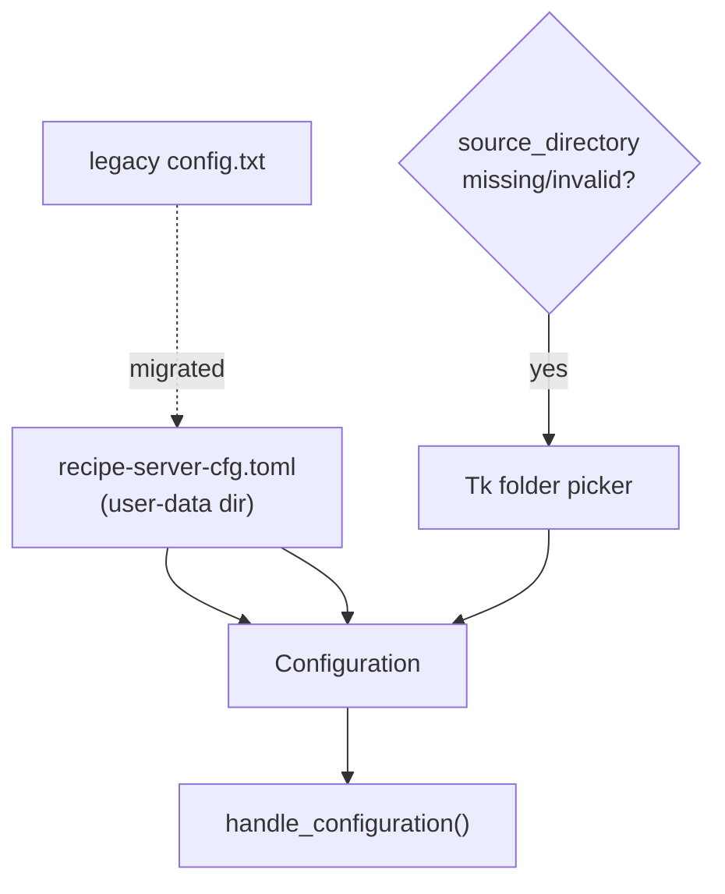

# Configuration (`src/recipeserver/config.py`)

Everything about the runtime configuration lives here: the `recipe-server-cfg.toml` file in the user-data directory, the legacy `config.txt` migration, the Tk folder picker, the optional local-AI settings, and the prompt files.

## The on-disk files

- Config file: `<user-data>/recipe-server-cfg.toml` (macOS: `~/Library/Application Support/recipe-server/recipe-server-cfg.toml`). A legacy `config.txt` in the same directory is read on startup and rewritten as TOML (the legacy file is then removed).
- Site directory: `user_data_path("recipe-server") / "site"` — generated output, recreated on every regeneration. Never store content there.
- Prompts: `NewRecipePrompt.md` and `NewRecipeFromImagePrompt.md`, re-read on every run so edits take effect on next start.
- Runtime logs: `.logs/<argv0>.py.log` relative to the cwd (see [_logger.py.md](_logger.py.md)).

## `Configuration`

Mutable bag of settings with property setters that normalize and validate (assignment never raises; invalid non-blank typed values fall back to defaults with a logged warning). Keys and their `CONFIG_FIELDS` entries — `recipe_server_name`, `source_directory`, `model_endpoint`, `all_purpose_model_name`, `image_analysis_model`, `server_port` (default 8000), `food_color` — are the single source of truth for the Configuration editor UI: `field_specs()`, `get_config_values()`, and `apply_config_values()` all derive from `CONFIG_FIELDS`, so adding a field means appending one `ConfigField`.

Legacy read-only keys: `model_name` → `all_purpose_model_name`, `server_name` → `recipe_server_name` (normalized on save). `categories`-style singular field handling lives in [recipe_utils.py](recipe_utils.py.md), not here.

## Startup flow

`handle_configuration(optional_config_path=None)` resolves the config file (migrating legacy when present), reads and parses it, resolves the source directory (Tk directory picker when missing/invalid — cancel exits), applies loaded settings (prompting for the Ollama endpoint with `input()` when the key is absent; Enter skips and the empty setting is saved), loads the prompts, and persists everything back to TOML.

## Validation helpers

`_normalize_model_endpoint` (adds a scheme if omitted, requires http/https), `_normalize_server_port` (1–65535), `_normalize_food_color` (`#rgb`/`#rrggbb`, normalized to lowercase `#rrggbb`), `_validate_source_directory` (must be an existing directory). `_parse_toml_config` accepts a bare-integer `server_port`; `_parse_config` reads the legacy line-based format.

## Where it is used

[core.py.md](core.py.md) constructs it in `__main__.py` startup; [server.py.md](server.py.md) exposes `GET|POST /api/config` through it; [ai_recipe.py.md](ai_recipe.py.md) reads the model settings via `AIConfigView`.

## Related pages

- [core.py.md](core.py.md) — startup
- [server.py.md](server.py.md) — the configuration API
- [README.md](README.md) — the package hub
