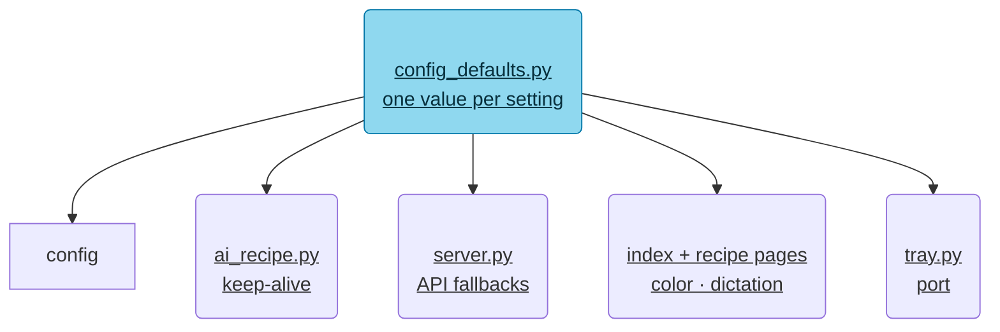

# Configuration defaults (`src/recipeserver/config_defaults.py`)

The one authoritative definition of default settings. Each consumer previously
carried its own copy — the AI drafter restated keep-alive `"0"`, the index and
server disagreed about the dictation fallback, the tray repeated port `8000`,
and the recipe renderer used a blue color where the index used the configured
brown default. All now import these constants.

## Values

- Server: `DEFAULT_RECIPE_SERVER_NAME`, `DEFAULT_SERVER_PORT`,
  `DEFAULT_SERVER_BIND_ADDRESS`, `MAX_PORT`.
- Appearance: `DEFAULT_FOOD_COLOR` (also the stylesheet's `--food-color`).
- Dictation: `DEFAULT_DICTATION_ENABLED`, `DEFAULT_TRANSCRIPTION_ENDPOINT`,
  `DEFAULT_TRANSCRIPTION_MODEL`.
- Models: `DEFAULT_KEEP_ALIVE_MINUTES` (`"0"` — unload immediately; `-1` keeps
  the model loaded).

[config.py.md](config.py.md) re-exports the same names for its public API, so
callers that already import defaults from `recipeserver.config` keep working.
`test/test_architecture.py` fails if a consumer restates a default or stops
importing the leaf.

## Related pages

- [config.py.md](config.py.md) — persistence, validation, and the field registry
- [retention_policy.py.md](retention_policy.py.md) — the other shared config leaf
- [README.md](README.md) — the package hub
