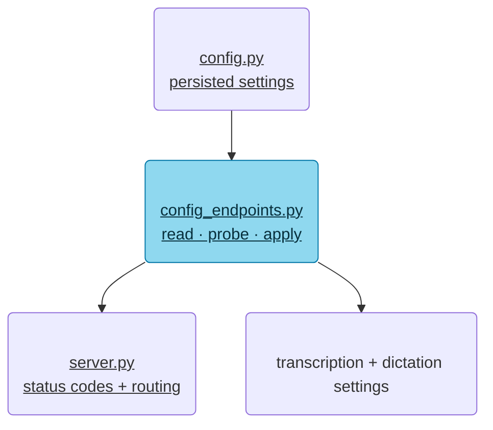

# Configuration API operations (`src/recipeserver/config_endpoints.py`)

The domain work behind `/api/config` and the live settings the dictation
endpoints need. [server.py.md](server.py.md) still owns routing, size-limit
error responses, and the site rebuild after a save; this module shapes the
payload and applies edits, never writing a response.

## Public interface

- `config_payload(config)` — `{values, fields, models}`; auth keys are still
  excluded because [config.py.md](config.py.md) owns that boundary.
- `probe_configured_models(config)` — best-effort model metadata via
  [ai_recipe.py.md](ai_recipe.py.md), using the canonical defaults from
  [config_defaults.py.md](config_defaults.py.md).
- `apply_config_payload(config, rfile, headers, max_size)` — parse, validate,
  persist, and return `(changed_keys, current_values)`.
- `dictation_enabled(config)` / `transcription_settings(config)` — the live
  values used by `/api/transcribe` and `/api/config/test-transcription`.

## Related pages

- [config.py.md](config.py.md) — persistence and the field registry
- [authorization.py.md](authorization.py.md) — the non-secret auth status payload
- [README.md](README.md) — the package hub
