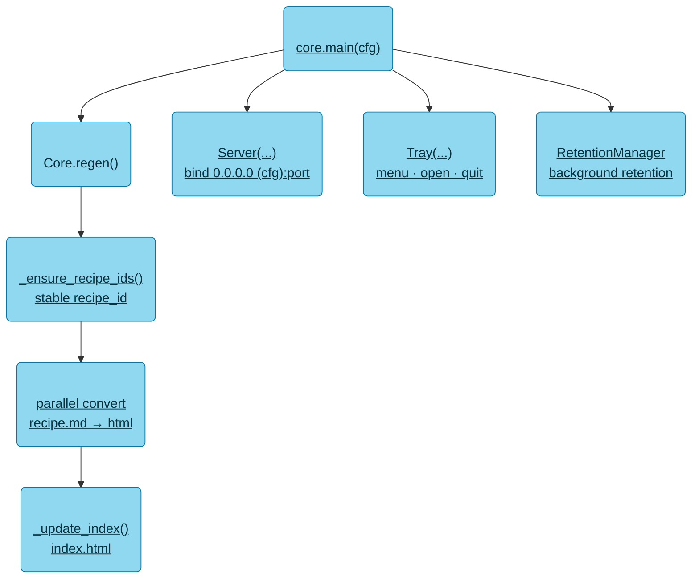

# Startup and site regeneration (`src/recipeserver/core.py`)

The application spine. `main(cfg)` builds the site, starts the HTTP server, and runs the tray; `Core` owns the site directory and the parallel recipe conversion.

## Public surface

- `DEFAULT_WORKERS = 8`, `MAX_WORKERS = 16`, `get_worker_count()` — thread-pool sizing for recipe conversion (`min(MAX_WORKERS, max(DEFAULT_WORKERS, cpu_count))`).
- `QUIT_POLL_INTERVAL_SECONDS = 0.25` — poll interval for the non-macOS shutdown path.
- `Core` — holds `cfg`, a `_regen_lock`, a `_recipes` map, and `last_regen_timings`. Methods:
  - `_ensure_recipe_ids(markdown_files)` — runs before conversion: every recipe without a valid `recipe_id` gets a fresh UUIDv4 injected textually into its front matter (or a new block prepended), and duplicate identifiers — such as when a recipe file is copied — are resolved deterministically: the path that sorts first keeps the id, the copies get fresh ones. Identity assignment is not a content modification, so it creates no history snapshots and never blocks the build (per-file failures are logged and skipped).
  - `convert_recipe(markdown)` — renders one `recipe.md` to HTML next to `site/` preserving the source tree structure, and copies the recipe's images into the page directory. Rejects anything outside the source directory or not named `recipe.md`.
  - `regen()` / `_regen_locked()` — full rebuild: deletes and recreates the site directory, copies `assets/`, finds every `recipe.md` under the source tree, converts them in parallel, then rebuilds `index.html`. One broken recipe is logged and skipped so the rest of the site still builds. `_regen_locked()` records phase timings (`assets_copy`, `recipe_conversion`, `index_build`, `total`, seconds) onto `core.last_regen_timings`; this is additive instrumentation for the scale tests (`test/scale/`) and changes no behavior. The "Regenerated site with N workers in Xs" log line is unchanged.
  - `on_markdown_save(markdown)` — re-render one recipe and rebuild the index (called after editor saves).
  - `on_recipes_deleted(paths)` — drop deleted recipes from the index and unlink their pages.
  - `on_config_save()` — full rebuild after a configuration change. When the saved configuration disables dictation, the shared transcriber is torn down ([transcriber.py.md](transcriber.py.md)), which stops the managed whisper-server ([whisper_server.py.md](whisper_server.py.md)). A forced background retention pass is then requested, so a switch of `timeline_retention` (GFS ⇄ Unlimited) is applied without resetting or migrating history — it is a no-op under Unlimited.
- `parse_args()` — `--log-level LEVEL` (`-l`), choices from `LogLevel` ([_logger.py.md](_logger.py.md)), default `INFO`.
- `main(cfg)` — `Core(cfg)` → `regen()` → the shared retention manager ([retention.py.md](retention.py.md)) is configured with `cfg` and started (an initial full scan plus the periodic sweep) → `Server(...)` ([server.py.md](server.py.md)) → `Tray(...)` ([tray.py.md](tray.py.md)). On macOS the tray runs on the main thread; elsewhere it runs detached and this thread polls the shutdown event. The shutdown path also stops the shared transcriber after the HTTP server and tray stop, so a whisper-server started for dictation never outlives the app; the periodic retention thread is stopped there too (in-flight prunes may finish first — they are interruption-safe).

The server binds `0.0.0.0` on the configured port (default 8000) by default — LAN-reachable, with no authentication; set `server_bind_address` to `127.0.0.1` to restrict it to this machine (see [config.py.md](config.py.md)). If the port is in use at startup, `Server.start()` logs an error and exits (see [server.py.md](server.py.md)).

## Related pages

- [**main**.md](__main__.py.md) — the `python -m recipeserver` wrapper
- [server.py.md](server.py.md) — the HTTP server wired up here
- [tray.py.md](tray.py.md) — the tray icon wired up here
- [history.py.md](history.py.md) — the snapshot store keyed by `recipe_id`
- [retention.py.md](retention.py.md) — timeline revision retention (GFS / Unlimited)
- [index_html_generator.py.md](index_html_generator.py.md) — builds `index.html`
- [markdown_to_html/converter.py.md](markdown_to_html/converter.py.md) — renders each recipe page
- [transcriber.py.md](transcriber.py.md) · [whisper_server.py.md](whisper_server.py.md) — the dictation transcription and its managed process
- [README.md](README.md) — the package hub
