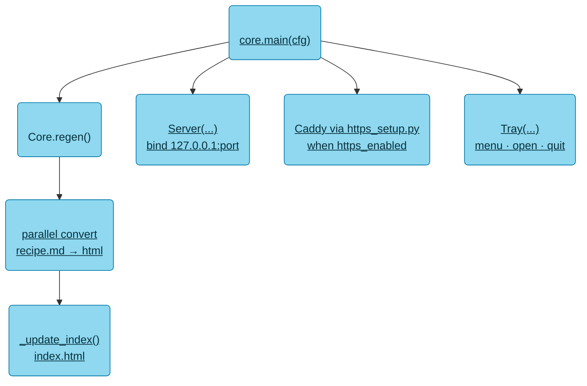

# Startup and site regeneration (`src/recipeserver/core.py`)

The application spine. `main(cfg)` builds the site, starts the HTTP server, and runs the tray; `Core` owns the site directory and the parallel recipe conversion.

## Public surface

- `DEFAULT_WORKERS = 8`, `MAX_WORKERS = 16`, `get_worker_count()` — thread-pool sizing for recipe conversion (`min(MAX_WORKERS, max(DEFAULT_WORKERS, cpu_count))`).
- `QUIT_POLL_INTERVAL_SECONDS = 0.25` — poll interval for the non-macOS shutdown path.
- `Core` — holds `cfg`, a `_regen_lock`, and a `_recipes` map. Methods:
  - `convert_recipe(markdown)` — renders one `recipe.md` to HTML next to `site/` preserving the source tree structure, and copies the recipe's images into the page directory. Rejects anything outside the source directory or not named `recipe.md`.
  - `regen()` / `_regen_locked()` — full rebuild: deletes and recreates the site directory, copies `assets/`, finds every `recipe.md` under the source tree, converts them in parallel, then rebuilds `index.html`. One broken recipe is logged and skipped so the rest of the site still builds.
  - `on_markdown_save(markdown)` — re-render one recipe and rebuild the index (called after editor saves).
  - `on_recipes_deleted(paths)` — drop deleted recipes from the index and unlink their pages.
  - `on_config_save()` — full rebuild after a configuration change. When the saved configuration disables dictation, the shared transcriber is torn down ([transcriber.py.md](transcriber.py.md)), which stops the managed whisper-server ([whisper_server.py.md](whisper_server.py.md)). Then HTTPS is reconciled with the saved configuration.
  - `attach_server(server)` — let the core manage the HTTPS front-end around the server (the configuration can change the serving mode at runtime; see [https_setup.py.md](https_setup.py.md)).
  - `start_caddy()` / `stop_caddy()` — create or tear down the Caddy subprocess fronting the embedded server ([https_setup.py.md](https_setup.py.md)). A running Caddy already proxying to the server's current internal port is kept; anything else is replaced, so the proxy always targets the right port.
  - `start_all()` / `stop_all()` — start/stop the site as a unit: Python, plus Caddy when `https_enabled` (Caddy first when stopping, because Caddy holds the configured port). The tray menu uses these.
  - `_reconcile_https()` — match the running Caddy/server to `cfg.https_enabled`. Enabling frees the configured port for Caddy (Python moves to an ephemeral loopback port) and rolls back to plain HTTP when Caddy cannot start; disabling makes Caddy release the port before Python binds it again.
- `parse_args()` — `--log-level LEVEL` (`-l`), choices from `LogLevel` ([_logger.py.md](_logger.py.md)), default `INFO`.
- `main(cfg)` — `Core(cfg)` → `regen()` → `Server(...)` ([server.py.md](server.py.md)) → when `https_enabled`, `core.start_caddy()` (a failure here stops the server and exits, mirroring the port-in-use policy) → `Tray(...)` ([tray.py.md](tray.py.md)). On macOS the tray runs on the main thread; elsewhere it runs detached and this thread polls the shutdown event. The shutdown path stops the site (Caddy, then the server) and the shared transcriber, so a whisper-server started for dictation never outlives the app.

The server binds `127.0.0.1` on the configured port (default 8000); if the port is in use at startup, `Server.start()` logs an error and exits (see [server.py.md](server.py.md)). When HTTPS is enabled it binds an ephemeral loopback port instead and Caddy serves the configured port (see [https_setup.py.md](https_setup.py.md)).

## Related pages

- [**main**.md](__main__.py.md) — the `python -m recipeserver` wrapper
- [server.py.md](server.py.md) — the HTTP server wired up here
- [https_setup.py.md](https_setup.py.md) — the Caddy/mkcert HTTPS front-end wired up here
- [tray.py.md](tray.py.md) — the tray icon wired up here
- [index_html_generator.py.md](index_html_generator.py.md) — builds `index.html`
- [markdown_to_html/converter.py.md](markdown_to_html/converter.py.md) — renders each recipe page
- [transcriber.py.md](transcriber.py.md) · [whisper_server.py.md](whisper_server.py.md) — the dictation transcription and its managed process
- [README.md](README.md) — the package hub
