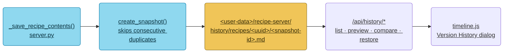

# Recipe revision history (`src/recipeserver/history.py`)



Immutable, application-managed revision history for recipes — a convenient local revision history, **not** a backup system (users remain responsible for backing up their libraries). It is created automatically: every RecipeServer-managed modification of a recipe preserves the replaced version before writing, and the [server.py.md](server.py.md) APIs (`/api/history`, `/api/history/preview`, `/api/history/compare`, `/api/history/restore`) let the recipe page browse, preview, diff, and restore those versions in the **Version History** dialog (`assets/recipe-history/timeline.js`).

History is stored in the OS-specific application data directory (`user_data_path("recipe-server")/history`), never inside the user's recipe directory, organized by the recipe's stable `recipe_id` so renames and moves do not break the association. There is no database — the directory itself is the index. Tests point `RECIPE_SERVER_HISTORY_DIR` at a scratch directory instead (mirroring `RECIPE_SERVER_HTTPS_DIR`).

## Layout

```text
history/
└── recipes/
    └── <recipe-uuid>/
        ├── 20261117T123045123456Z-a1b2c3d4.md
        └── 20261117T140115042123Z-9f8e7d6c.md
```

A snapshot identifier embeds a UTC microsecond timestamp plus a random suffix: identifiers are unique without relying on the clock alone, directories sort chronologically, and creation times parse straight from the filename. Each snapshot is the exact Markdown of the recipe before it was replaced, including front matter, comments, and whitespace.

## Public surface

- `HISTORY_DIR_ENV_VAR` — `RECIPE_SERVER_HISTORY_DIR`, the test/override escape hatch.
- `history_directory()` — the history root, honoring the override.
- `recipe_history_directory(recipe_id)` — the directory holding a recipe's snapshots; raises `HistoryError` for an invalid id.
- `sha256_text(content)` — hex SHA-256 of UTF-8 content; used to skip consecutive duplicate versions.
- `make_snapshot_id(now=None)` / `is_valid_snapshot_id(id)` / `parse_snapshot_id(id)` — mint, validate, and parse snapshot identifiers (UTC).
- `read_snapshot(recipe_id, snapshot_id)` — the exact stored Markdown; `FileNotFoundError` when missing.
- `snapshot_exists(recipe_id, snapshot_id)` — existence check with the same validation.
- `latest_snapshot(recipe_id)` — the newest snapshot path, or `None`.
- `list_snapshots(recipe_id)` — `SnapshotInfo` items (`.id`, `.created`, `.size`), newest first.
- `create_snapshot(recipe_id, content)` — store `content` as the newest snapshot; returns the path, or `None` when the newest snapshot already holds the identical content (consecutive duplicates are skipped by SHA-256). Raises `HistoryError` when the snapshot cannot be written; callers that snapshot before a save must abort the save in that case so the previous version is never lost.
- `write_file_atomic(path, content)` — temp file + rename helper shared with the save mechanism (also used for recipe writes).
- `SnapshotInfo` — frozen dataclass: `.id`, `.created` (timezone-aware UTC), `.size`.

## Guarantees

- Snapshots are immutable: nothing here overwrites or deletes a stored snapshot.
- A failed save never destroys the previous version: the save aborts before replacing the file when the snapshot cannot be created, and the snapshot is rolled back only when the write itself failed afterwards (the recipe file was then untouched, so no information is lost).
- Unchanged saves create no snapshot (`_save_recipe_contents` compares ignoring `updatedOn` and explicit-null editor fields).
- History survives recipe deletion: deletes remove the recipe file, never the `recipes/<uuid>/` directory. A deleted recipe can be recovered by path + `recipeId` through `/api/history/restore`.
- History is retained indefinitely; the layout leaves room for a future configurable retention policy.

## Related pages

- [server.py.md](server.py.md) — the save mechanism and the history API routes
- [recipe_utils.py.md](recipe_utils.py.md) — the `recipe_id` text-level helpers
- [core.py.md](core.py.md) — assigns `recipe_id` to existing recipes during `regen()`
- [README.md](README.md) — the package hub
