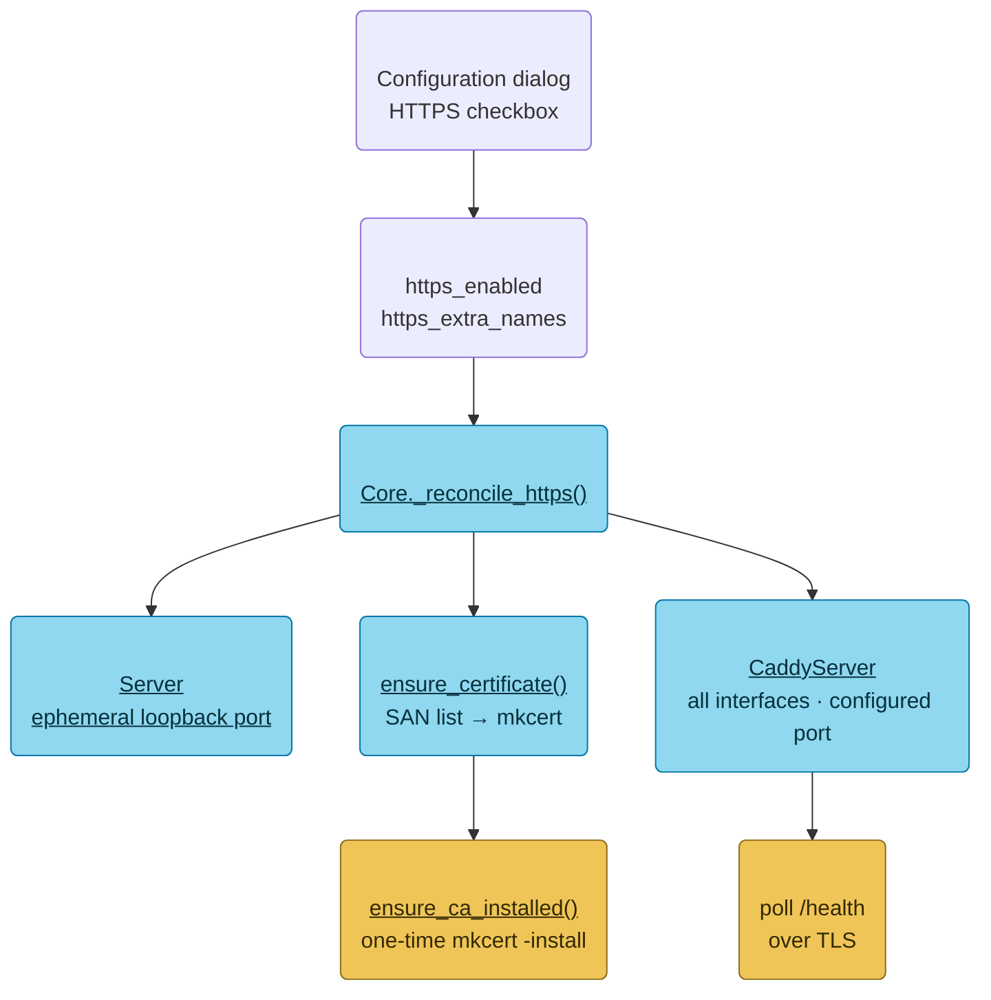

# Optional HTTPS front-end (`src/recipeserver/https_setup.py`)

HTTPS is opt-in: enabling it follows the same **Configuration** dialog that edits every other setting. With HTTPS off (the default) the app serves plain HTTP on the configured port, as it always has. With HTTPS on, the same configured port serves HTTPS for every address this machine has, and the embedded server moves to an ephemeral loopback port behind Caddy. The whole feature rides on two bundled binaries and one prompt.

## What HTTPS on means

- The embedded server binds `127.0.0.1` on an **ephemeral** port (it is selected by the OS at start), so the site is reachable only through the HTTPS front-end.
- [Caddy](https://github.com/caddyserver/caddy) (bundled in `tools/caddy/`, refreshed by `tools/caddy/update.sh`) listens on the configured port on **all interfaces**, terminates TLS, and reverse-proxies to the embedded server. Its default `X-Forwarded-Proto: https` is what makes the dictation button ([transcriber.py.md](transcriber.py.md)) appear.
- [mkcert](https://github.com/FiloSottile/mkcert) (bundled in `tools/mkcert/`, refreshed by `tools/mkcert/update.sh`) issues a certificate covering everything the machine answers to — see below.
- The public root CA is exported to `rootCA.pem` in the site directory so other devices can install it from `https://<host>:<port>/rootCA.pem`.

## Names the certificate covers

`collect_san_names()` builds the subject-alternative-name list, in order, de-duplicated:

1. `localhost`, `127.0.0.1`, `::1`
2. this machine's host name (`socket.gethostname()`) and, for a bare host name, its mDNS form (`<host>.local`)
3. every non-loopback, non-link-local, non-multicast, non-unspecified IPv4/IPv6 address of this machine's interfaces (via `psutil`, including Tailscale's CGNAT range when the daemon assigns one, e.g. `tailscale0`)
4. this machine's Tailscale MagicDNS name and `TailscaleIPs` from `tailscale status --json` (best effort; if the `tailscale` CLI is missing, fails or times out after 5 seconds, or `Self` is absent, those entries are simply skipped)
5. the extra names from the `https_extra_names` configuration key, parsed by `parse_extra_names()` (comma/whitespace/new-line separated; each entry must be an IP address or a valid host name, an optional leading `*.` wildcard is allowed)

The first four groups make HTTPS work from any of this machine's addresses without configuration; the fifth is the escape hatch for connections the automatic list cannot see (another VPN, an alias, a friendly name).

## Certificate lifecycle

`ensure_certificate()` (re)issues the certificate only when the name list changed **or** when the existing certificate is within `CERT_RENEWAL_THRESHOLD_DAYS` (30 days) of its `notAfter` — mkcert issues leaf certificates valid for 2 years and 3 months, so this keeps devices working without user intervention. A signature of the SAN list (a SHA-256, `san_signature()`) is stored in `recipe-server-sans.txt` to detect changes, so restarts do not churn the files when the machine's addresses have not moved. An unreadable existing certificate also triggers reissuance. Files live in `<user-data>/recipe-server/https/` (override `RECIPE_SERVER_HTTPS_DIR`, used by tests):

- `recipe-server-cert.pem` / `recipe-server-key.pem` — the served pair
- `recipe-server-sans.txt` — the signature marker
- `mkcert-ca-installed` — marker that the CA was installed here before
- `Caddyfile` — rewritten on every start and handed to `caddy run --config ... --adapter caddyfile`
- `caddy-storage/` — Caddy's own storage root (kept next to the rest instead of the platform default)

A regeneration whose SAN list picks up a new address (after a network change) happens automatically on the next start or configuration save — no prompts after the first.

## The one-time CA prompt

`ensure_ca_installed()` runs `mkcert -install` the first time HTTPS is enabled: mkcert creates a local CA and installs it into the system trust store (and the Firefox NSS store, when its `certutil` is available). On macOS this invokes `sudo security add-trusted-cert` (a password prompt on the terminal); on Windows it writes to the system `ROOT` store via the CryptoAPI (root-store access may require running as Administrator — see the [mkcert README](https://github.com/FiloSottile/mkcert#windows)). From then on, enabling or disabling HTTPS is fully silent: the `mkcert-ca-installed` marker and the existence of `mkcert -CAROOT`/`rootCA.pem` are enough to skip the install.

## The `CaddyServer` class

Owns the `caddy run` subprocess, mirroring [whisper_server.py.md](whisper_server.py.md): `ensure_running()` spawns `caddy run --config <Caddyfile> --adapter caddyfile`, resolved through the same env → bundle → PATH chain (`CADDY_BIN` → the bundled `tools/caddy/` pin → `caddy` on `PATH`); waits for `https://127.0.0.1:<port>/health` to answer (bypassing certificate verification — Python's `ssl` does not trust the mkcert CA; any HTTP response counts as ready, and what answers it is the app, proxied by Caddy); `stop()` terminates and escalates to a kill. A Caddy that exits during startup fails with its exit code and the tail of its output.

## Exporting the root CA

`export_root_ca()` copies `mkcert -CAROOT`/`rootCA.pem` to `rootCA.pem` in the site directory (the file is rebuilt on every regeneration; it is the _public_ CA certificate, never `rootCA-key.pem`). Other devices need it once: on iOS install the profile and enable full trust; on Android install it as a CA; on another computer install it into that machine's store. The README documents the flow.

## Environment variables

| Variable                  | Purpose                                                         |
| ------------------------- | --------------------------------------------------------------- |
| `CADDY_BIN`               | Absolute path to a `caddy` binary; overrides the bundled pin    |
| `MKCERT_BIN`              | Absolute path to a `mkcert` binary; overrides the bundled pin   |
| `RECIPE_SERVER_HTTPS_DIR` | Override `<user-data>/recipe-server/https/` (tests)             |
| `CAROOT`                  | mkcert's own CA directory override (respected by mkcert itself) |

Constants worth knowing: `STARTUP_TIMEOUT_SECONDS = 20.0`, `POLL_INTERVAL_SECONDS`, `STOP_TIMEOUT_SECONDS`, `TAILSCALE_TIMEOUT_SECONDS = 5.0`, `MKCERT_TIMEOUT_SECONDS`, `SAN_SIGNATURE_FILENAME`, `CA_MARKER_FILENAME`, `CADDYFILE_FILENAME`, `ROOT_CA_SITE_FILENAME`.

## Related pages

- [core.py.md](core.py.md) — `Core.attach_server()`, `start_caddy()`/`stop_caddy()`, `_reconcile_https()`, and where `export_root_ca()` is called
- [server.py.md](server.py.md) — how the embedded server decides to bind the configured port or an ephemeral one
- [config.py.md](config.py.md) — the `https_enabled` and `https_extra_names` keys
- [tray.py.md](tray.py.md) — the tray opens `https://` when HTTPS is on
- [README.md](README.md) — the package hub
