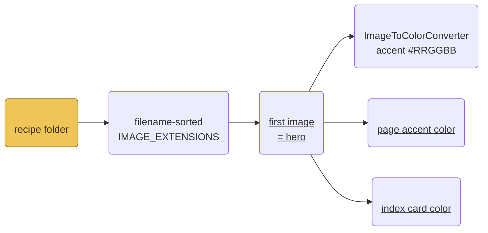

# Image handling (`src/recipeserver/image_handler.py`)

Supported-image rules and the hero-image → accent-color derivation.

## Public surface

- `IMAGE_EXTENSIONS` — the canonical supported set: `.jpg .jpeg .png .gif .webp .bmp .tiff .tif .svg .avif`. Defined once here; imported by [core.py.md](core.py.md) (image copying) and [server.py.md](server.py.md) (upload validation) and [markdown_to_html/converter.py.md](markdown_to_html/converter.py.md).
- `get_first_image_in_dir(directory)` — the first `IMAGE_EXTENSIONS` file in the directory, in filename-sorted order (stable across filesystems). This is the hero image for a recipe: it decides the page accent color and which image is copied alongside the page.
- `get_recipe_accent_color(directory, fallback)` — the `--food-color` accent a recipe page derives from its hero image: the dominant color of the directory's first image, or `fallback` when there is no usable image or the color cannot be read. Shared by the converter (recipe pages) and the index generator (cards) so both always use the same color for a recipe.
- `ImageToColorConverter.get_hex_color_from_image(image)` — thumbnail to 200×200, quantize to a 16-color palette, drop near-white/near-black/low-saturation colors, and score the rest by `count * (0.5 + saturation) * (0.5 + value)`. Returns the best `#RRGGBB`, or `#888888` when nothing passes the filters.
- `DEFAULT_TITLE = "#4169E1"` — fallback accent when no hero image is usable (the converter and the index generator's cards both fall back to the configured `food_color` when it is set).

SVG heroes are supported by extension, but `get_hex_color_from_image` goes through PIL's raster open — a `.svg` hero that PIL cannot decode raises, and the converter catches `OSError`/`ValueError` and falls back to the configured food color.

## Where it is used

[markdown_to_html/converter.py.md](markdown_to_html/converter.py.md) (accent color + lint), [core.py.md](core.py.md) (copying images next to pages), [index_html_generator.py.md](index_html_generator.py.md) (hero URL, per-card colors), [server.py.md](server.py.md) (upload extension checks).

## Related pages

- [markdown_to_html/converter.py.md](markdown_to_html/converter.py.md) — hero color resolution
- [index_html_generator.py.md](index_html_generator.py.md) — index card hero URLs
- [README.md](README.md) — the package hub
