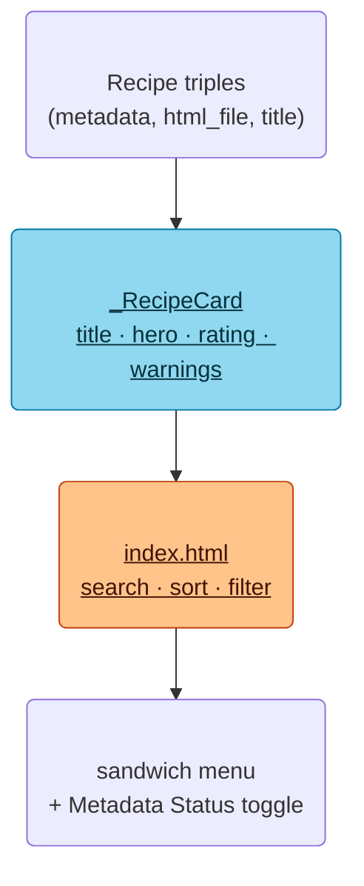

# The index page (`src/recipeserver/index_html_generator.py`)

Builds `index.html`: the searchable, sortable grid of recipe cards with filter menus, a reviewer filter, and advisory metadata warnings. Called by [core.py.md](core.py.md) after every regeneration (`Core._update_index`); output goes to `<site>/index.html`.

## Key pieces

- `Recipe` — the `(metadata, html_file, title)` triple the converter produces; `IndexHTMLGenerator.add()` collects them before `convert()` renders the page.
- `FILTER_FIELDS` — the multi-select filters in the Advanced section, in display order: meals, cuisine, status, categories, tags, contributors, sourceTitles. `MAX_REVIEW_FILTER_OPTIONS = 30` caps the reviewer dropdown (ranked by number of recipes rated, most active first).
- `_prepare_card(recipe, filter_values)` → `_RecipeCard` — computes everything one card needs: title (heading → front-matter `title` → directory name), hero image URL, average rating, filter values, `data-*` attributes, and the metadata warnings from [metadata_linter.py.md](metadata_linter.py.md).
- `convert()` — aggregates filter option counts, renders the page shell (`_render_page`), and writes `index.html`.
- Page chrome: `_page_head_html`, `_page_header_html`, `_toolbar_html`, `_results_bar_html`, `_version_footer_html`. The toolbar includes the sandwich menu ([menu.py.md](menu.py.md)), filter menus, and the **Metadata Status** toggle — warnings are advisory and hidden by default.
- The search field sits in a `.speech-input` wrapper with a `.speech-button` next to it: the dictation button that records a search phrase instead of asking for the keyboard. The button is generated `hidden` and only revealed by `assets/speech-button/speech-button.js` when the page was loaded over HTTPS, because the browser only hands out the microphone to secure pages. The recording is transcribed by the server ([transcriber.py.md](transcriber.py.md)). When dictation is disabled in the configuration (`dictation_enabled`, see [config.py.md](config.py.md)), the button, its CSS/JS, and the `.speech-input` wrapper are omitted from the generated page and the search field renders as a plain control.
- Stable test hooks: the search input carries `data-testid="recipe-search"`, the list carries `data-testid="recipe-list"`, and every recipe item carries `data-testid="recipe-item"`. The Selenium browser tests under `test/e2e/` select on these.
- Accent color: `accent_color_declarations` in [color_utils.py.md](color_utils.py.md) supplies the light/dark `--food-color` and `--food-color-hover` declarations for both this page and recipe pages; `FOOD_COLOR_HOVER_MIX_PERCENT = 82` weights the hover `color-mix()`.
- Assets URLs are content-hashed via `versioned_asset_url` ([_version.py.md](_version.py.md)); icons are inlined from `assets/*.svg` (never inline ad-hoc SVG). The page also inlines `SERVICE_WORKER_REGISTRATION_SNIPPET`, which registers `assets/sw.js` (scope `/assets/`, cache-first for hashed assets, stale-while-revalidate for recipe images) so a flaky client connection does not lose subresources — browsers do not retry a failed asset request. Pages themselves are never cached by the worker (they are `no-store`).
- The page also loads `assets/api.js` before all page scripts (one JSON request wrapper), `assets/page-path.js` for the URL→Markdown path helper, and `assets/sse.js` before the assistant and editor scripts (one SSE frame reader for both), `assets/katex-loader.js` for on-demand math support in the assistant and shopping list, `assets/dictation.js` for the shared microphone transport, then the AI assistant bubble (`assets/ai-assistant/`, after `icons.js`); the bubble renders itself only when `/api/ai-status` reports the local model is configured. On mobile it hides on scroll-down and returns on scroll-up, and a long press starts dictation when dictation is enabled and the page came over HTTPS ([ai_assistant.py.md](ai_assistant.py.md)).

The filter UI (`data-*` attributes, `filter-*` controls) is consumed by `assets/index.js`; the reviewer filter re-averages ratings per selected reviewer without hiding recipes (that logic is browser-side, not in this file).

## Related pages

- [core.py.md](core.py.md) — calls `add()`/`convert()`
- [metadata_linter.py.md](metadata_linter.py.md) — the warnings rendered on cards
- [menu.py.md](menu.py.md) — the sandwich menu markup used in the toolbar
- [sources.py.md](sources.py.md) — shared source-list rendering rules
- [transcriber.py.md](transcriber.py.md) — the transcription behind the dictation button
- [ai_assistant.py.md](ai_assistant.py.md) — the chat behind the bubble loaded on the page
- [README.md](README.md) — the package hub
