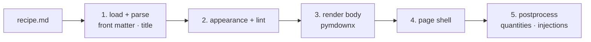

# The `markdown_to_html` package (`src/recipeserver/markdown_to_html/`)



Renders recipe Markdown files to full HTML pages. The pipeline stages live in sibling modules; this package's `__init__.py` re-exports the orchestrator and the package version.

## `markdown_to_html/__init__.py`

```python
from .._version import PACKAGE_VERSION as VERSION
from .converter import MarkdownToHTMLConverter
__all__ = ["MarkdownToHTMLConverter", "VERSION"]
```

`VERSION` is the release version shown in the page footer ("v..."); it flows from [_version.py.md](../_version.py.md).

## The stages

1. Load and parse the source, resolve the title from the first level-one heading (fenced code blocks ignored), then the front-matter `title`, then the directory slug ([converter.py.md](converter.py.md)).
2. Resolve appearance (accent from the hero image, else the configured food color) and lint the metadata against [metadata_linter.py.md](../metadata_linter.py.md).
3. Render the Markdown body with `pymdownx.extra`, `pymdownx.blocks.html`, `pymdownx.tasklist`, and `pymdownx.arithmatex` (KaTeX is vendored under `assets/katex/`).
4. Assemble the page shell ([page.py.md](page.py.md)) with the feedback sections ([feedback.py.md](feedback.py.md)).
5. Postprocess: quantity spans ([quantities.py.md](quantities.py.md)), definition-list grouping, overview/contributor/sources/version injection ([overview.py.md](overview.py.md), [extras.py.md](extras.py.md)), checkbox enabling.

## Related pages

- [converter.py.md](converter.py.md) — the orchestrator
- [page.py.md](page.py.md) — the HTML shell
- [quantities.py.md](quantities.py.md) · [overview.py.md](overview.py.md) · [extras.py.md](extras.py.md) · [feedback.py.md](feedback.py.md) · [icons.py.md](icons.py.md)
- [README.md](../README.md) — the package hub
