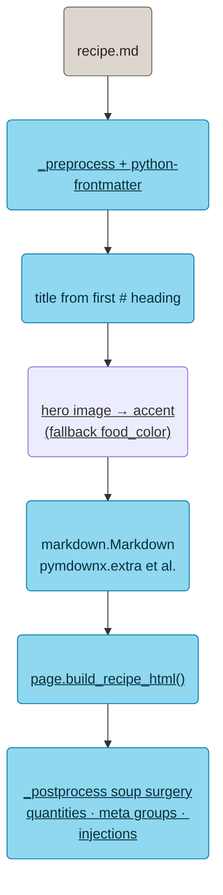

# The recipe converter (`src/recipeserver/markdown_to_html/converter.py`)

`MarkdownToHTMLConverter` turns one `recipe.md` into one HTML page. It is the heart of [core.py.md](../core.py.md)'s parallel build: `Core.convert_recipe` constructs a converter per recipe and calls `convert(markdown_file, html_file)`.

## Pipeline

1. **Load and parse** — reads the file (UTF-8, `\n` newlines), runs `_preprocess` (moves `<!--` off the same line as `:::`/`///` admonition markers), and splits front matter with python-frontmatter.
2. **Title** — `_get_title_from_markdown_content` scans for the first `#` heading (ignoring fenced code blocks); falls back to front-matter `title`, then a title-cased directory slug (`recipe_utils.slug_to_title`). The rendered heading text returned from `_postprocess` replaces it for the caller (used by the index).
3. **Appearance and metadata** — `_resolve_heading_color` calls the shared `get_recipe_accent_color` ([image_handler.py.md](../image_handler.py.md)): the accent is the hero image's dominant color, with the configured `food_color` as the fallback when there is no usable image; `_lint_metadata` logs warnings for missing required fields; `metadata_json` is embedded in a `<script id="recipe-metadata">` tag with `<` escaped as `\u003c`.
4. **Body** — `markdown.Markdown` with `pymdownx.extra`, `pymdownx.blocks.html`, `pymdownx.tasklist`, `pymdownx.arithmatex`.
5. **Assemble and postprocess** — `page.build_recipe_html` builds the shell; `_postprocess` does soup surgery: `quantities.convert_quantity_code_spans`, `_group_recipe_meta_terms` (wrap each `dt`/`dd` run in `.recipe-meta__group`), `_enable_checkbox_inputs`, and the overview/contributor/sources/version injections.

After writing, `lint_html` warns about `<code>…</code>` pairs that survived conversion — those are inline-code quantities the scaler could not parse (see [quantities.py.md](quantities.py.md)).

## Where it is used

[core.py.md](../core.py.md) only. The converter's `metadata`, `metadata_json`, and `title` attributes are read after `convert()` returns to build the index card.

## Related pages

- [page.py.md](page.py.md) — the page shell
- [quantities.py.md](quantities.py.md) · [overview.py.md](overview.py.md) · [extras.py.md](extras.py.md) · [feedback.py.md](feedback.py.md) · [icons.py.md](icons.py.md)
- [README.md](../README.md) — the package hub
