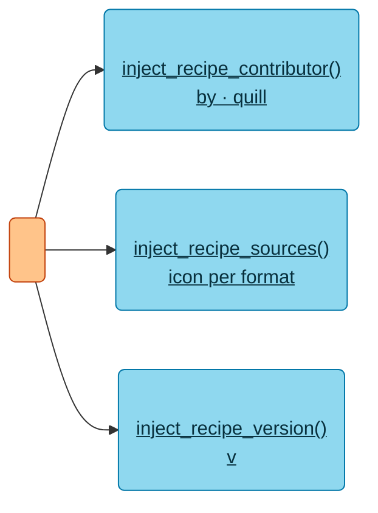

# Page extras (`src/recipeserver/markdown_to_html/extras.py`)

The trailing blocks appended at the end of the recipe page's `<main>`: contributor, sources, and version. All three end the `<main>` element; they share the `"· <time>"` fragment built by `recipe_utils.meta_time_html` (date-only values render as a bare date; timestamps render in browser-local time via `data-local-time`).

## The three blocks

- **Contributor** (`inject_recipe_contributor`) — `by <name>` with a quill icon, plus the front-matter `createdOn` timestamp when present. A list/tuple `contributor` is joined with `", "`.
- **Sources** (`inject_recipe_sources`) — one item per normalized source ([sources.py.md](../sources.py.md)): icon by format (`website`/`book`/`ai`/otherwise `user`), the title (as an external link for websites with a URL), and an author row when `source.author` is set. Sources without a title are dropped.
- **Version** (`inject_recipe_version`) — `v<PACKAGE_VERSION>` (from [_version.py.md](../_version.py.md)) with an updated-on timestamp prefixed `Edited `.

Each injector appends to `soup.find("main", class_="recipe")` no-op when the main element is absent.

## Related pages

- [converter.py.md](converter.py.md) — calls the three injectors during postprocessing
- [overview.py.md](overview.py.md) — the block above the hero image
- [sources.py.md](../sources.py.md) — shared source normalization/icon rules
- [README.md](../README.md) — the package hub
