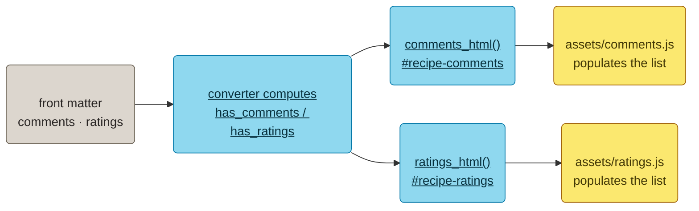

# Feedback sections (`src/recipeserver/markdown_to_html/feedback.py`)

The comments and ratings sections rendered at the bottom of every recipe page. Both share one skeleton — a heading with an add button, a hidden add-form, and an empty list that `assets/comments.js` / `assets/ratings.js` populate — differing only in naming and form fields.

## Public surface

- `comments_html(has_comments=False)` — the `<section class="recipe-comments recipe-extras" id="recipe-comments">` fragment; the list is `#comment-list`, the form `#recipe-comment-form` (name dropdown + textarea).
- `ratings_html(has_ratings=False)` — the ratings counterpart; form ids `#recipe-rating-form`, `#rating-score` (a text field, not a number input — see the ratings conventions in `AGENTS.md`).
- `_feedback_section(kind=…, singular=…, heading=…, add_label=…, has_items=…, form_body=…)` — the shared builder; `has_items=False` adds an `is-empty` class.

`has_comments` / `has_ratings` are decided by [converter.py.md](converter.py.md) from the front matter (`_has_comments` / `_has_valid_ratings`); the lists themselves are filled client-side. The rating meter shows five stars (two points each) alongside the numeric score.

The name fields in both forms (and the edit forms) are the same dropdown widget the recipe editor uses for contributors (`assets/recipe-editor/metadata-picker.js`), in its "combo" variant: a typeable text input that carries the current name, with the library dropdown beside it. Selecting an option writes the name into the input; there is no chip row and no "Add new…" swap — the input accepts any name. The dropdown offers the names that already exist elsewhere in the library (labelled `commenters` / `raters`, with a `data-max-length` of 100) and is re-read from `GET /api/metadata-options` every time a form opens, so a name used on another recipe shows up right away. The device remembers who used the form last: `assets/comments.js` / `assets/ratings.js` store the submitted name in `localStorage` (`lastCommenter` / `lastRater`, via the `getStoredName` / `setStoredName` helpers in `assets/recipe-feedback.js`) and preselect it the next time the form renders. (The chip-variant pickers the editor uses for contributors and the multi-value fields render their chips outlined and font-colored with `--food-color`.)

## Related pages

- [converter.py.md](converter.py.md) — computes `has_comments` / `has_ratings`
- [page.py.md](page.py.md) — where these sections land in the page shell
- [metadata_options.py.md](../metadata_options.py.md) — collects the commenter/rater names
- [README.md](../README.md) — the package hub
